# core 实体关系图（ENTITY-MAP）

> 本文件是 **关系视图**，不是概念说明：领域语言看 [CONTEXT.md](../CONTEXT.md)，模块边界与数据流看
> [ARCHITECTURE.md](./ARCHITECTURE.md) §5。
>
> **事实来源是代码。** 本文件中的实体、引用字段、物理表、repository 全部取自当前分支代码；
> 与 ARCHITECTURE / CONTEXT 的描述冲突时**以代码为准**。
>
> **维护规则**
>
> 1. 改 `packages/core/src/entity/**` 的 schema、改 `packages/db/src/schema/**` 或
>    `packages/db/src/migrations.ts` 的物理表、增删 `packages/core/src/repository/**` 的接口，
>    **必须同步本文件**；只改实现不改契约时可不动。
> 2. 只画**真实存在的引用字段**（如 `accountId`、`strategyVersionId`、`adviceId`）。
>    物理层**没有任何 `FOREIGN KEY`**（`packages/db/src/schema/index.ts` 里 `references(` 出现 0 次），
>    关系由应用层事务、唯一索引与 `assert*Invariants` 维护。不要把「概念相似」当外键。
> 3. 每个实体名下方给出源文件路径；**路径不存在即为文档错误**。
> 4. 覆盖口径：`packages/core/src/entity/` 下 **63 个非测试文件**（`invariants.ts` 是断言集合，不是实体），
>    外加 `core/strategy/`、`core/portfolio/`、`core/personal/` 中定义、但**不在 `entity/` 目录**的领域对象。
> 5. 本文件不重复 tool 清单：tool 名以 `packages/tools/src/registry.ts` 为准，归类见
>    [TOOL-INVENTORY.md](./TOOL-INVENTORY.md)。这里只写「谁会写这个实体」。
>
> **复核口径**（asOf 2026-11-04，分支 `dsh`）
>
> ```bash
> ls packages/core/src/entity/*.ts | grep -v '\.test\.ts' | wc -l        # 64，含 invariants.ts；实体文件 63
> grep -c '^export interface .*Repository' packages/core/src/repository/index.ts
> # 46（含 RepositoryRegistry）；业务 repository 45，加 9 个分文件接口 = 54
> grep -oE 'CREATE (VIRTUAL )?TABLE (IF NOT EXISTS )?[a-z_]+' packages/db/src/migrations.ts \
>   | sed 's/.* //' | sort -u | wc -l                                    # 88
> ```
>
> 第 18 节是逐文件覆盖索引，可据此核对「63 个文件都被收录」。

## 1. 总览：子域与主干

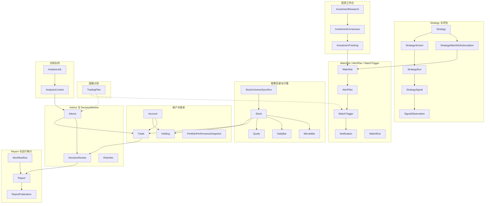

实线 = 子实体里存在引用字段（外键式依赖）；虚线 = 只有约定/引用数组（`TradingPlan.source.adviceIds`、
`poolId = trading-plan-watch:<accountId>`），无物理约束。

主干只有四条：**账本**（`Account` ← `Trade`/`Holding`/`PortfolioCashFlow`）、
**研究线**（`Strategy` → `StrategyVersion` → `StrategyRun` → `StrategySignal` → `SignalObservation`）、
**提醒线**（`Watchlist` → `AlertPlan` → `WatchTrigger` → `Notification`）、
**决策复盘线**（`Advice` + `Trade` → `DecisionReview` → `Report`）。
其余实体都是这四条线的证据、快照、审计或载体。

## 2. 账户与账本

现金是 `Account.cashBalance` 字段，**不是**快照实体；所有账户事实写入走
`LedgerRepository` 的原子方法（`packages/core/src/repository/index.ts`），交易 / 持仓 / 流水与余额同事务提交。

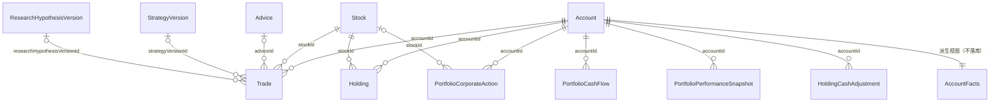

| 实体 | 关键引用 | 写入方（tool / workflow） | repository | 物理表 | 守护测试 |
|---|---|---|---|---|---|
| `Account`<br>`packages/core/src/entity/account.ts` | 主键 `id`；`cashBalance` 只由账本事务改 | `create_account` / `update_account` / `ensure_default_account` | `repos.account`（`AccountRepository`）；余额写 `repos.ledger` | `accounts` | `packages/tools/src/tools/create-account.test.ts`、`packages/db/src/repository/drizzle/account.contract.test.ts` |
| `Holding`<br>`packages/core/src/entity/holding.ts` | `accountId`、`stockId`；`(accountId,stockId)` 唯一；`availableQuantity ≤ quantity` | `add_holding` / `update_holding` / `close_holding` / `record_decision_trade` | `repos.holding`（`HoldingRepository`），写经 `repos.ledger.applyHolding` | `holdings` | `packages/tools/src/tools/add-holding.test.ts`、`packages/tools/src/tools/close-holding.test.ts` |
| `Trade`<br>`packages/core/src/entity/trade.ts` | `accountId`、`stockId`；可选 `adviceId` / `strategyVersionId` / `researchHypothesisVersionId` | `add_trade`；`record_decision_trade`（同事务写复盘+回执） | `repos.trade`（`TradeRepository`），写经 `repos.ledger.applyTrade` | `trades` | `packages/tools/src/tools/add-trade.test.ts`、`packages/db/src/repository/decision-review.contract.test.ts` |
| `AccountFacts`<br>`packages/core/src/entity/account-facts.ts` | `accountId`、`positions[].stockId`、`digest` | 无写入；`get_account_facts` 现算（`buildAccountFacts`） | 无（纯函数）；摘要见 `packages/core/src/portfolio/ledger.ts` | —（派生，不落库） | `packages/core/src/portfolio/ledger.test.ts`、`packages/db/src/repository/drizzle/trading-plan-concurrency.test.ts` |
| `PortfolioCashFlow`<br>`packages/core/src/entity/portfolio-performance.ts` | `accountId`、可选 `stockId` | `create_portfolio_cash_flow`；入金/出金经 `repos.ledger.applyCashFlow` | `repos.portfolioCashFlow`（`PortfolioCashFlowRepository`） | `portfolio_cash_flows` | `packages/tools/src/tools/portfolio-performance.test.ts` |
| `PortfolioCorporateAction`<br>`packages/core/src/entity/portfolio-performance.ts` | `accountId`、`stockId` | `create_portfolio_corporate_action` | `repos.portfolioCorporateAction` | `portfolio_corporate_actions` | `packages/tools/src/tools/portfolio-performance.test.ts`、`packages/core/src/portfolio/performance.test.ts` |
| `PortfolioPerformanceSnapshot`<br>`packages/core/src/entity/portfolio-performance.ts` | `accountId`；`inputFingerprint` 幂等 | `audit_account_performance_snapshots`、workflow `snapshot-account-performance` | `repos.portfolioPerformanceSnapshot` | `portfolio_performance_snapshots`（唯一索引 account+from+to+fingerprint） | `packages/core/src/portfolio/performance.test.ts`、`packages/workflows/src/snapshot-account-performance.test.ts` |
| `HoldingCashAdjustment`<br>（**不在 entity/**：`packages/core/src/portfolio/ledger.ts`） | `accountId`、`holdingId`、`stockId` | 持仓增删改的账本副作用 | `repos.ledger.listHoldingAdjustments` | `holding_cash_adjustments` | `packages/core/src/portfolio/ledger.test.ts`、`packages/db/src/repository/trading-plan-legacy.test.ts` |

口径提醒：`AccountFacts` 是**每次读取重算**的派生视图，`digest`（持仓 + 现金 + 本金指纹）是
`TradingPlan.accountFactsDigest` 判断「账户事实变了没有」的唯一依据；账本一变，旧计划即失效。

## 3. 股票目录与行情（市场证据）

`Stock` 是本地目录身份；`StockUniverseSnapshot` / `StockUniverseSyncRun` 是带同步审计的目录快照；
`Quote` / `DailyBar` / `MinuteBar` 是落库行情；其余（`MarketSnapshot`、`SectorQuoteList`、`NewsList`、
`DragonTigerList`、`NorthboundFlowSeries`、`AShareSentimentSnapshot`）是**适配器一次性输出**，不落库。

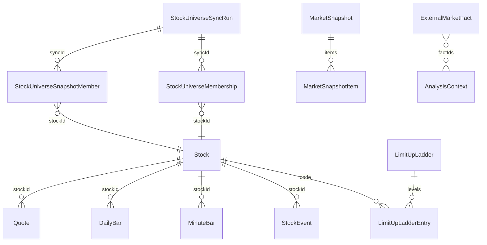

| 实体 | 关键引用 | 写入方（tool / workflow） | repository | 物理表 | 守护测试 |
|---|---|---|---|---|---|
| `Stock`<br>`packages/core/src/entity/stock.ts` | `id` ≡ `code.exchange`；`code` 为品牌类型 | `sync_stock_universe`；`add_trade` 缺行时补 stub | `repos.stock`（`StockRepository`） | `stocks`（`code+exchange` 唯一） | `packages/tools/src/tools/search-stocks.test.ts`、`packages/db/src/repository/stock-universe-legacy.test.ts` |
| `StockUniverseSnapshot` / `StockUniverseEntry`<br>`packages/core/src/entity/stock-universe.ts` | `entries[].stockId`；`attributeCoverage` 与成员属性一致 | `sync_stock_universe`（tool + workflow） | `repos.stockUniverse.applySnapshot` | `stock_universe_memberships`、`stock_universe_snapshot_members`、`stock_universe_sync_runs` | `packages/core/src/entity/stock-universe.test.ts`、`packages/workflows/src/sync-stock-universe.test.ts` |
| `StockProfile`<br>`packages/core/src/entity/stock-profile.ts` | `stockId`（`000001.SH` 形状，6 位数字 + 交易所后缀）、`source`、`asOf` | `get_stock_profile`（适配器现取） | 无 | —（不落库） | `packages/tools/src/tools/get-stock-profile.test.ts` |
| `Quote`<br>`packages/core/src/entity/quote.ts` | `stockId`；`observedAt`/`fetchedAt` 分离 | 内部 `resolveQuotes`（`list_holdings`、`batch_quote`、`get_account_facts` 等回源后落库） | `repos.quote`（`QuoteRepository`） | `price_snapshots`（`(stockId, observedAt, source)` 唯一） | `packages/core/src/entity/quote.test.ts`、`packages/tools/src/tools/sync-quotes.test.ts` |
| `DailyBar`<br>`packages/core/src/entity/quote.ts`（同文件多 schema） | `stockId`、`date`；qfq 口径 | `sync_daily_bars`、`get_stock_market_view`、`prepare_strategy_data` | `repos.dailyBar`（`DailyBarRepository`） | `daily_bars`（PK `stockId+date`） | `packages/tools/src/tools/sync-daily-bars.test.ts`、`packages/core/src/entity/quote.test.ts` |
| `MinuteBar`<br>`packages/core/src/entity/minute-bar.ts` | `stockId`、`interval`、`endedAt` | `get_stock_minute_bars`（miss 回源后落库） | `repos.minuteBar`（`MinuteBarRepository`） | `minute_bars` | `packages/core/src/entity/minute-bar.test.ts`、`packages/tools/src/tools/get-stock-minute-bars.test.ts` |
| `MarketSnapshot` / `MarketSnapshotItem`<br>`packages/core/src/entity/market-snapshot.ts` | `items[].id` 是**标的 id**，快照自身无稳定 id | 适配器（`fuyao`、`tencent`）返回，不落库 | 无 | — | `packages/adapters/src/market/manager.test.ts`、`packages/adapters/src/fuyao/source.test.ts` |
| `SectorQuoteList` / `SectorQuoteItem`<br>`packages/core/src/entity/sector-quote.ts` | `code`、`leadingStockCode`（**名称/代码快照，非外键**） | `fetch_sector_quotes` | 无 | — | `packages/core/src/entity/sector-quote.test.ts`、`packages/adapters/src/sector-quote/eastmoney.test.ts` |
| `AShareSentimentSnapshot`<br>`packages/core/src/entity/ashare-sentiment.ts` | `date`、`coverage='CN_A_SHARES_SH_SZ'` | `get_ashare_sentiment` | 无 | — | `packages/core/src/entity/ashare-sentiment.test.ts`、`packages/adapters/src/ashare-sentiment/manager.test.ts` |
| `LimitUpLadder` / `LimitUpLadderEntry`<br>`packages/core/src/entity/limit-up-ladder.ts` | `date`+`source`；entry `code` 对应 `Stock.code` | `limit_up_ladder`；PIT 快照由 `run_strategy` 读取 | `repos.limitUpLadderSnapshot`（`LimitUpLadderSnapshotRepository`） | `limit_up_ladder_snapshots`（PK `date+source`） | `packages/core/src/entity/limit-up-ladder.test.ts`、`packages/adapters/src/limit-up-ladder/manager.test.ts` |
| `NewsList` / `NewsItem`<br>`packages/core/src/entity/news.ts` | `id` 是**上游** id（可重复、可被改写） | `fetch_news` | 无 | — | `packages/core/src/entity/news.test.ts`、`packages/adapters/src/news/manager.test.ts` |
| `DragonTigerList` / `DragonTigerEntry`<br>`packages/core/src/entity/dragon-tiger.ts` | `code`（股票代码文本） | `dragon_tiger_list` | 无 | — | `packages/core/src/entity/dragon-tiger.test.ts`、`packages/adapters/src/dragon-tiger/manager.test.ts` |
| `NorthboundFlowSeries`<br>`packages/core/src/entity/northbound-flow.ts` | `endDate`、`days` | `northbound_flow` | 无 | — | `packages/core/src/entity/northbound-flow.test.ts`、`packages/adapters/src/northbound-flow/manager.test.ts` |
| `StockEvent`<br>`packages/core/src/entity/stock-event.ts` | `stockId`；`(provider, externalId)` 幂等 | `add_stock_event` / `update_stock_event` / `delete_stock_event`、workflow `sync-stock-events` | `repos.stockEvent`（`StockEventRepository`） | `stock_events` | `packages/workflows/src/sync-stock-events.test.ts`、`packages/tools/src/tools/delete-stock-event.test.ts` |
| `ExternalMarketFact`<br>`packages/core/src/entity/external-fact.ts` | 稳定 id `extfact:<kind>:<source>:<subjectKey>:<observedAt>`；`referencedBy[]` 是反查列表 | `persist_external_facts` | `repos.externalMarketFact`（`ExternalMarketFactRepository`） | `external_market_facts` | `packages/core/src/entity/external-fact.test.ts`、`packages/tools/src/tools/persist-external-facts.test.ts` |

口径提醒：`external_market_facts` 与 `news` 等「一次性输出」是**两套东西**——只有落库的外部事实
才有稳定 id 可被 `AnalysisContext.factIds` 与 `Advice` 的反证链引用（`externalFactIdsOf` /
`checkExternalFactPersistence` 按 `extfact:` 前缀识别）。

## 4. 财务与研报（PIT）

`financial_fact_revisions` 是 append-only PIT 事实；`FinancialVintage` 是**读期解析**的严格 vintage
视图（`strict-pit-v1`），不是一张表；`financial_ingest_snapshots` 只是数据商漂移告警层，
`resolveVintage` 永不读它。

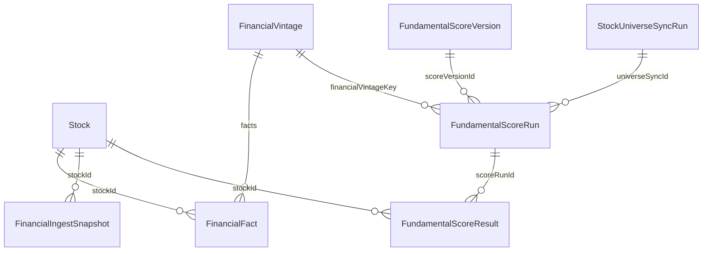

| 实体 | 关键引用 | 写入方（tool / workflow） | repository | 物理表 | 守护测试 |
|---|---|---|---|---|---|
| `FinancialFact`<br>`packages/core/src/entity/fundamental.ts` | `stockId`、`metricId`、`periodEnd`、`supersedesId`、`contentHash` | `sync_financial_facts` | `repos.financialFact`（`FinancialFactRepository`） | `financial_fact_revisions`（逻辑修订 hash 唯一） | `packages/core/src/entity/fundamental.test.ts`、`packages/tools/src/tools/financial-facts.test.ts` |
| `FinancialVintage` / `FinancialFact`（`missing`/`coverage`）<br>`packages/core/src/entity/fundamental.ts` | `vintageKey`（sha256）、`facts[].id` | 无写入；`resolveStrictPitFinancialVintage` 读期解析 | `repos.financialFact.listRevisions` + `postProcessRevisions` | —（读期视图，不落库） | `packages/core/src/entity/fundamental.test.ts`、`packages/core/src/entity/fundamental.p3-0-audit.test.ts` |
| `FinancialIngestSnapshot`<br>`packages/core/src/entity/financial-ingest-snapshot.ts` | `stockId`、`metricId`、`periodEnd`、`ingestHash` | 内部 `pit-layers.ts`（层 3 检测） | `repos.financialIngestSnapshot`（`FinancialIngestSnapshotRepository`） | `financial_ingest_snapshots` | `packages/tools/src/pit-layers.test.ts` |
| `FundamentalScoreVersion`<br>（**不在 entity/**：`packages/core/src/strategy/fundamental-factor.ts`） | `definitionHash`、`registryHash`、`components[].factorId` | `run_fundamental_score`（内部创建/复用） | `repos.fundamentalScoreVersion`（`FundamentalScoreVersionRepository`） | `fundamental_score_versions`（`definitionHash` 唯一） | `packages/tools/src/tools/fundamental-score.test.ts`、`packages/core/src/strategy/fundamental-score-run.test.ts` |
| `FundamentalScoreRun`<br>（同上文件） | `scoreVersionId`、`universeSyncId`、`financialVintageKey` | `run_fundamental_score` | `repos.fundamentalScoreRun`（`FundamentalScoreRunRepository`） | `fundamental_score_runs` | 同上 |
| `FundamentalScoreResult`<br>（同上文件） | `scoreRunId`、`stockId`、`vintageKey` | `run_fundamental_score`（随 run 终态原子提交） | `repos.fundamentalScoreRun.commit` | `fundamental_score_results` | 同上 |
| `DisclosureSource` / `AnnouncementDisclosure` / `VendorSnapshot`<br>`packages/core/src/entity/disclosure-source.ts` | 非 zod：`packages/adapters/src/fundamental/disclosure-source.ts` 实现 | 适配器（真实/ mock 披露源） | 无 | — | `packages/tools/src/pit-layers.test.ts`、`packages/adapters/src/fundamental/mock.test.ts` |

口径提醒：`FinancialVintage` 与 `FinancialIngestSnapshot` **不是同一层**。前者是 PIT 判定输入，
后者是「数据商改口径」的告警记录；`docs/ARCHITECTURE.md` §6.1 的层 1/2/3 分工在这里落成三张不同表。

## 5. Strategy 与评估

`Strategy` 是身份，`StrategyVersion` 是不可变 DSL，`StrategyRun` 一次运行，
`StrategyResult` / `StrategySignal` 是逐股结果与信号，`SignalObservation` 是信号的事后表现。
评估/回测的进度与 PIT 快照同在 `strategy_*` 表族里。

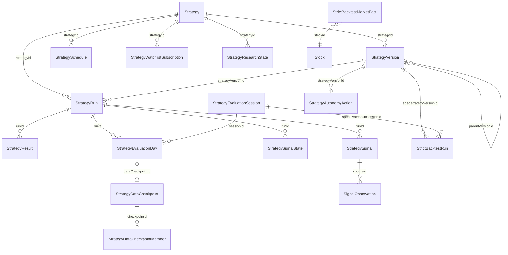

| 实体 | 关键引用 | 写入方（tool / workflow） | repository | 物理表 | 守护测试 |
|---|---|---|---|---|---|
| `Strategy` / `StrategyVersion` / `StrategyDslV1`<br>`packages/core/src/entity/strategy.ts` | `Strategy.currentVersionId`；`StrategyVersion.strategyId`、`parentVersionId`、`definitionHash` | `create_strategy` / `create_strategy_version` / `publish_strategy_version` / `validate_strategy_version` / `archive_strategy` / `pause_strategy` / `resume_strategy` / `delete_strategy`；`import_strategy_manifest` | `repos.strategy`（`StrategyRepository`） | `strategies`、`strategy_versions`（`strategyId+version` 唯一） | `packages/core/src/entity/strategy.test.ts`、`packages/tools/src/tools/strategy-definition.test.ts`、`packages/tools/src/tools/strategy-manifest.test.ts` |
| `StrategyRun` / `StrategyResult` / `StrategySignal` / `StrategySignalState`<br>`packages/core/src/entity/strategy.ts` | `strategyId`、`strategyVersionId`、`runId`、`stockId`；state 按 `contextKey` | `run_strategy` / `trial_strategy`；`prune_strategy_runs` / `reconcile_stale_strategy_runs` 收敛 | `repos.strategyRun`（`StrategyRunRepository`） | `strategy_runs`、`strategy_results`、`strategy_signals`、`strategy_signal_states`、`strategy_run_leases` | `packages/tools/src/tools/run-strategy.test.ts`、`packages/workflows/src/run-strategies.test.ts` |
| `StrategySchedule`<br>`packages/core/src/entity/strategy-schedule.ts` | `strategyId`（一策略一调度，唯一）；`lastRunId` | `set_strategy_schedule`、`claim_due_strategy_schedules` / `finish_strategy_schedule_claim` / `renew_strategy_schedule_claim`；workflow `run-strategy-schedules`、`strategy-daily-cycle` | `repos.strategySchedule`（`StrategyScheduleRepository`） | `strategy_schedules` | `packages/tools/src/tools/strategy-schedule.test.ts`、`packages/workflows/src/run-strategy-schedules.test.ts` |
| `StrategyDataCheckpoint` / `StrategyDataCheckpointMember`<br>`packages/core/src/entity/strategy-checkpoint.ts` | `universeSyncId`；member `checkpointId`+`stockId` | `prepare_strategy_data` | `repos.strategyDataCheckpoint` | `strategy_data_checkpoints`、`strategy_data_checkpoint_members` | `packages/tools/src/tools/prepare-strategy-data.test.ts` |
| `StrategyEvaluationSession` / `StrategyEvaluationDay`<br>`packages/core/src/entity/strategy-checkpoint.ts` | `strategyId`、`strategyVersionId`；day `sessionId`、`runId`、`dataCheckpointId` | `start_strategy_evaluation_session` / `finish_strategy_evaluation_session` / `cancel_strategy_evaluation_session` / `resume_strategy_evaluation_session`、`record_strategy_evaluation_day` | `repos.strategyEvaluation`（`StrategyEvaluationRepository`） | `strategy_evaluation_sessions`、`strategy_evaluation_days` | `packages/tools/src/tools/strategy-evaluation.test.ts` |
| `DailyBarRevision`<br>`packages/core/src/entity/strategy-checkpoint.ts` | `stockId`+`date`+`recordedAt`；`contentHash` | `sync_daily_bars`、`prepare_strategy_data`（`dailyBar.saveRevisions`） | `repos.dailyBar` | `daily_bar_revisions` | `packages/tools/src/tools/prepare-strategy-data.test.ts` |
| `StrategyResearchState` / `StrategyResearchSettings` / `StrategyResearchConclusion` / `StrategyResearchComparisonRecord`<br>`packages/core/src/entity/strategy-checkpoint.ts` | `strategyId`、`accountId`；`revision`+`requestId` 幂等 | `save_strategy_research_state` | `repos.strategyEvaluation`（`StrategyEvaluationRepository.findResearchState` / `saveResearchState`） | `strategy_research_states` | `packages/tools/src/tools/strategy-research.test.ts` |
| `StrictBacktestRun` / `StrictBacktestMarketFact`<br>`packages/core/src/entity/strategy-backtest.ts` | run：`spec.strategyId`/`strategyVersionId`/`evaluationSessionId`、`specHash`；fact：`stockId`+`date`+`recordedAt`+`contentHash` | `create_strict_strategy_backtest` / `execute_strict_strategy_backtest` | `repos.strategyBacktest`（`StrategyBacktestRepository`） | `strategy_backtest_runs`、`strategy_backtest_market_facts` | `packages/tools/src/tools/strategy-backtest.test.ts`、`packages/tools/src/tools/strategy-backtest-market-facts.test.ts` |
| `StrategyAutonomyAction`<br>`packages/core/src/entity/strategy-autonomy-action.ts` | `strategyId`、`strategyVersionId`、`evaluationSessionId`、`factReferences[]` | `create_strategy_autonomy_action` / `confirm_strategy_autonomy_action` / `reject_strategy_autonomy_action` / `transition_strategy_autonomy_action`；workflow `strategy-autonomy-weekly` | `repos.strategyAutonomyAction` | `strategy_autonomy_actions` | `packages/core/src/entity/strategy-autonomy-action.test.ts`、`packages/tools/src/tools/strategy-autonomy-action.test.ts` |
| `StrategyWatchlistSubscription`<br>`packages/core/src/entity/strategy-watchlist-subscription.ts` | `strategyId`、`watchlistId`（+共识 `investmentBinding`） | `subscribe_strategy_to_watchlist` / `unsubscribe_strategy_from_watchlist` / `sync_strategy_watchlist_subscriptions` | `repos.strategyWatchlistSubscription` | `strategy_watchlist_subscriptions` | `packages/tools/src/tools/strategy-watchlist-subscription.test.ts` |
| `SignalObservation`<br>`packages/core/src/entity/signal-observation.ts` | `sourceKind`+`sourceId`（strategy-signal / watch-trigger）、`stockId`、`horizon ∈ {t1,t3,t5}`（`t20` 仅读） | `create_strategy_observation_candidates`、`complete_strategy_observations`、workflow `backfill-strategy-observations` | `repos.signalObservation`（`SignalObservationRepository`） | `signal_observations` | `packages/core/src/entity/signal-observation.test.ts`、`packages/tools/src/tools/signal-observation.test.ts` |
| `ReviewRevisionProposal`<br>`packages/core/src/entity/review-revision-proposal.ts` | `strategyId`、`sourceReviewId`（必须真实存在）、`factIds[]` | `propose_review_revision`（**只提案，不发布**） | 无（工具输出） | —（不落库；`status` 恒 `draft`） | `packages/tools/src/review-revision.guard.test.ts` |

口径提醒：`strategy_run_leases` 是 fencing token 表，不是实体；`StrategyRun` 的
`status=running/complete/failed` 与 `dataHealth` 分离，`partial` 只存在于历史行。

## 6. Watchlist / AlertPlan / WatchTrigger

`Watchlist` 是观察集合，`AlertPlan` 引用一个 watchlist 并产生 `WatchTrigger`；
`WatchRuleState` 是 `(poolId, stockId, ruleId)` 的边沿状态机；`WatchRun` 记一轮心跳。
`TradingPlan` 的监控提醒复用同一张 `watch_triggers` 表，靠 `poolId = trading-plan-watch:<accountId>` 约定识别。

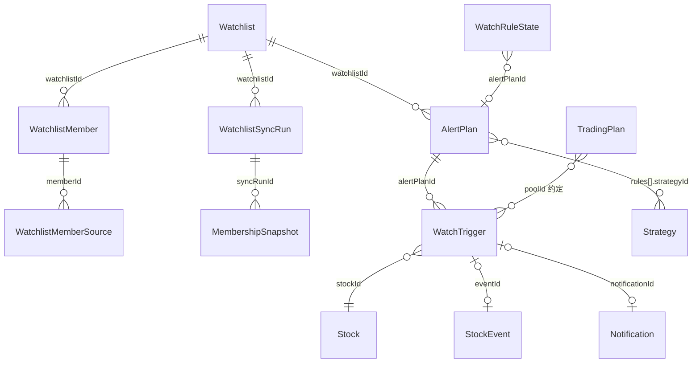

| 实体 | 关键引用 | 写入方（tool / workflow） | repository | 物理表 | 守护测试 |
|---|---|---|---|---|---|
| `Watchlist` / `WatchlistMember` / `WatchlistMemberSource`<br>`packages/core/src/entity/watchlist.ts` | `WatchlistMember.{watchlistId, stockId}`；source `{memberId, sourceId, sourceVersionId, syncRunId, importBatchId}` | `create_watchlist` / `update_watchlist` / `archive_watchlist` / `add_watchlist_member` / `add_watchlist_members` / `update_watchlist_member` / `archive_watchlist_member` / `sync_watchlist_source`；workflow `sync-portfolio-watchlists` | `repos.watchlist`、`repos.watchlistMember`（`WatchlistRepository` / `WatchlistMemberRepository`） | `watchlists`、`watchlist_members`、`watchlist_member_sources` | `packages/core/src/entity/watchlist.test.ts`、`packages/tools/src/tools/watchlist.test.ts` |
| `WatchlistSyncRun` / `MembershipSnapshot`<br>`packages/core/src/entity/watchlist.ts` | `syncRunId`；`producerRunId`（上游 run） | workflow `sync-portfolio-watchlists` / `run-strategies`；`commit_watchlist_facts` | `repos.watchlistMember` | `watchlist_sync_runs`、`membership_snapshots` | `packages/workflows/src/sync-portfolio-watchlists.test.ts` |
| `AlertPlan` / `AlertRule`<br>`packages/core/src/entity/alert-plan.ts` | `watchlistId`；rule kind ∈ `strategy-signal`（`strategyId`）/`cost-threshold`/`price-change`/`price-level`/`event-date` | `create_alert_plan` / `update_alert_plan` / `delete_alert_plan`；个人版 `save_personal_alert_plan` | `repos.alertPlan`（`AlertPlanRepository`） | `alert_plans` | `packages/core/src/entity/alert-plan.test.ts`、`packages/tools/src/tools/alert-plan.test.ts` |
| `WatchTrigger`<br>`packages/core/src/entity/watch-trigger.ts` | `alertPlanId`（可空；plan 监控触发时缺省）、`poolId`、`stockId`、`ruleId`、`eventId`、`notificationId`；内联 `quote{close,ts}` | `save_watch_trigger` / `commit_watch_evaluation` / `set_watch_trigger_delivery_status`；workflow `intraday-watch`、`intraday-trading-plan-watch`、`evaluate-event-rules` | `repos.watchTrigger`（`WatchTriggerRepository`，带执行租约 `watch_execution_lease`） | `watch_triggers` | `packages/core/src/entity/watch-trigger.test.ts`、`packages/workflows/src/intraday-watch.test.ts` |
| `WatchRuleState`<br>`packages/core/src/entity/watch-trigger.ts` | `(poolId, stockId, ruleId)` 唯一；`alertPlanId` 可空 | `save_watch_rule_states`、`commit_watch_evaluation` | `repos.watchRuleState`（`WatchRuleStateRepository`） | `watch_rule_states` | `packages/tools/src/tools/save-watch-trigger.test.ts`、`packages/workflows/src/intraday-watch-alert-plan.test.ts` |
| `WatchRun`<br>`packages/core/src/entity/watch-run.ts` | 无外键；只记计数（`triggered`/`notified`/`delivered`…） | `record_watch_run`；workflow `intraday-watch` | `repos.watchRun`（`WatchRunRepository`） | `watch_runs` | `packages/tools/src/tools/get-watch-status.test.ts`、`packages/workflows/src/intraday-watch-observed.test.ts` |
| `Notification` / `NotificationResult`<br>`packages/core/src/entity/notification.ts` | `adviceId` / `tacticSignalId` 可选；`channel` | `send_notification`；个人版 `packages/tools/src/personal/notification-delivery.ts` | `repos.notification`（`NotificationRepository`） | `notifications` | `packages/core/src/entity/notification.test.ts`、`packages/tools/src/tools/send-notification.test.ts` |
| `WatchDeliveryIntent` / `WatchNotificationSettings`<br>`packages/core/src/entity/notification.ts` | intent `businessKey`/`resultRef`/`notificationId`；settings 是单租户 KV | `begin_watch_delivery`、`resolve_watch_notification` | `repos.watchDelivery`（`WatchDeliveryRepository`） | `watch_delivery_intents`、`watch_notification_settings`（**DDL 由 `packages/db/src/personal/watch-delivery-schema.ts` 负责，不在 migrations.ts**） | `packages/db/src/personal/watch-delivery.test.ts`、`packages/tools/src/tools/resolve-watch-notification.test.ts` |

口径提醒：`WatchTrigger` **没有** `watchRunId`。想从一轮心跳定位触发，只能按 `createdAt` 区间与
`poolId` 反查——不要假设存在 run → trigger 的外键。

## 7. 逐股交易计划（TradingPlan）

`TradingPlan` 是**按 (planId, version) 版本化**的计划表：`versionId` 是物理主键，
`planId`+`version` 唯一；`status ∈ draft/active/superseded/revoked/expired`，`supersedesVersionId` 指向前一版。

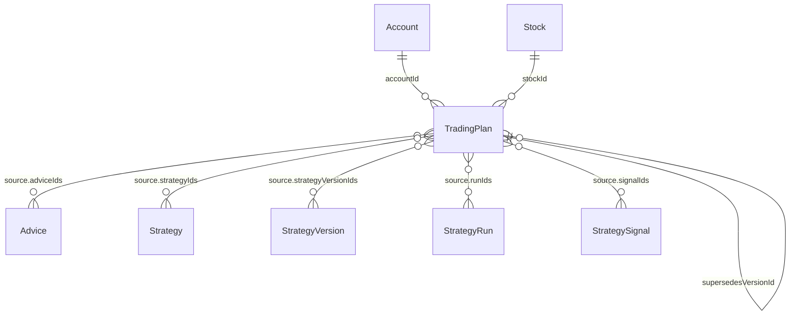

| 实体 | 关键引用 | 写入方（tool / workflow） | repository | 物理表 | 守护测试 |
|---|---|---|---|---|---|
| `TradingPlan` / `TradingPlanV1` / `TradingPlanExit` / `TradingPlanSource` / `TradingPlanView` / `TradingPlanMonitoring`<br>`packages/core/src/entity/trading-plan.ts` | `accountId`、`stockId`、`supersedesVersionId`、`source.{strategyIds,strategyVersionIds,runIds,signalIds,adviceIds}`、`accountFactsDigest`、`marketFacts[].id`、`evidence[].factIds` | `save_trading_plan`；workflow `trading-plan-daily-cycle` | `repos.tradingPlan`（`TradingPlanRepository`，带乐观锁 expectedRevision） | `trading_plans`（PK `version_id`；`planId+version` 唯一） | `packages/core/src/entity/trading-plan.test.ts`、`packages/db/src/repository/drizzle/trading-plan.lock.guard.test.ts`、`packages/db/src/repository/drizzle/trading-plan-concurrency.test.ts` |

口径提醒：`TradingPlanSource` 是**引用数组**，不是外键；一个计划可以同时引用多个 strategy/signal/advice。
`TradingPlan.query` 的 `currentOnly`/`views`/`monitoring` 语义由
`packages/core/src/portfolio/trading-plan-budget.ts` 与实体里的 `resolveTradingPlanVersions` 决定，
不要在读取侧自己「取最大版本当当前计划」。

## 8. Advice 与 DecisionReview

`Advice` 是建议事实（不可变，带有效期与免责声明），`AdviceCard` 是**渲染视图**；
`DecisionReview` 是「当时依据 + 用户行动」的账户级记录，修订 append-only；
`AdviceOutcome` 的读面已由 `DecisionReviewRevision.content.adviceFeedback` 派生。

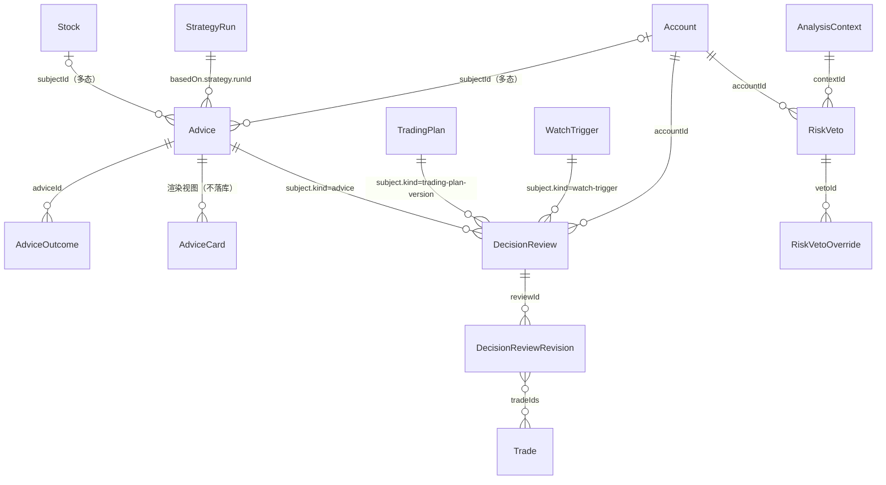

| 实体 | 关键引用 | 写入方（tool / workflow） | repository | 物理表 | 守护测试 |
|---|---|---|---|---|---|
| `Advice` / `AdviceOutcome` / `AdviceDataSnapshot`<br>`packages/core/src/entity/advice.ts` | `subjectKind`+`subjectId`（多态）；`basedOn.strategy.{strategyId,strategyVersionId,runId,signalIds,observationIds}`；`basedOn.quotes[stockId]` | `record_advice`（队列写回，`repos.analysis.recordAdvice` 事务内落库）；`delete_advice`；outcome 写面见下一行 | `repos.advice`（`AdviceRepository`）、`repos.analysis` | `advices`、`advice_outcomes` | `packages/core/src/entity/advice.test.ts`、`packages/tools/src/queue/analysis.test.ts` |
| `AdviceOutcome`（同上） | `adviceId`；`tradeIds[]` | `record_advice_outcome` **只写 DecisionReview**，不双写 `advice_outcomes` | `repos.advice.recordOutcome`（仅历史/审计与测试 fixture 使用） | `advice_outcomes`（存量表） | `packages/tools/src/tools/record-advice-outcome.test.ts`、`packages/db/src/repository/contract-tests.ts` |
| `AdviceCard`<br>`packages/core/src/entity/advice-card.ts` | `adviceId`；五段（结论/反证/风险/有效期/免责） | 无写入；`renderAdviceCard` 现算 | 无 | —（派生） | `packages/core/src/entity/advice-card.test.ts` |
| `DecisionReview` / `DecisionReviewRevision` / `DecisionReviewContext`<br>`packages/core/src/entity/decision-review.ts` | `accountId`+`subject{kind,id}`（唯一）；revision `reviewId`+`revision`；`content.tradeIds[]`；`context.confirmationSourceDraftId` | `save_decision_review`、`confirm_review_draft`、`record_decision_trade`、`record_advice_outcome` | `repos.decisionReview`（`DecisionReviewRepository`）、`repos.decisionTrade`（`DecisionTradeRepository`，原子提交） | `decision_reviews`、`decision_review_revisions`、`decision_review_trade_links`、`decision_write_receipts` | `packages/core/src/entity/decision-review.test.ts`、`packages/tools/src/tools/decision-review.test.ts`、`packages/db/src/repository/decision-review.contract.test.ts` |
| `RiskVeto` / `RiskVetoOverride`<br>`packages/core/src/entity/risk-veto.ts` | `accountId`+`subject`、`contextId`→AnalysisContext、`factIds[]`、`vetoId` | **当前没有 tool/workflow 写入方**（见 §17） | `repos.riskVeto`（`RiskVetoRepository`） | `risk_vetoes`、`risk_veto_overrides` | `packages/db/src/repository/risk-veto.guard.test.ts` |

口径提醒：`record_advice_outcome` 的注释明确「旧 `advice_outcomes` 表只保留历史/审计数据」，
读面走 `packages/tools/src/internal/account-advice-outcomes.ts` 里的 DecisionReview 投影。
`RiskVeto` 的 `subject` 是 `AnalysisSubject`，与 `DecisionReview.subject` **不是同一套**。

## 9. Report

`Report` 是结构化事实简报（周期 + scope），`ReportDocument` 是**已发布渲染产物**
（落盘 Markdown，不进表），`ReportPublication` 是「已发布」的唯一判据（带 `documentHash`）。

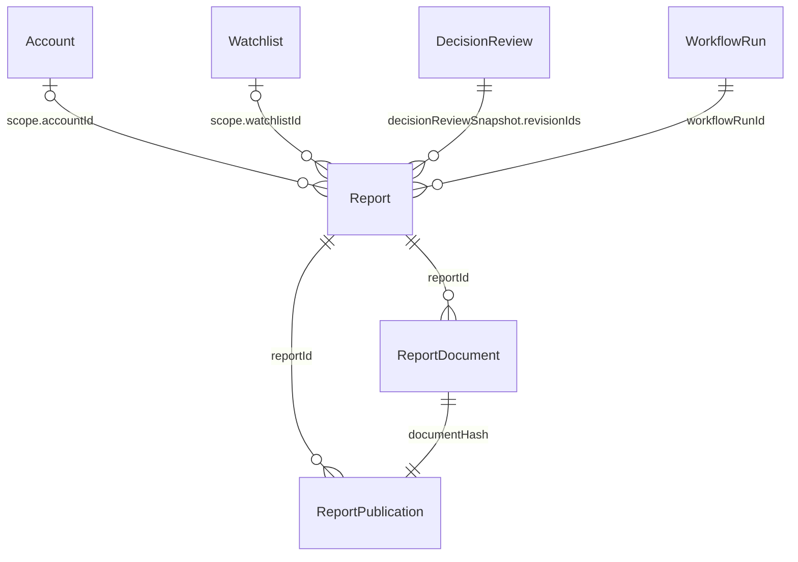

| 实体 | 关键引用 | 写入方（tool / workflow） | repository | 物理表 | 守护测试 |
|---|---|---|---|---|---|
| `Report` / `ReportSection` / `ReportEvidence` / `ReportBlock`<br>`packages/core/src/entity/report.ts` | `workflowRunId`、`supersedesReportId`、`scope`（`all-accounts`/`account`/`watchlist`）、`decisionReviewSnapshot.{accountId,revisionIds,tradeFactHashes}`、`watchlistFactsSnapshot` | `save_report`、`refresh_decision_review_report`、`set_report_delivery_status`、`delete_report`；workflow `opening-report` / `closing-report` / `weekly-report` / `morning-brief` | `repos.report`（`ReportRepository`） | `reports`（`(kind, scopeKey, periodStart, periodEnd, version)` 唯一；新报告固定 `version=1`）；`report_refresh_receipts` 幂等回执 | `packages/core/src/entity/report.test.ts`、`packages/tools/src/tools/report-tools.test.ts`、`packages/workflows/src/closing-report.test.ts` |
| `ReportDocument` / `ReportEnvelope`<br>`packages/core/src/entity/report-document.ts` | `reportId`；`schemaVersion`/`rendererVersion` 字面量 | `write_report_artifact`（宿主 `packages/dsh-luoome/src/host/report-artifacts.ts` 落盘到 `$LUOOME_HOME/reports`） | 无 DB repository（`ReportArtifactWriter` 端口在 `packages/core/src/report-artifact.ts`） | —（文件 + 指纹） | `packages/core/src/entity/report-document.test.ts`、`packages/tools/src/tools/write-report-artifact.test.ts` |
| `ReportPublication`<br>`packages/core/src/entity/report-publication.ts` | `reportId`（一版只发一次）、`documentHash` | `publish_report` | `repos.reportPublication`（`ReportPublicationRepository`，`publish` 幂等但不覆盖） | `report_publications` | `packages/tools/src/tools/publish-report.test.ts`、`packages/db/src/repository/contract-tests.ts` |

口径提醒：`ReportDocument` **没有物理表**，也不该有——它是「已发布产物」的渲染结果，
指纹落在 `report_publications.document_hash`。文件丢失或哈希不符时，`write_report_artifact` 回环校验失败。

## 10. Research

研究域分三层：Obsidian vault 投影（topic/document/subject/chunk）、假设版本、向量索引；
`ResearchBrief` 与 `StockResearchProfile` 是**工具输出视图**，不落库。
`ResearchVaultSyncRun` 与 topic/document 之间**只有共享 `vaultId`**，不是外键，故不画边。

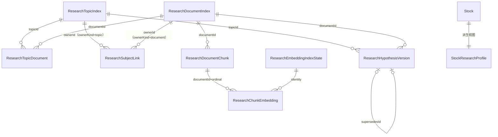

| 实体 | 关键引用 | 写入方（tool / workflow） | repository | 物理表 | 守护测试 |
|---|---|---|---|---|---|
| `ResearchTopicIndex` / `ResearchDocumentIndex` / `ResearchSubjectLink` / `ResearchTopicDocument` / `ResearchDocumentChunk` / `ResearchVaultSyncRun`<br>`packages/core/src/entity/research-vault.ts` | `topicId`/`documentId`；`ownerKind+ownerId`；`vaultId`+`relativePath`+`contentHash` | `sync_research_vault`、`import_local_research_document`、`import_remote_research_document`、`create_research_topic` / `create_research_document`、`link_research_document`、`archive_research_topic`；workflow `sync-research-vault` | `repos.researchIndex`（`ResearchIndexRepository`）、`repos.researchVaultSyncRun` | `research_topic_index`、`research_document_index`、`research_subject_links`、`research_topic_documents`、`research_document_chunks`、`research_vault_sync_runs`、`research_document_fts`（FTS5） | `packages/core/src/entity/research-vault.test.ts`、`packages/tools/src/tools/research-vault.test.ts` |
| `ResearchHypothesisVersion`<br>`packages/core/src/entity/research-hypothesis.ts` | `topicId`、`documentId`、`documentContentHash`、`supersedesId`（v1 不得有，>1 必须有） | `create_research_hypothesis_version` | `repos.researchHypothesisVersion` | `research_hypothesis_versions` | `packages/core/src/entity/research-hypothesis.test.ts`、`packages/tools/src/tools/research-hypothesis.test.ts` |
| `ResearchChunkEmbedding` / `ResearchEmbeddingIndexState` / `ResearchEmbeddingModelIdentity`<br>`packages/core/src/entity/research-embedding.ts` | `documentId`+`ordinal`；`identity`（provider/model/dimensions/version） | `rebuild_research_embeddings`、`evaluate_research_embeddings` | `repos.researchEmbedding`（`ResearchEmbeddingRepository`） | `research_chunk_embeddings`、`research_embedding_index_states` | `packages/core/src/entity/research-embedding.test.ts`、`packages/tools/src/tools/research-embedding.test.ts` |
| `ResearchBrief`<br>`packages/core/src/entity/research-brief.ts` | `facts[].ref` / `counterEvidence[].ref`（证据引用，非外键） | `build_research_brief` | 无 | —（工具输出） | `packages/core/src/entity/research-brief.test.ts` |
| `StockResearchProfile`<br>`packages/core/src/entity/stock-research-profile.ts` | `stock{...}`、`evidence[]`/`counterEvidence[]` 的 fact `id` | `get_stock_research_view` | 无（聚合 `ResearchIndexRepository` 仓储 + `StockEvent` + Advice/Trade 等） | —（工具输出） | `packages/tools/src/tools/research-vault.test.ts` |

## 11. 插件授权、运行编排与对话

`PluginOperation` 是**跨一次副作用调用的幂等/回执**（含人工授权 token hash 与 grant 授权），
`PluginAutomationGrant` 是任务级自动化授权，`PluginSetting` 是极窄 KV（自动化档位）。
`WorkflowRun` 是 workflow 审计；`ChatSession`/`ChatMessage` 是 Web 对话。

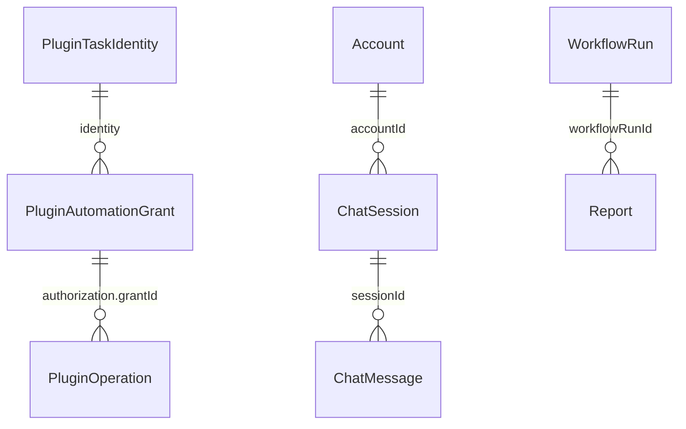

| 实体 | 关键引用 | 写入方（tool / workflow） | repository | 物理表 | 守护测试 |
|---|---|---|---|---|---|
| `PluginOperation` / `PluginAutomationGrant` / `PluginCapabilitySchema` / `PluginTaskIdentity`<br>`packages/core/src/entity/plugin-authority.ts` | operation `{id,userId,accountId,tool}`；`authorization.grantId`+`grantVersion`；grant `identity` | **DSH 插件宿主**（`packages/dsh-luoome/src/host/*`），不经过领域 tool registry | `repos.pluginAuthority`（`PluginAuthorityRepository`） | `plugin_operations`、`plugin_automation_grants` | `packages/db/src/repository/drizzle/plugin-authority.contract.test.ts`、`packages/tools/src/plugin-operations.test.ts` |
| `PluginSetting`<br>`packages/core/src/entity/plugin-setting.ts` | `key`（枚举）+`value`；只存 `automationTier` | `set_automation_tier`；宿主装配 | `repos.pluginSetting`（`PluginSettingRepository`） | `plugin_settings` | `packages/tools/src/plugin-operations.tier-gate.test.ts`、`packages/dsh-luoome/src/host/automation-tier-wiring.test.ts` |
| `WorkflowRun` / `ProviderStatus`<br>`packages/core/src/entity/workflow-run.ts` | `workflowName`、`mode`、`providerStatuses[]`；`inputSummary` 保留账户归属 | `record_workflow_run`、`reconcile_stale_workflow_runs`、`begin_account_plan_batch` / `finish_account_plan_batch`；所有 workflow | `repos.workflowRun`（`WorkflowRunRepository`） | `workflow_runs` | `packages/tools/src/tools/record-workflow-run.test.ts`、`packages/tools/src/tools/reconcile-stale-workflow-runs.test.ts` |
| `ChatSession` / `ChatMessage` / `ChatMessagePart`<br>`packages/core/src/entity/chat-session.ts` | `accountId`；message `sessionId` | `create_chat_session` / `append_chat_message` / `rename_chat_session` / `delete_chat_session` / `settle_chat_draft` | `repos.chat`（`ChatRepository`） | `chat_sessions`、`chat_messages` | `packages/tools/src/tools/chat-session.test.ts` |

## 12. 数据导入导出

导入导出**没有 entity 文件**：它不是一个实体，而是一套「表清单 + 策略 + 回执」契约。
权威表清单在 `packages/db/src/data-import-manifest.ts`，分四类策略 + FTS 重建：

| 策略 | 语义 | 表（节选，完整见 manifest） |
|---|---|---|
| `replace` | 恢复时整表替换（业务事实） | `accounts`、`trades`、`holdings`、`portfolio_cash_flows`、`strategies`、`strategy_runs`、`watchlists`、`alert_plans`、`watch_triggers`、`advices`、`decision_reviews`、`reports`、`trading_plans`、`price_snapshots`、`daily_bars`、`minute_bars`、`financial_fact_revisions`、`research_topic_index`、`research_document_index`、`research_topic_documents`、`research_subject_links`、`research_document_chunks`、`research_vault_sync_runs`、`research_hypothesis_versions`、`research_chunk_embeddings`、`research_embedding_index_states`、`chat_sessions`、`chat_messages`、`analysis_jobs`、`analysis_contexts`、`investment_research`、`investment_consensus`、`investment_tracking`、`watch_delivery_intents`、`report_delivery_intents` |
| `union` | 恢复时按主键并集（回执/幂等记录） | `decision_write_receipts`、`report_refresh_receipts`、`watchlist_import_batches`、`watchlist_removal_receipts`、`personal_alert_plan_mutations`、`personal_alert_evaluations`、`personal_watch_feedback`、`watchlist_facts_report_keys` |
| `preserve` | 保留本机（配置与迁移账本） | `plugin_operations`、`plugin_automation_grants`、`plugin_settings`、`data_import_receipts`、`schema_migrations`、`watch_notification_settings` |
| `transient` | 不随导入导出迁移（本机观测/动作痕迹） | `strategy_run_leases`、`watch_execution_lease`、`report_execution`、`watchlist_import_previews`、`financial_ingest_snapshots`、`report_publications`、`risk_vetoes`、`risk_veto_overrides` |
| `rebuild` | 恢复后重建 | `research_document_fts`（及其 shadow 表） |

| 对象 | 关键引用 | 写入方 | repository | 物理表 | 守护测试 |
|---|---|---|---|---|---|
| `DataImportReceipt` / `DataImportCommand`<br>`packages/core/src/repository/data-import.ts` | `requestId`+scope；`requestHash`；`targetDigest` | `preview_data_import` / `restore_data_import`；`export_business_data`（读） | `repos.dataImport`（`DataImportRepository`；**只有 Drizzle 装配提供**） | `data_import_receipts` | `packages/db/src/repository/data-import.contract.test.ts` |

口径提醒：`repos.dataImport` 在 `RepositoryRegistry` 里是可选字段——in-memory 实现只是合约替身，
不进生产装配；导入事务与回执原子性只在真实 SQLite 连接上成立。

## 13. 分析队列与写回

`AnalysisJob` 是待分析任务（含 lease/claim token），`AnalysisContext` 是「当时依据的事实包」，
`AnalysisProvenance` 嵌在写回产物里，`AnalysisPublication` 是写回契约的联合类型。

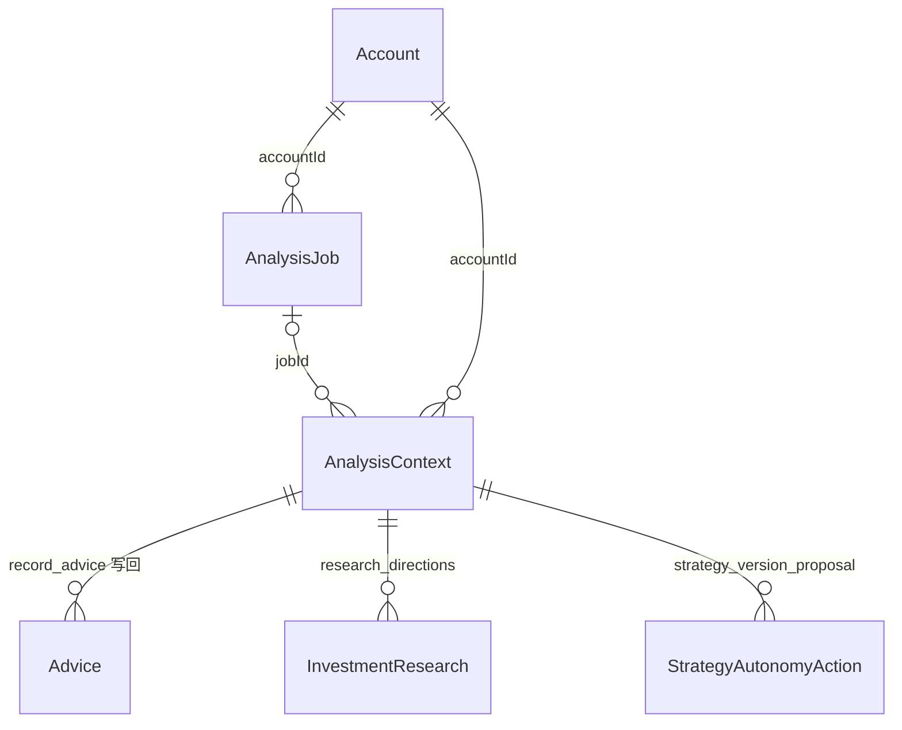

| 实体 | 关键引用 | 写入方（tool / workflow） | repository | 物理表 | 守护测试 |
|---|---|---|---|---|---|
| `AnalysisJob` / `AnalysisSubject` / `AnalysisFailureSchema`<br>`packages/core/src/entity/analysis-job.ts` | `accountId`、`subject{kind,id}`、`dedupeKey`、`contextId`、`claimedBy` | `enqueue_analysis_job` / `claim_analysis_jobs` / `complete_analysis_job` / `fail_analysis_job` / `cancel_analysis_job` / `requeue_analysis_job` | `repos.analysis`（`AnalysisRepository`） | `analysis_jobs` | `packages/core/src/entity/analysis-job.test.ts`、`packages/tools/src/queue/analysis.test.ts` |
| `AnalysisContext` / `AnalysisMissingFact`<br>`packages/core/src/entity/analysis-context.ts` | `jobId`、`accountId`、`subject`、`factIds[]`（含 `extfact:` 外部事实）、`recordedResult.ref` | `get_analysis_context`；`record_advice` / `record_analysis_result` 校验后写回 | `repos.analysis` | `analysis_contexts` | `packages/core/src/entity/analysis-context.test.ts`、`packages/tools/src/queue/analysis.test.ts` |
| `AnalysisProvenance`<br>`packages/core/src/entity/analysis-provenance.ts` | `{generatorKind,model,skillVersion,promptHash,sessionRef,contextId,jobId,evidenceFactIds[]}` | 随 `record_advice` / `record_analysis_result` / autonomy action 写入 | 无独立 repository | —（嵌入 `advices`、`investment_research`、`strategy_autonomy_actions` 的 JSON） | `packages/core/src/entity/analysis-job.test.ts`、`packages/tools/src/queue/analysis.test.ts` |
| `AnalysisPublication`<br>`packages/core/src/entity/analysis-publication.ts` | `{kind, research/action/draft}`；`analysisPublicationRef` | `record_analysis_result` | 无（写回契约，`repos.analysis.recordPublication`） | —（联合类型，落到各目标表） | `packages/tools/src/queue/analysis.test.ts`、`packages/db/src/repository/drizzle/analysis.contract.test.ts` |

口径提醒：`AnalysisContext` 是**事实包深冻**（`contextHash` + `writeUntil`/`expiresAt`），
`AnalysisProvenance` 只记录生成来源。写回时必须校验 `provenance.contextId === context.id`，
否则 `assertAnalysisPublication` 抛 `context_mismatch`。

## 14. 投资工作台（InvestmentWorkspace）

方向研究（`InvestmentResearch`）→ 用户确认的方向共识（`InvestmentConsensus`，追加不可变版本）→
跟踪接线（`InvestmentTracking`，只连已有 Watchlist 与 Strategy 订阅）。

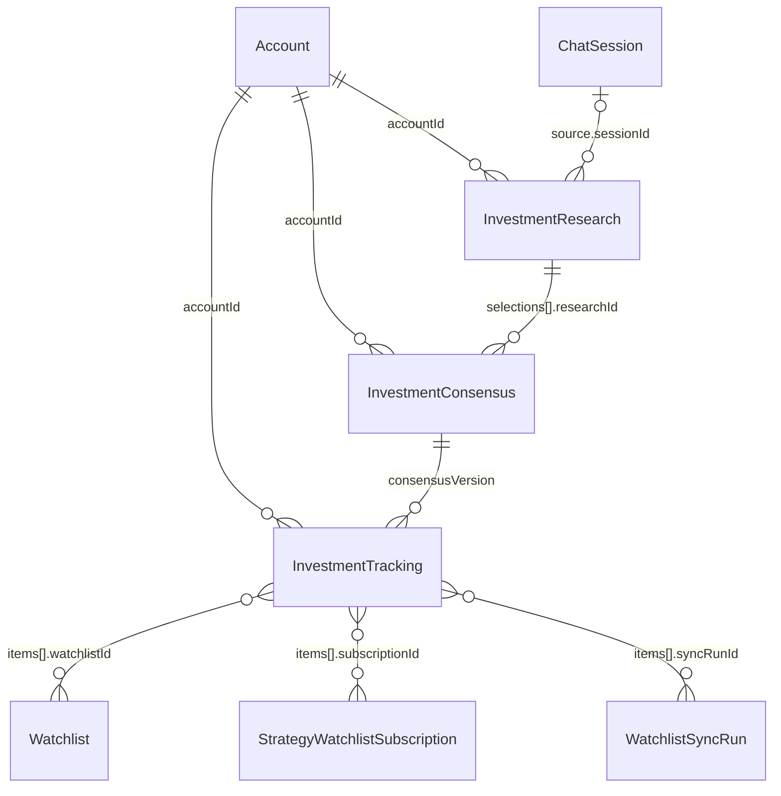

| 实体 | 关键引用 | 写入方（tool / workflow） | repository | 物理表 | 守护测试 |
|---|---|---|---|---|---|
| `InvestmentResearch` / `InvestmentDirection` / `InvestmentEvidence` / `InvestmentObjectionSchema`<br>`packages/core/src/entity/investment-workspace.ts` | `ownerUserId`、`accountId`、`requestId`+`requestHash`、`source.{sessionId,messageId}`、`evidence[].id`、`directions[].{strategyId,strategyVersionId,runId}` | `get_investment_workspace` / `get_investment_candidates` | `repos.investmentWorkspace`（`InvestmentWorkspaceRepository`） | `investment_research` | `packages/core/src/entity/investment-workspace.test.ts`、`packages/tools/src/tools/investment-workspace.test.ts` |
| `InvestmentConsensus` / `InvestmentSelection` / `InvestmentRecentIntentSchema`<br>`packages/core/src/entity/investment-workspace.ts` | `ownerUserId`+`accountId`+`version`；`supersedesId`；`selections[].researchId`+`directionId` | `save_investment_consensus`（expectedVersion 乐观锁） | `repos.investmentWorkspace` | `investment_consensus` | 同上 + `packages/db/src/repository/drizzle/investment-workspace.contract.test.ts` |
| `InvestmentTracking` / `InvestmentTrackingItemSchema` / `InvestmentUnmappedDirectionSchema`<br>`packages/core/src/entity/investment-workspace.ts` | `consensusVersion`、`requestId`+`requestHash`、`items[].{watchlistId,subscriptionId,syncRunId,strategyId,directionId}` | `set_investment_tracking` | `repos.investmentWorkspace` | `investment_tracking` | 同上 |

## 15. 横切值对象与派生视图

这些 schema **没有独立物理表**：要么嵌进别的实体 JSON，要么是读期计算/配置。

| 实体 | 源文件 | 本性 | 被谁使用 |
|---|---|---|---|
| `DataProvenance` / `DataFreshness` | `packages/core/src/entity/provenance.ts` | 值对象（嵌入） | `Quote`、`FinancialFact`、`ReportEvidence`、`ExternalMarketFact`、`SignalObservation` 等 |
| `QuoteFreshness` / `QuoteSession` | `packages/core/src/entity/quote-freshness.ts` | 读期分类（`classifyQuoteFreshness`） | `batch_quote`、盘中 watch 规则、报告 display |
| `TechnicalIndicators` / `KnownIndicatorKey` | `packages/core/src/entity/indicator-set.ts` | 计算快照（嵌入 `AdviceDataSnapshot.indicators`、策略结果） | `compute_indicators`、策略 evaluator、`get_stock_market_view` |
| `Market` / `Exchange` | `packages/core/src/entity/market.ts` | 枚举 | 全仓行情与目录口径 |
| `MarketProviderConfig` / `MarketProviderName` | `packages/core/src/entity/market-provider.ts` | 环境配置（`parseMarketProviderConfigFromEnv`） | `packages/adapters/src/market/*` 装配 |
| `TriangleRoles` / `BullRationale` / `BearRationale` / `JudgeVerdict` / `RiskOfficerVerdict` / `FalsifiableCondition` | `packages/core/src/entity/triangle-roles.ts` | **孤儿 schema**：仅从 `packages/core/src/index.ts` 导出 | 当前无 tools/workflows/repository 引用；只有 `packages/core/src/entity/triangle-roles.guard.test.ts` 守护 |

口径提醒：`TriangleRoles` 不是「文档漏写」，而是**代码里已无消费方**。`triangle-gate.ts` 是另一个概念
（三角门控/降级），与三角色 schema 无关。保留或删除需要产品决策，本图只如实记录。

## 16. 实体定义不在 `entity/` 的领域对象

| 对象 | 源文件 | 物理表 / 载体 | 说明 |
|---|---|---|---|
| `FundamentalScoreVersion` / `FundamentalScoreRun` / `FundamentalScoreResult` / `FactorDefinition` | `packages/core/src/strategy/fundamental-factor.ts` | `fundamental_score_versions` / `runs` / `results` | 走 `repos.fundamentalScoreVersion` / `fundamentalScoreRun` |
| `HoldingCashAdjustment` | `packages/core/src/portfolio/ledger.ts` | `holding_cash_adjustments` | 账本对账重放记录，不计入外部现金流 |
| `PersonalAlertPlan` / `PersonalAlertPlanMutation` / `PersonalPriceRuleSchema` | `packages/core/src/personal/alert.ts` | `alert_plans`、`personal_alert_plan_mutations` | 个人版的 AlertPlan 子集，复用同一张业务表 |
| `PersonalWatchTriggerSnapshot` / `PersonalWatchFeedback` | `packages/core/src/personal/watch.ts` | `watch_triggers`、`personal_watch_feedback` | 触发快照与反馈 |
| `WatchlistImportRow` / `WatchlistImportPreview` / `WatchlistImportSelection` / `WatchlistImportResult` | `packages/core/src/personal/watchlist.ts` | `watchlist_import_previews`（transient）、`watchlist_import_batches`（union） | 导入预览与批次 |
| `PersonalOperationReceipt` / `ExecutionIdentity` | `packages/core/src/personal/receipt.ts`、`execution-identity.ts` | 无独立表 | 插件操作回执与执行身份 |
| `readStrategyRunSnapshot` / `StrategyRunSnapshotView`（V3/V2/legacy 兼容） / `StrategyDefinitionDiff` / `StrategyRunDiff` / `StrategyResultView` / `AdaptivePersonality*` / `StrategyPromotion*` / `StrategyRecommendationPreflight*` / `StrategyDailyCycleAudit*` | `packages/core/src/strategy/*.ts` | 无独立表（工具输出/审计摘要） | 都是视图或评估产物，不新增持久实体 |

仓储实现位置（同一契约两套实现）：

- 接口：`packages/core/src/repository/*.ts`
- Drizzle：`packages/db/src/repository/drizzle/*.ts`（表名见各文件引用的 `packages/db/src/schema/**`）
- 内存：`packages/db/src/repository/memory/*.ts`
- 个人版与投递：`packages/core/src/personal/repository.ts`（`PersonalRepository` → `repos.personal`）、
  `packages/core/src/entity/notification.ts` 里的 `WatchDeliveryRepository` → `repos.watchDelivery`、
  `packages/core/src/report-automation.ts` 的 `ReportAutomationRepository` → `repos.reportAutomation`
- 合约测试：`packages/db/src/repository/contract-tests.ts` + `packages/db/src/repository/*.contract.test.ts`

## 17. 物理表清单与「已接线但无写入方」

物理表总数 = `packages/db/src/migrations.ts` 的 88 个 `CREATE TABLE` / `CREATE VIRTUAL TABLE`
（含 `research_document_fts` 虚拟表与 2 个迁移期临时表 `price_snapshots_mig`、`watch_triggers_mig`），
再加 12 张不在 migrations 里的自建表（`data_import_receipts` 与 11 张 personal 表）。
表到实体的映射见上面各节。

以下关系容易画错，单独列出：

| 事实 | 说明 |
|---|---|
| 物理层零外键 | `packages/db/src/schema/index.ts` 无 `references(`；只有 PK / 唯一索引 / 普通索引 |
| 个人表不在 migrations.ts | `watch_delivery_intents`、`watch_notification_settings`、`report_delivery_intents`、`report_execution`、`personal_*`、`watchlist_import_*`、`watchlist_facts_report_keys` 由 `packages/db/src/personal/schema.ts`、`watch-delivery-schema.ts`、`report-automation-schema.ts` 的 `ensureSchema` 建 |
| 一次性重建表 | `price_snapshots_mig`、`watch_triggers_mig` 是迁移期临时表名（建→灌→rename），不是常驻表 |
| `RiskVeto` / `RiskVetoOverride` | 有 schema、drizzle 实现、memory 实现、contract/guard 测试，但**当前没有任何 tool / workflow 调用 `repos.riskVeto`**；唯一写入入口未接线 |
| `ReviewRevisionProposal` | 有实体与 tool（`propose_review_revision`），但**不落库**：`status` 恒 `draft`，无 repository |
| `advice_outcomes` | 存量表；`record_advice_outcome` 明确只写 DecisionReview，不再双写 |
| `TriangleRoles` | 孤儿 schema，无消费方（见 §15） |
| `AccountFacts` | 派生视图，无表；`digest` 是计划失效判据 |
| `ReportDocument` | 落盘 Markdown + `report_publications.document_hash`，无表 |

## 18. 63 个 entity 文件覆盖索引

`packages/core/src/entity/` 下全部非测试文件（按字母序），章节号对应上文。

| # | 文件（`packages/core/src/entity/`） | 主要 schema / 类型 | 章节 |
|---:|---|---|---:|
| 1 | `account-facts.ts` | `AccountFacts`、`AccountFactsPosition` | 2 |
| 2 | `account.ts` | `Account` | 2 |
| 3 | `advice-card.ts` | `AdviceCard`、`AdviceCardSegment` | 8 |
| 4 | `advice.ts` | `Advice`、`AdviceOutcome`、`AdviceDataSnapshot`、`AdviceReasoning` | 8 |
| 5 | `alert-plan.ts` | `AlertPlan`、`AlertRule`、`StrategySignalAlertRuleSchema` | 6 |
| 6 | `analysis-context.ts` | `AnalysisContext`、`AnalysisMissingFact` | 13 |
| 7 | `analysis-job.ts` | `AnalysisJob`、`AnalysisSubject`、`AnalysisFailureSchema` | 13 |
| 8 | `analysis-provenance.ts` | `AnalysisProvenance` | 13 |
| 9 | `analysis-publication.ts` | `AnalysisPublication` | 13 |
| 10 | `ashare-sentiment.ts` | `AShareSentimentSnapshot` | 3 |
| 11 | `chat-session.ts` | `ChatSession`、`ChatMessage`、`ChatMessagePart` | 11 |
| 12 | `decision-review.ts` | `DecisionReview`、`DecisionReviewRevision`、`DecisionReviewContent`、`DecisionReviewContext` | 8 |
| 13 | `disclosure-source.ts` | `DisclosureSource`、`AnnouncementDisclosure`、`VendorSnapshot`（接口，非 zod） | 4 |
| 14 | `dragon-tiger.ts` | `DragonTigerList`、`DragonTigerEntry`、`DragonTigerSeat` | 3 |
| 15 | `external-fact.ts` | `ExternalMarketFact`、`ExternalFactDraft`、`ExternalFactKind` | 3 |
| 16 | `financial-ingest-snapshot.ts` | `FinancialIngestSnapshot`、`FinancialIngestVerdict` | 4 |
| 17 | `fundamental.ts` | `FinancialFact`、`FinancialVintage`、`FinancialVintageCoverage` | 4 |
| 18 | `holding.ts` | `Holding` | 2 |
| 19 | `indicator-set.ts` | `TechnicalIndicators`、`KnownIndicatorKey` | 15 |
| 20 | `investment-workspace.ts` | `InvestmentResearch`、`InvestmentConsensus`、`InvestmentTracking`、`InvestmentDirection` | 14 |
| 21 | `limit-up-ladder.ts` | `LimitUpLadder`、`LimitUpLadderEntry`、`LimitUpLadderLevel`、`LimitUpLadderDiff` | 3 |
| 22 | `market-provider.ts` | `MarketProviderConfig`、`MarketProviderName` | 15 |
| 23 | `market-snapshot.ts` | `MarketSnapshot`、`MarketSnapshotItem`、`MarketSnapshotCompleteness` | 3 |
| 24 | `market.ts` | `Market`、`ALL_MARKETS`、`MARKET_LABEL` | 15 |
| 25 | `minute-bar.ts` | `MinuteBar`、`MinuteBarInterval` | 3 |
| 26 | `news.ts` | `NewsList`、`NewsItem`、`NewsCategory` | 3 |
| 27 | `northbound-flow.ts` | `NorthboundFlowSeries`、`NorthboundFlowEntry` | 3 |
| 28 | `notification.ts` | `Notification`、`NotificationResult`、`WatchDeliveryIntent`、`WatchNotificationSettings` | 6 |
| 29 | `plugin-authority.ts` | `PluginOperation`、`PluginAutomationGrant`、`PluginTaskIdentity`、`PluginCapabilitySchema` | 11 |
| 30 | `plugin-setting.ts` | `PluginSetting`、`PluginSettingKey`、`AutomationTierValue` | 11 |
| 31 | `portfolio-performance.ts` | `PortfolioCashFlow`、`PortfolioCorporateAction`、`PortfolioPerformanceSnapshot`、`PortfolioPerformance` | 2 |
| 32 | `provenance.ts` | `DataProvenance`、`DataFreshness` | 15 |
| 33 | `quote-freshness.ts` | `QuoteFreshness`、`QuoteSession` | 15 |
| 34 | `quote.ts` | `Quote`、`DailyBar`、`IntradayMinute`、`IndexQuote`、`DateRange` | 3 |
| 35 | `report-document.ts` | `ReportDocument`、`ReportEnvelope`、`ReportDocumentSection` | 9 |
| 36 | `report-publication.ts` | `ReportPublication`、`PublishRejection` | 9 |
| 37 | `report.ts` | `Report`、`ReportSection`、`ReportEvidence`、`ReportBlock`、`DecisionReviewReportSnapshot` | 9 |
| 38 | `research-brief.ts` | `ResearchBrief`、`EvidenceRef` | 10 |
| 39 | `research-embedding.ts` | `ResearchChunkEmbedding`、`ResearchEmbeddingIndexState`、`ResearchEmbeddingModelIdentity` | 10 |
| 40 | `research-hypothesis.ts` | `ResearchHypothesisVersion` | 10 |
| 41 | `research-vault.ts` | `ResearchTopicIndex`、`ResearchDocumentIndex`、`ResearchSubjectLink`、`ResearchTopicDocument`、`ResearchDocumentChunk`、`ResearchVaultSyncRun` | 10 |
| 42 | `review-revision-proposal.ts` | `ReviewRevisionProposal` | 5 |
| 43 | `risk-veto.ts` | `RiskVeto`、`RiskVetoOverride` | 8 |
| 44 | `sector-quote.ts` | `SectorQuoteList`、`SectorQuoteItem` | 3 |
| 45 | `signal-observation.ts` | `SignalObservation`、`SignalObservationHorizon`、`SignalObservationVintage` | 5 |
| 46 | `stock-event.ts` | `StockEvent`、`StockEventKind`、`EventImportance` | 3 |
| 47 | `stock-profile.ts` | `StockProfile`、`StockHolderStat`、`StockConcept` | 3 |
| 48 | `stock-research-profile.ts` | `StockResearchProfile`、`StockResearchProfileFact` | 10 |
| 49 | `stock-universe.ts` | `StockUniverseSnapshot`、`StockUniverseEntry`、`StockUniverseSyncRun`、`StockUniverseMembershipState` | 3 |
| 50 | `stock.ts` | `Stock`、`Exchange` | 3 |
| 51 | `strategy-autonomy-action.ts` | `StrategyAutonomyAction`、`StrategyAutonomyActionTrigger` | 5 |
| 52 | `strategy-backtest.ts` | `StrictBacktestRun`、`StrictBacktestSpec`、`StrictBacktestMarketFact`、`StrictBacktestMetrics` | 5 |
| 53 | `strategy-checkpoint.ts` | `StrategyDataCheckpoint`、`StrategyEvaluationSession`、`StrategyEvaluationDay`、`DailyBarRevision`、`StrategyResearchState` | 5 |
| 54 | `strategy-schedule.ts` | `StrategySchedule`、`StrategyRecommendationPolicyV1/V2`、`StrategyRecommendationBatchSummarySchema` | 5 |
| 55 | `strategy-watchlist-subscription.ts` | `StrategyWatchlistSubscription` | 5 |
| 56 | `strategy.ts` | `Strategy`、`StrategyVersion`、`StrategyDslV1`、`StrategyRun`、`StrategyResult`、`StrategySignal`、`StrategySignalState` | 5 |
| 57 | `trade.ts` | `Trade` | 2 |
| 58 | `trading-plan.ts` | `TradingPlan`、`TradingPlanV1`、`TradingPlanExit`、`TradingPlanSource`、`TradingPlanView` | 7 |
| 59 | `triangle-roles.ts` | `TriangleRoles`、`BullRationale`、`BearRationale`、`JudgeVerdict`、`RiskOfficerVerdict` | 15 |
| 60 | `watch-run.ts` | `WatchRun` | 6 |
| 61 | `watch-trigger.ts` | `WatchTrigger`、`WatchRuleState`、`WatchRuleKind`、`TriggerFeedback` | 6 |
| 62 | `watchlist.ts` | `Watchlist`、`WatchlistMember`、`WatchlistMemberSource`、`WatchlistSyncRun`、`MembershipSnapshot` | 6 |
| 63 | `workflow-run.ts` | `WorkflowRun`、`ProviderStatus`、`ProviderLatency` | 11 |

合计 **63 个实体文件**（另有 `invariants.ts` 为跨实体的断言集合，不计入实体）。
