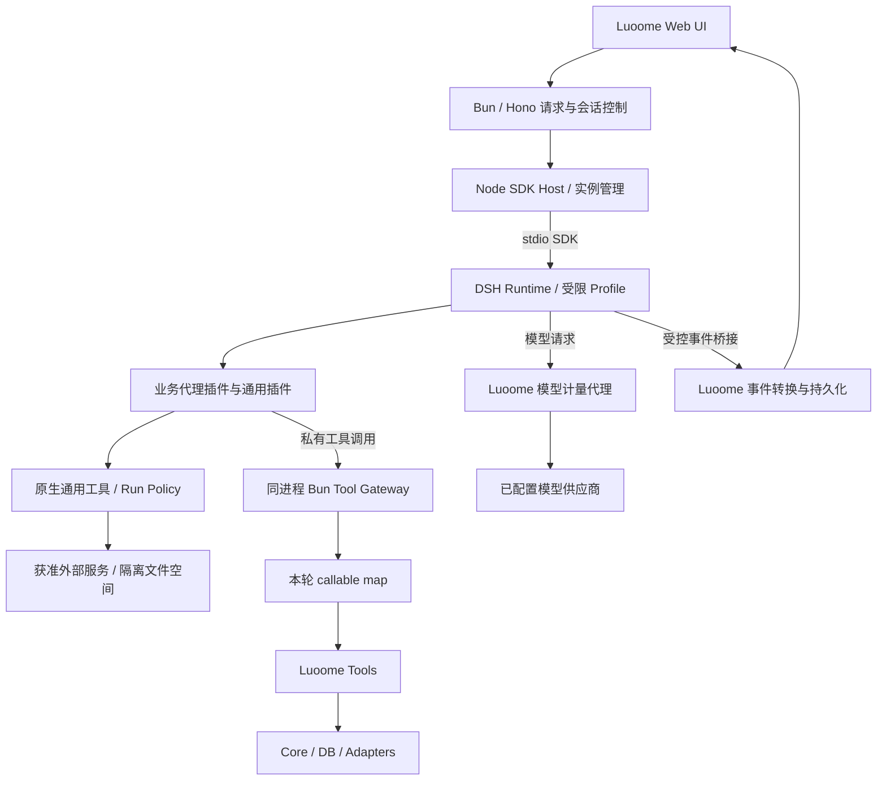
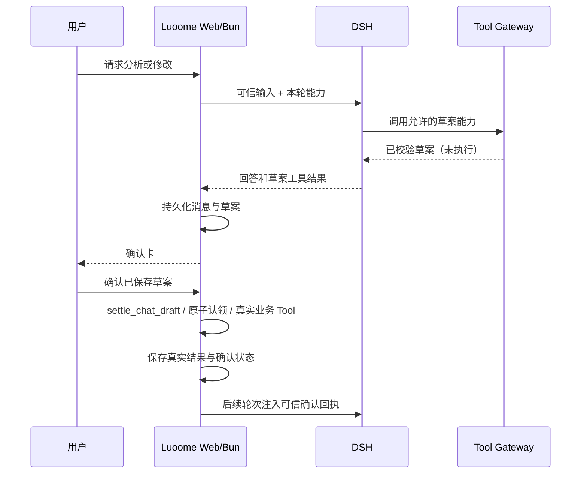

# Luoome × DSH 插件能力平台设计

> 状态：设计基线；D01–D07 已通过受控开发环境验收，生产、持久恢复与多 Agent 等后续能力仍待验证。
> 创建：2026-10-20；实施状态更新：2026-10-21。
> 目标：将投资业务能力按域组织为插件，并复用成熟通用插件，通过组合形成不同 Agent 能力。
> 配套：[详细研究与验证计划](../archive/dsh-plugin-platform-research-plan.md)（已归档）。
> 实施：[开发任务与线程边界](../archive/dsh-plugin-platform-development-plan.md)（已归档）。
> 约束依据：[领域语言](../../CONTEXT.md)、[架构](../ARCHITECTURE.md)、[安全](../SECURITY.md)、[Web Chat](./web-chat-design.md)。
>
> **适用范围（2026-10-23）**：本文设计的是**内嵌 DSH Host + 原生 Cordis 插件**这条路，
> 它的前提包含多租户托管层（租户生命周期、托管模型计量、托管站点）。
> 托管形态下线后这些前提不再成立，内嵌 Host 与业务 Cordis 插件的代码也已从仓库删除：
> 本文保留 Run/Tool Manifest、生命周期与事件契约部分作为插件化能力契约，
> 托管相关的前提（Tenant、租约、计量账本、托管入口）不再是当前行为。
> 当前单机形态（三实例 MCP、只读面板、技能目录、DSH 定时任务与队列消费）以
> [luoome 的 DSH 改造详细设计](./luoome-dsh-transformation-detailed-design.md) 为准。

## 1. 目标、范围与决策状态

Luoome 继续拥有投资产品界面、业务事实、用户身份、权限、确认、任务和成本账本。
DeepSeek Harness（DSH）提供 Agent 执行、上下文管理与原生 Cordis 插件组合能力。
Luoome 自研插件和外部通用插件使用同一套运行、观察和能力准入机制。

接入价值需要同时验证两件事：现有业务可以通过插件复用；新增通用插件可以在不重写业务和 Chat 的情况下被组合使用。
只完成 SDK 调用或换一个模型，不能作为插件平台验收。

| 决策 | 状态 | 含义 |
|---|---|---|
| 保留 Luoome Web 和投资业务 | 用户已确认 | Hono + 原生 HTML/CSS/JS；不迁入 DSH Web UI，不重写核心业务 |
| DSH 作为能力插件平台 | 用户已确认 | 按能力域拆分，支持自研、官方和第三方插件 |
| SDK 控制 + 原生 Cordis 插件 | 用户已确认 | 本次集成不使用 MCP，不 fork DSH；已有单机 MCP surface 不在修改范围 |
| 先设计、研究，再实现 | 已进入开发阶段 | 设计与研究规划已完成；用户已授权首批开发，按任务切片验证并实施 |
| Node SDK Host + Bun 私有 Gateway | 首批已验证 | 受限 Node/DSH 真实启动与关闭通过；不在 Bun 进程加载 SDK |
| Chat 作为第一条产品链路 | 首批已验证 | 受控行情、官方网页工具、草案确认与回执接续通过；复杂场景后续扩展 |
| 分阶段保留现有运行时 | 已实现 | AI SDK 仍为默认；DSH 开发开关显式启用，生产拒绝启动 |
| 第三方插件、具体版本、容量与性能目标 | 待研究 | 见配套计划；“候选”不代表成熟、安全或已兼容 |

首期不建立插件商城、自助安装任意代码、复杂 Agent 编辑器或通用工作流编排器。
Agent 管理和多 Agent 可视化在基础运行契约验证后增加。
现有确定性 Strategy、回测、规则求值和 workflow 契约保持；Advice 不授权交易。

## 2. 事实基线与证据等级

### 2.1 Luoome 当前工作树

以下为设计阶段的代码审查基线；部分实现在首批开发中更新，托管形态下线后相关文件已删除。
现行行为见[架构文档](../ARCHITECTURE.md)与[单机形态改造设计](./luoome-dsh-transformation-detailed-design.md)，不能把下表的历史快照当成永久接口。

| 能力 | 当前事实与来源 | 设计影响 |
|---|---|---|
| Agent 端口 | [core context](../../packages/core/src/context.ts) 只保留 AgentCallableTool；AgentRuntimeLike 与结果类型随模型层退役 | DSH 类型不进入业务层 |
| Web Chat | 已退役：`apps/web/src/chat.ts` 的 ChatStreamRuntime、场景路由与主体核验随模型层删除 | DSH 侧不再有 Web 模型对话端口 |
| 工具权限 | [agent-whitelist](../../packages/tools/src/agent-whitelist.ts)、[scenarios](../../packages/tools/src/agent/scenarios.ts) 构造明确的可调用能力 | 不全量导出 registry；逻辑插件与场景名单取交集 |
| 草案 | [settle_chat_draft](../../packages/tools/src/tools/settle-chat-draft.ts) 执行已保存输入；Web 侧生成虚拟草案的包装随 chat 端点删除 | 确认工具不暴露给模型 |
| 历史 | modelHistory 随 chat 端点删除 | DSH 增量会话不能遗漏回执，也不能每轮重复追加全部历史 |
| 前端 | `apps/web/public/js/chat.js` 已删除；Web 只保留待确认草案面板 | 不再有 Chat 协议与页面 |
| 托管入口 | `apps/web/src/server.ts` 曾从请求 context 取得托管 agent，`apps/web/src/hosted-providers.ts` 曾装配托管模型执行——两者随托管形态下线 | 这条前提已失效；单机形态改由 MCP 实例与面板接入，不走请求级托管 agent |
| 成本 | `packages/adapters/src/llm/hosted-meter.ts` 曾拦截 AI SDK fetch 做预占与结算——随托管计量下线 | 托管计量账本不存在；模型调用成本由单机侧自行承担，无逐请求预占 |
| 流式 | 上述托管装配当时有 response.text() 全量读取 | 返回 SSE 格式不能证明实时增量；必须测浏览器到达时序 |
| 生命周期 | `apps/web/src/hosted-server.ts` 曾 retain 连接并维护写屏障——随托管形态下线 | 租约与写屏障不再存在；单机形态的排空与恢复按 DSH 会话与队列租约重新定义 |
| 运营策略 | `packages/tools/src/hosted/web.ts`、`apps/web/src/hosted-config.ts` 曾控制权益策略——随托管形态下线 | 「始终必须付费订阅」等策略不再适用；行情配置由单机 provider 装配管理 |

### 2.2 DSH 上游审查基线

源码基线为 `687f282e8625c6b8d11ff58211a90524be2e4317`，该 checkout 的 SDK manifest 版本为 `0.2.1-rc.2`。
这是固定源码审查基线，不宣称它是最新稳定版或已验证的 npm 发布物。研究阶段另行冻结实际安装产物、完整性哈希和依赖锁。

| 已确认事实 | 一手证据 | 对接要求 |
|---|---|---|
| SDK 驱动 stdio JSON-RPC 子进程，支持 Profile/patch | [U01](#u01) | SDK 管控制，工具在 Runtime 内注册 |
| 启动使用 process.execPath | [U02](#u02) | Bun 中调用不会自动使用 Node；Node Host 为基线 |
| run 结果按接收回执至下一次 idle 收集 | [U01](#u01) | 同会话串行；不能把任意 idle 当作多 Agent 全部完成 |
| resumeSession 显式恢复原持久 Session | [U01](#u01)、[U03](#u03) | 记录原 home/session 归属，不能仅重复使用字符串 ID |
| SDK 无单轮取消、无 session-close，也无完整客户端审批请求流 | [U03](#u03) | 取消与业务确认由 Luoome 控制；关闭进程影响范围必须明确 |
| SDK 转发 durable session/status/subagent；实时 assistant-stream 未接入该服务端 | [U04](#u04)、[U05](#u05) | 真文本流需单独事件桥接实验 |
| 工具必须声明 canonical output；raw input 与 output schema 支持范围不同 | [U06](#u06)、[U07](#u07) | 验证输入转换、输出投影和错误映射 |
| sdk-minimal 仍含 Shell 和 danger-full-access | [U08](#u08) | 自定义受限组合并检查实际库存 |
| Session-log 上传默认启用且独立于 OTel | [U09](#u09) | 受限组合关闭额外日志上传，不能只关遥测变量 |
| 原生 Host 插件在进程内执行，管理变更影响同 Profile 会话；SDK 默认需重启 | [U10](#u10)、[U11](#u11) | 插件视为部署代码；升级通过排空和新实例生效 |
| token-meter 不等于账单，llm/stream 提供模型扩展点 | [U12](#u12)、[U13](#u13) | Luoome 持有预占、真实成本及未知费用恢复 |
| spawn-in-process 不导入父 Agent 的 agent-local 工具限制 | [U14](#u14) | 每个子 Agent 重新绑定不超过父级的授权与预算，不能假设自动继承 |

本节基线来自设计阶段的源码审查，不能替代依赖安装、插件加载、供应商调用、性能或端到端运行证据；后续实验以开发交接记录逐项确认。

## 3. 插件与业务的边界

### 3.1 术语

| 名称 | 本设计中的含义 |
|---|---|
| Plugin | 原生 Cordis 模块，贡献工具、服务、上下文或事件处理；不是权限沙箱 |
| Bundle | 一组插件及配置的发布组合 |
| Runtime Profile | 启动一个受控 Runtime 所需的固定插件树和配置版本 |
| Agent 场景 | Luoome 拥有的业务职责、主体范围和允许能力；先复用现有 scenarios |
| Capability | 一项可授权能力；插件安装和 Agent 获得该能力是独立动作 |
| Tool Manifest | 服务端为一次执行派生的可调用工具声明，包含实际调用模式 |
| Run | Luoome 发起的一次受控执行；有身份、预算、状态与独立执行 ID |
| Runtime Session | DSH 的上下文与执行日志；与产品 conversation 有显式绑定 |
| Skill | 提示与操作指导，可由插件装载；不授予工具、数据或写入权限 |

### 3.2 三类插件

| 类别 | 建议逻辑模块 | 权威来源 |
|---|---|---|
| 平台桥接 | 可信执行上下文、能力注册、工具代理、事件投影、模型计量接入 | Luoome 服务端身份/授权/账本，DSH 提供扩展点 |
| 投资业务 | market、research、strategy、portfolio、watch、review | 既有 tools/schema/领域规则；插件只组合和适配 |
| 通用生态 | 网页读取、搜索、文档处理、知识检索、子 Agent provider | 候选插件的公开契约，经兼容和权限测试后启用 |

逻辑拆分不等于立即新增六个 npm 包。首期在同一插件包中按模块导出，独立依赖或发布周期出现后再拆物理包。
平台授权与费用账本不能成为普通插件可替换的最终权威；运行时 guard 只是补充控制。
不可信插件应隔离运行，通过受控服务或进程代理接入；同进程的 Cordis scope 不是隔离边界。

### 3.3 投资能力映射

以下是拟定能力域与代表入口，非新增库存；实际工具仍由 registry/scenarios 派生。

| 能力域 | 复用入口示例 | 写入/正式分析语义 |
|---|---|---|
| market | search_stocks、fetch_quote、batch_quote、get_market_data_status | 行情查询可能刷新缓存，仍遵守 external opt-in；不伪装纯 read |
| research | get_stock_research_view、build_research_brief、研究文档检索 | 研究归档与正式 Advice 生成仍为草案 |
| strategy | 策略定义、运行与信号查询、版本比较 | 候选版本、试算、发布和正式运行遵守既有确认与确定性引擎 |
| portfolio | 账户事实、持仓、绩效和交易计划读取 | 账本修改保持逐项确认；不开放自动证券交易 |
| watch | Watchlist、AlertPlan、WatchTrigger 查询 | 列表/规则变更走草案；后台 worker 和领域租约保持原归属 |
| review | DecisionReview、Advice 统计、报告和事后观察 | 不编造盈亏、因果或回测；新增记录走既有确认 |

get_stock_market_view 尚不在当前 Agent 外部能力白名单，不能因加入 market 插件就自动开放。
原型先使用 fetch_quote；扩展工具必须更新现有能力声明及测试。
workflow 继续只通过 ctx.tools 编排；不得把整个 workflow 注册为工具制造嵌套循环，也不启动第二套租户调度器。

### 3.4 场景组合

| 产品场景 | 拟组合能力 | 首期安排 |
|---|---|---|
| 股票研究 | market + research + 经准入的网页/搜索能力 | 第一条链路 |
| 策略助手 | strategy + market + research | 草案确认通过后扩展 |
| 持仓助手 | portfolio + market + watch | 账户隔离通过后扩展 |
| 复盘助手 | review + research + 可选子 Agent | 多 Agent 阶段 |

有效能力分两路构造：业务能力从既有 scenario/callable map 派生；原生通用能力从已准入插件的声明和服务端明确的场景授权派生。
现有 scenarios 只有 Luoome 工具名，不能自动包含网页/搜索插件；实施时增加 SDK 无关的通用能力授权配置，不因插件安装就追加到所有场景。
两路能力合并后，再与固定 Profile、当前租户/账户授权和本轮范围取交集，分别控制可见性和执行。
子 Agent 需要独立派生 scope，并再次取父级允许范围的交集；DSH 的 spawn-in-process 默认不复制父级局部工具限制，父级白名单不能替代对子级的执行校验。
原生通用工具不必伪装成 Luoome registry 工具，但不能绕过统一 run policy、外发和费用约束。
前期不为每个场景启动一套永久服务；Profile 管部署组合，场景管 Agent 本轮能力。

## 4. 目标拓扑与代码依赖

Node Host 独立运行，SDK 再拥有 DSH 子进程；这是明确的三进程基线，不能把启动代码复制进 Bun 后宣称仍为 Node Runtime。
Node Host 不加载 bun:sqlite，不持有业务 Repository，不直接访问 control/Tenant 数据库。
Tool Gateway 位于持有请求上下文和 callable closures 的 Bun 服务中，业务执行仍通过 tools。
模型代理与 Tool Gateway 可以同属一个内部服务，职责、凭证 audience 和审计必须区分。

拟定落点（尚未创建）：

| 路径 | 职责与依赖 |
|---|---|
| packages/dsh-bridge/ | transport-neutral JSON 契约、Node Cordis 插件、结果与事件转换；禁止 import tools/db/workflows/web |
| apps/agent-runtime/ | Node SDK Host 的可部署入口、健康与有界实例管理；不加载业务包 |
| apps/web/src 的 DSH 接入模块 | Bun runtime client、Tool Gateway、请求身份和原 Chat callable 接线 |
| apps/web/src/hosted-providers.ts（已删除） | 曾承载请求级模型快照与 Chat runtime 选择；托管形态下线后该职责不存在 |
| packages/adapters/src/llm/ | 复用/提取现有计量传输契约；不反向引用 tools 或 Web |
| infra/dsh/ | 固定 Profile、Bundle 与部署配置；无凭证和私人数据 |

纯协议子入口必须与 Node 插件入口分离，避免 Bun 客户端 import 协议时连带启动 DSH 或加载 Node-only 模块。
首期不同时建立两套 SDK client（adapters/dsh 与 dsh-bridge 各一份）。物理目录最终由启动与打包实验确认。
任何新增 repository 仍要求 core 接口、memory/Drizzle 双实现、contract tests 及幂等迁移。

## 5. 插件准入、配置与生命周期

### 5.1 两层清单

部署清单固定插件来源、精确版本/commit、完整性、许可证、DSH/Node 兼容范围、依赖、所需服务、网络/文件/模型能力和审查结果。
它引用实际包与配置，不重新实现 Cordis 包管理器，也不从市场页面描述推断可信性。

每轮 Tool Manifest 合并两个来源：业务项从服务端 callable map 派生；通用项从固定插件产物的已审查声明和本轮场景授权派生。
每项记录 name、description、JSON input schema、调用模式（执行/草案）、能力域、sourcePlugin、executionLocation（bun-gateway/runtime-native）、副作用/requiredCapabilities、费用策略与协议版本。
业务项由桥接层提供输出投影；原生项保留插件 canonical output，适配为 Luoome 可展示结果和失败状态。
manifestHash 绑定本轮能力快照；同名冲突启动失败，不采用最后注册者覆盖。实际注册结果与声明不一致或运行中新注册能力时拒绝其执行。
平台工具、settle_chat_draft、trade、迁移和内部恢复能力均不出现在模型工具表。

### 5.2 启用流程

候选发现 → 源码/许可证/依赖审查 → 固定产物 → 隔离契约测试 → 业务/计费验证 → 加入批准组合 → 灰度。
平台运营者在部署侧安装；普通用户选择已开放功能。首期不向模型开放 plugin_manager、自修改配置和任意包安装能力。

一次 run 固定 Runtime build、Profile/config hash、插件集合、模型与费率快照；运行中不替换。
SDK 默认配置变更需重启，采用“停止接收新 run → 排空旧实例 → 启动新组合 → 探针 → 路由切换”。
插件 unload 不能撤销已发生的外部副作用，失败升级也不能通过重放付费或写入调用补偿。
回滚前核对 Session 格式兼容；不能让旧 DSH 读取不支持的新格式并自动覆盖。

### 5.3 最小受限组合

- 保留 SDK 服务、Agent loop、所需模型服务、工具系统、会话存储和必要平台桥接。
- 排除 Shell、通用文件写入、动态插件管理、未知后台任务、MCP clients/resources 与无关 UI 插件。
- 显式禁用 session-log-deepseek 等额外日志外发；供应商所需推理输入单独受数据范围控制。
- 使用独立 DSH_HOME、工作目录和显式最小子进程环境；不继承个人 home/.env 或整套平台凭据。
- 启动检查 dump-config 与实际工具库存，两者都匹配批准快照才接收任务。
- 原生插件代码按受信部署代码处理；文件系统权限、网络出口和进程资源限制单独实施，不能依赖工具白名单替代。

## 6. 控制与执行契约

以下为 Luoome 自有协议设计字段，不是声称 DSH SDK 已提供这些接口。实现时用 Zod 在跨进程边界验证并派生类型。

### 6.1 执行范围

| 对象 | 最小信息 | 归属 |
|---|---|---|
| ExecutionScope | tenantId、tenantGeneration、accountId、conversationId、runId、scenario、允许能力、到期时间、budgetOperationId | Bun 服务端保存 |
| RuntimeBinding | runtimeInstanceId、DSH sessionId、Profile/config hash、conversation/run 关联 | 可信 Host 与服务端协商 |
| RunRequest | protocolVersion、runId、conversationId、受核验输入/主体、manifestHash、配置引用 | 服务端签发，不接受模型指定身份 |
| ToolCall | runId、callId、toolName、JSON input、manifestHash | 插件生成，凭证通过传输附带 |
| ToolReply | callId、callable 的 ok/output、执行审计引用；output 保留草案标记或既有错误 | Bun Gateway 形成权威结果 |
| NativeToolReceipt | runId、callId、sourcePlugin、结果/失败状态、外发/费用关联 | 受控 DSH 执行观察形成；不冒充 Luoome 业务写入回执 |

内部传输首期优先同机 UDS；HTTP 仅绑定私有监听并认证，跨主机需部署身份与加密传输。
浏览器 Cookie、CSRF token 不转交 DSH。执行凭证只引用服务端 scope，绑定 audience、实例、有效期和撤销状态，不进入 prompt、schema、模型日志或通用工具参数。
Tool、模型、事件接口使用分别限权的凭证；模型不能通过修改 accountId、sessionId 或 runId 获得其他 scope。

新调用只在 run 活跃且 scope 当前有效时接受。租户 generation、权益策略、组合副作用、取消状态和维护屏障逐次检查；冻结的能力快照不冻结撤销权。
第三方工具不经业务 Gateway 的网络/文件动作也必须有准入策略与运行环境限制，否则不能进入托管组合。

### 6.2 业务代理工具声明与执行

1. Web 从已认证上下文生成业务 Chat callable map；沿用 scenarios 和 buildAgentCallableTools。
2. 业务声明与批准的原生能力合并校验，注册到该 Agent 的作用域；正式 prompt 前完成绑定，失败不启动模型。
3. Cordis 工具将调用发送给绑定 run 的 Gateway；传递取消信号，不自行选择租户。
4. Gateway 查本轮 map 并执行对应 closure，继续调用现有授权与 Tool 校验。
5. 原业务工具保持 ToolResult；callable 层按现有契约返回 {ok, output}，只读失败位于 output.error，草案位于 output.__luoomeDraft/draft。跨进程保留这些区别，再映射为 DSH canonical output、失败状态和 UI 投影。

不得使用 registry.get(name).execute 取代 map；否则同名草案会变成真实写入。
Zod 是业务 schema 权威。DSH raw parameters 可以接收 JSON Schema，但输出声明使用受限子集，需要显式投影与兼容测试。
日期、可选值、数字精度、枚举、嵌套数组/联合类型、超长输出和非 JSON 值必须有确定行为；不静默丢字段改变投资含义。
Luoome ok:false 不能当作 DSH 成功值吞下；保留脱敏错误 kind 与审计关联。协议/进程错误与领域 ToolError 分开映射，不改动原工具“永远返回 ToolResult”的契约。

重试按副作用判断：读取也可能刷新缓存或产生费用；只重放相同调用身份的已确认回执。
去重键属于 tenantGeneration/run/agent-session/callId，固定绑定 tool、manifestHash 和规范化 input hash；同键不同工具或输入必须拒绝。
首批实现由 Cordis 桥按 registry 执行 token 分配跨进程 callId，并贯穿 Gateway、原生授权与 UI 回执。模型返回的 DSH tool call ID 可在不同 step 重复，不能直接作为 Gateway 去重身份；同一次执行的传输重试仍必须沿用原 callId。
DSH tool call ID、跨进程 request ID、业务确认 ID 与 provider attempt ID 分别表示不同执行层级，不互相替代。
未知执行结果标记待核对，不能更换 callId 自动重新执行。调用去重记录的持久化位置在配套计划的确认与恢复实验中定案。

### 6.3 原生通用工具执行

原生插件直接在 DSH 注册并执行工具，不把其函数跨进程传给 Bun。平台插件在最终 dispatch guard 检查 sourcePlugin、固定工具声明、本轮授权、撤销状态和调用上限；需要付费或额外数据外发时，先向服务端申请对应准入。
结果和失败经受控观察转换为统一事件，工具自身的 AbortSignal、超时、重试及清理行为必须通过契约测试。
这条路径不调用 Luoome 业务 Repository；需要投资事实或业务写入时，只能经显式获准的业务 Gateway 能力，写入仍为草案。
插件自带模型/API 调用要经过受控出口和计量，文件能力限制在该执行的隔离空间。原生代码能够绕开工具 guard，因此只允许审查后的受信插件，运行环境隔离另行保证。
Chat runtime 适配器接收业务 callable 和通用能力绑定两种元数据；不要求给每个第三方工具新增 Luoome Tool，也不复制其业务实现。

## 7. 业务确认与会话一致性

确认在当前 DSH run 结束后进行，不挂起一个模型请求等待用户无限期点击。
正式 Advice、研究归档、策略试算/发布等均保留当前业务确认规则；不允许插件自动执行来“完成研究”。
确认只执行服务端保存的输入；复用既有账户归属、Schema 校验和原子认领，重复确认不再次执行。
业务时效与修订约束由对应目标工具重验。既有确认协议没有通用草案 TTL 或所有实体的版本检查保证；如需增加，必须单独设计和验证。
向 DSH 同步回执只补充已发生事实，不再次执行业务工具；用户文本中的“已确认”不等价于回执。

Luoome conversation/message/draft 是产品历史与业务确认权威；DSH Session 是实际 Agent 执行日志与上下文权威。
两者通过消息 ID、runId、toolCallId、确认回执 ID 关联，不直接编辑 DSH 私有 JSONL。

建议持久化 RuntimeBinding 和待同步输入/回执的 delivery cursor，归当前 Tenant 的技术执行记录。
若现有 Chat/HostedJob 存储不能表达这些记录，实施阶段新增 SDK 无关接口与双仓储，不能把全部状态塞进 ChatMessage.parts 或绕过 tools 私写数据库。
原型允许临时 DSH Session，但必须标注“尚未实现持久恢复”；正式会话恢复不允许只依赖进程内 Map。

正常继续只追加未确认送达的输入/回执；恢复需用 SDK resume 并核对持久日志或可信回执。
SDK enqueue 的模糊超时不提供天然 exactly-once：未查明是否已入队前不能盲目重发；无法核对时标记 interrupted/unresolved。
原 Runtime 不可恢复时，经过原执行排空后才可建立新 Session，并从 Luoome 的可信历史构建上下文；不得声称恢复了原始完整运行。

## 8. 事件、流式与产品展示

### 8.1 事件分层

内部归一化事件采用版本化 envelope：runId、conversationId、agentId/parentAgentId、source、sourceEventId、sequence、timestamp、type、payload。
sequence 的顺序域为单个来源/Agent，不伪造所有并行 Agent 的全局因果顺序。

| 事件类别 | 来源与展示 |
|---|---|
| run started / status / terminal | Host 生命周期与真实终态；状态不能从模型文字推断 |
| text delta | 实时 assistant-stream 桥接；转换为已有 text-delta |
| tool call / result | DSH 调用事件 + Gateway 权威回执；同 callId 对齐 |
| draft available / settled | 已持久化草案与 Luoome 确认结果 |
| usage / cost state | 供应商计量账本；区分估计、已确认、未知 |
| child started / ended | 验证父子绑定；不把子会话数据广播给其它租户 |

前端先继续消费现有 UI Message Stream：start、text-delta、tool-input-available、tool-output-available、finish 等。
DSH 原始事件留在适配层；未知事件可审计，不直接作为 HTML、工具结果或可执行 UI 指令渲染。
展示研究步骤、工具事实与进度，不将隐藏推理流原样暴露。

### 8.2 实时与持久事件衔接

SDK 的 durable assistant/message 不能伪装成实时 token 流。拟由原生插件监听实时事件，经受控内部事件通道发送；SDK 继续提供持久事实及控制。
两路事件必须以 message/attempt/turn 身份对齐，避免实时文本与最终完整消息重复展示。
事件通道需要认证、大小上限、背压、断开处理和去重；正文不可写到 SDK stdout，stdout 仅用于 JSON-RPC。
实时通道中断后可退回进度/完成消息，但要准确展示降级状态，不能宣称持续流式。

当时的托管链路有两处全量缓冲，必须在流式阶段解决，同时保留计量回执、响应消费与 Tenant lease 生命周期。
（该托管链路已随托管形态下线；单机形态的流式与租约语义按
[改造详细设计](./luoome-dsh-transformation-detailed-design.md) 的队列与 DSH 会话契约重新定义。）
onFinish 执行与有限收尾期间持有相关租约；持久化失败将 run 标记为 failed 并暴露 persistence_failed 诊断，禁止确认未保存草案或直接继续原 Session。
执行者已停止后按恢复协议释放 lease，不无限等待数据库恢复；连失败状态也无法落库时，由先前持久运行记录与启动恢复识别未完成执行。
上述 persistence_failed 是拟定运行诊断，不新增或替换业务 ToolError.kind。临时文本可丢失与已持久化事实可恢复的边界要明确，不能承诺进程硬退出前的每个 token 都可重放。
ChatMessage.parts 当前有数量上限；详细子 Agent 轨迹单独受限存储，产品消息只保存投影和可鉴权引用。

## 9. 模型与外部插件费用

优先研究受控模型代理：DSH 通过受准入的 provider route 请求 Luoome 代理，代理复用现有 ledger 的预占与结算逻辑。
llm/stream hook 可用于 scope 传播和观测；单纯结束后读取累计 tokens 不替代请求前准入。
若选择 hook 而非代理，必须证明主 Agent、所有子 Agent、重试、compaction 和其它隐式模型调用均受同一门禁控制，且无法直接出网绕过。

每个供应商 attempt 绑定 operation/run/tenant/generation/model/endpoint/pricing snapshot/request hash，并在发送前预占。
预算采用同一服务端原子账本，父子 Agent 共享总上限并可分配更小子额度；并行不得各自复制完整余额。
模型 maxTokens 只限制单次输出，不能作为整个任务预算。
按供应商真实 usage 结算；核对 uncached input、cache read/write 的不同口径，禁止直接把 DSH inputTokens 当作所有供应商的 prompt_tokens。
超时、取消、断网和进程崩溃可能留下未知成本，保留 unknown 并进入现有恢复协议，不自动归零或释放未停止执行者的预占。

搜索、解析等第三方 API 费用与 LLM 费用分开记录；插件若自带 embedding、总结模型或代理调用，也必须声明并接回计量。
无法观测付费请求或无法限制外发范围的插件，只能留在隔离研究环境，不能以“成熟插件”名义直接加入托管服务。
平台凭据保留在可信代理/密钥装配层，Runtime 尽量只获得短期、限范围的代理凭证。

## 10. 运行、取消、隔离与恢复

建议 run 状态集合为 preparing、running、stopping、completed、failed、cancelled、interrupted、unresolved。
正常执行经 preparing/running 到 completed；completed 要求所需子任务结束且收尾持久化完成。已知失败为 failed，用户停止经 stopping 到 cancelled，意外退出且无法完成回答为 interrupted；无法确认执行者是否停止或实际执行情况时为 unresolved。
执行终态、tool outcome 和 cost settlement 分开：例如进程已停止可以是 cancelled，同时费用仍为 unknown。
该状态机是拟定运行控制协议，不复用或改变 StrategyRun、HostedJob 的既有领域状态含义。

首期一个 Runtime 实例同时只承载一个活动 conversation，单 conversation 同时只接受一个 run；实例池有容量上限、空闲回收和健康探针。
这是解决 SDK 进程级取消影响范围的保守基线；是否共享同 Tenant 的多个会话由资源实验决定，禁止直接跨 Tenant 共享可变上下文或插件凭据。
复用实例必须保持 Tenant/generation、Profile 和模型配置一致；不为每次 HTTP 请求无条件创建 Runtime。
Profile 是固定能力上限，run manifest 可随场景收窄或切换：每轮结束撤销旧凭证、清理旧绑定，下一轮重新注册并校验工具声明。
若 DSH 不能可靠更新会话工具上下文，必须重建实例/Session 并按可信历史接续，旧历史中的工具描述不构成新授权。该能力由场景切换实验验证。

停止步骤：撤销新工具/模型请求资格 → 发起进程关闭 → 收集已发生回执/部分回答 → 等待实际退出与排空 → 结算或标记未知 → 释放租约。
浏览器断开与用户明确停止分别记录；后台是否继续由既有 Chat 契约决定，不能因 SSE 断开就声称任务已停止。

DSH_HOME、Session、附件、日志均新增私人数据副本，使用当前 Tenant/generation 的私有目录并纳入导出范围评估、删除和备份恢复。
业务数据库、平台密钥目录和其他租户目录不挂载给 Runtime；网络访问限制实际生效，插件不能通过任意 URL 访问内网、云 metadata 或计量代理管理端口。
面向模型输入的网页 URL 应复用[现有研究下载器](../../packages/adapters/src/research-vault/remote.ts)的地址分类、DNS 校验、固定连接 IP、逐跳重定向重验及大小/超时限制；原生 fetch 不自动获得这些保护。
管理员配置的模型供应商地址和服务端固定 Gateway 地址属于独立信任边界，不向模型开放任意目标替换。
租户删除先撤销 generation、阻断新调用，再排空 Runtime/插件工作和已发出的 provider 活动；未确认排空不得清目录并释放原预算。
恢复应用最新删除 ledger，撤销旧凭证和旧执行身份，核对调用/费用回执；不重新发送旧通知、旧写入或旧付费请求。

## 11. 第三方能力接入策略

按能力先找可复用实现，再决定直接安装原生插件还是薄适配成熟库/服务。
原生 DSH 插件、Skill、仅有 MCP 接口的服务和普通 SDK/库必须分开标注；后两类不能宣传为“已可直接装入 DSH”。
本项目无 MCP 路径，只有 MCP 接口的候选不进入本轮实现；有原生 SDK/HTTP 接口的能力可研究薄 Cordis 适配。

候选逐项记录：

- 源码与发布来源、精确版本/commit、许可证、依赖和安装脚本。
- DSH peer/engines、Node 版本、Cordis 服务注入、SDK headless 与 UI 依赖。
- 工具与输出契约、取消/超时、错误与重试、测试及维护证据。
- 网络/文件/进程/凭据范围、数据外发、状态存储、后台任务和费用。
- 同名冲突、与平台 guards 的组合、卸载清理、升级和回退兼容。

“官方”“有文档”“stars 多”都不等于通过 Luoome 的准入。成熟度证据不足时标为候选，缺点写入实验结论。
候选矩阵和优先试验项由[研究计划](../archive/dsh-plugin-platform-research-plan.md)维护，避免在本设计复制版本库存。

通用工具产生普通文本/JSON 时优先复用 Chat 展示；专用卡片使用稳定 Luoome artifact 协议和鉴权下载。
DSH Web 客户端插件不自动成为 Luoome UI；需要单独产品适配，不能为追求“零改动装插件”重新引入 DSH 官方前端。

## 12. 迁移、对照与回退

1. 在隔离环境固定版本和受限 Profile，验证启动、工具与事件契约。
2. 在测试租户接通自研行情插件和一个外部通用能力；检验替换/增减插件是否需要修改核心桥接。
3. 接入一个原有草案旅程，验证确认、幂等和真实结果进入后续上下文。
4. 完成托管计量、隔离、删除恢复和故障验证，才开放小范围灰度。
5. 基于固定任务对照决定是否默认使用 DSH，再扩展其它业务插件与多 Agent。

现有 AISDKAgentRuntime、LLMAdapterLike.generate 和确定性 workflow 分阶段保留。
试验开关由部署配置控制，不先建设一套复杂用户 Runtime 设置。
相同任务只运行用户选择的一条真实执行链；对照使用隔离数据/录制工具结果，避免双写和重复付费。
运行途中失败不自动切换另一个 Runtime 重跑；先确认原执行停止、核对回执，再由明确的新 run 继续。
回退新流量到原 Runtime 不删除 DSH 历史；跨 Runtime 接续仅使用可信业务历史，保留缺失轨迹说明。

## 13. 验收定义

| ID | 用户或运营方可验证的结果 |
|---|---|
| AC01 | 原 Luoome 页面保留；一次研究通过 DSH 调用真实获准行情工具，回答有来源、时间和缺失说明 |
| AC02 | 自研业务插件与一个经评估的通用能力可组合；增减插件不改领域规则或复制业务 handler |
| AC03 | 未注册/越权/错误 Tenant 或 generation/撤销凭证调用被拒绝；父子能力不能扩大 |
| AC04 | write/正式 Advice 只产生草案；确认执行服务器输入，重复确认无重复写入，回执进入下一轮 |
| AC05 | 浏览器在最终完成前收到文本与工具进度；重连无重复最终消息、无伪造工具成功 |
| AC06 | 每次模型及收费插件调用受准入和计量，预算耗尽拒绝下一次调用，未知费用不归零 |
| AC07 | 停止只影响目标执行；实际排空前保持租约，取消后的部分结果与成本状态准确 |
| AC08 | 重启恢复不会重复追加用户消息或执行已确认调用；不能恢复时明确 interrupted/unresolved |
| AC09 | 插件缺失、版本冲突、启动失败可诊断；配置切换采用新实例，不污染在途执行 |
| AC10 | Tenant 删除与备份恢复覆盖 DSH 私人副本、活动进程、执行凭证与费用回执 |
| AC11 | 对照报告覆盖正确性、证据质量、延迟、内存、费用、故障恢复；所有量化结果来自可重复测量 |
| AC12 | 多 Agent 完成判定包含所需后代任务，父子共享预算且审计关联完整；单纯 root idle 不算全部完成 |

AC01–AC11 是托管灰度门槛；AC12 在多 Agent 开放前通过。AC02 的外部能力来源与“原生插件/薄适配”形态必须披露。
详细任务、依赖、实验步骤和交付物见[研究计划](../archive/dsh-plugin-platform-research-plan.md)。

## 14. 尚需定案的问题

| 问题 | 建议基线 | 定案证据 |
|---|---|---|
| Bun 直接 SDK 还是 Node Host | Node Host | 发布包安装/启动/信号/退出兼容实验 |
| 实时事件侧通道如何与 SDK 对齐 | 插件事件桥接 + 持久事件校正 | 流式、取消、丢包与重连实验 |
| 长会话确认回执如何增量同步 | 服务端 delivery cursor + 可信上下文注入 | 模糊超时与崩溃窗口实验，确认 DSH 可用扩展点 |
| RuntimeBinding/调用去重存哪里 | Tenant 技术记录，经 tools 管理 | 现有 Chat/HostedJob 契约评估，必要时双仓储设计 |
| 模型预算接入方式 | 受控代理，hook 传播 scope | 全部模型调用覆盖与供应商 usage 对账 |
| 第一个通用插件 | 候选比较后选定 | 无 MCP、headless、成本/外发受控、输出质量与维护证据 |
| 实例池粒度与容量 | 单实例单活动会话、有界回收 | 启动延迟、空闲资源、并发压测与取消影响范围 |
| 插件包装粒度 | 一个包内按域模块化 | 独立版本/依赖或发布需求出现后再拆包 |

关键实验失败时缩小试点、补适配或推迟默认迁移；不通过关闭权限、费用或确认门禁换取演示成功。

## 15. 上游证据索引

以下链接固定到同一源码基线，避免滚动文档变更导致设计依据漂移。实施时另记录实际发布产物。

U01：[TypeScript SDK 客户端](https://github.com/deepseek-ai/deepseek-harness/blob/687f282e8625c6b8d11ff58211a90524be2e4317/packages/sdk/client/README.md)。

U02：[SDK launch 实现](https://github.com/deepseek-ai/deepseek-harness/blob/687f282e8625c6b8d11ff58211a90524be2e4317/packages/sdk/client/src/launch.ts)。

U03：[SDK 协议与限制](https://github.com/deepseek-ai/deepseek-harness/blob/687f282e8625c6b8d11ff58211a90524be2e4317/packages/sdk/protocol/README.md)。

U04：[SDK Server 事件转发](https://github.com/deepseek-ai/deepseek-harness/blob/687f282e8625c6b8d11ff58211a90524be2e4317/packages/sdk/server/src/server.ts)。

U05：[架构与实时/持久事件](https://github.com/deepseek-ai/deepseek-harness/blob/687f282e8625c6b8d11ff58211a90524be2e4317/docs/architecture.md)。

U06：[ToolDefinition 与执行管线](https://github.com/deepseek-ai/deepseek-harness/blob/687f282e8625c6b8d11ff58211a90524be2e4317/packages/core/tools/src/index.ts)。

U07：[工具输出 JSON Schema 子集](https://github.com/deepseek-ai/deepseek-harness/blob/687f282e8625c6b8d11ff58211a90524be2e4317/packages/core/tools/src/json-schema.ts)。

U08：[sdk-minimal 实际组合](https://github.com/deepseek-ai/deepseek-harness/blob/687f282e8625c6b8d11ff58211a90524be2e4317/packages/bundle/sdk-minimal/cordis.patch.yml)。

U09：[Session-log 上传](https://github.com/deepseek-ai/deepseek-harness/blob/687f282e8625c6b8d11ff58211a90524be2e4317/packages/session/session-log-deepseek/README.md)。

U10：[插件管理与信任范围](https://github.com/deepseek-ai/deepseek-harness/blob/687f282e8625c6b8d11ff58211a90524be2e4317/packages/boot/plugin-manager/README.md)。

U11：[SDK Profile 与重启](https://github.com/deepseek-ai/deepseek-harness/blob/687f282e8625c6b8d11ff58211a90524be2e4317/packages/bundle/sdk-app/README.md)。

U12：[token-meter](https://github.com/deepseek-ai/deepseek-harness/blob/687f282e8625c6b8d11ff58211a90524be2e4317/packages/llm/token-meter/README.md)。

U13：[LLM 服务扩展点](https://github.com/deepseek-ai/deepseek-harness/blob/687f282e8625c6b8d11ff58211a90524be2e4317/packages/llm/llm/src/index.ts)。

U14：[进程内子 Agent 的注册作用域与限制](https://github.com/deepseek-ai/deepseek-harness/blob/687f282e8625c6b8d11ff58211a90524be2e4317/packages/subagent/subagent-spawn-in-process/README.md)。
