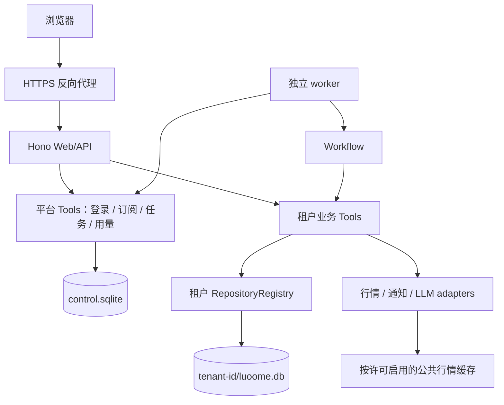

# 个人订阅托管版详细设计

> 状态：2026-10-13 原 Web 请求级融合、唯一默认账户及名称修改、订阅/通知设置页面已实现，并完成本轮隔离 fixture 浏览器验证。
> 原业务自动调度、通知投递汇总、统一配额计量及真实 provider 接入仍未完成；本轮验证不代表完整业务链路或生产服务已可用。
> 配套：[开发改造计划](../hosted-personal-subscription-development-plan.md)。
> 现有领域事实来源：[CONTEXT](../../CONTEXT.md)、[ARCHITECTURE](../ARCHITECTURE.md)、
> [SECURITY](../SECURITY.md)及当前代码；历史工程证据见[隔离验收记录](../archive/hosted-personal-subscription-fixture-acceptance.md)。

## 1. 设计结论与决策状态

### 1.1 用户确认的产品范围

1. 保留现有 Web 的页面、导航、技术栈和已实现功能，在其上增加登录、用户隔离与支付订阅；不重写成另一套精简应用。
2. 登录后的业务入口复用 `apps/web/public/index.html` 与 `createWebApp`，继续使用 Bun、Hono、原生 HTML/CSS/JS 和 Drizzle/SQLite。
3. `control.sqlite` 保存服务身份、会话、订阅、任务和用量；一用户一个 Tenant，私人业务事实使用独立 `luoome.db`。
4. 每个托管用户自动拥有且只拥有一个默认投资 Account；不提供新增账户或多账户切换，允许修改账户名称。User/Tenant/Account 仍是不同领域身份。
5. 现有自选、Strategy、AlertPlan、通知、持仓/手工记账、Advice、交易计划、报告、复盘、研究及 AI 对话均保留产品入口和既有语义，逐条完成托管隔离接线。
6. 登录采用邮箱验证码；订阅、个人通知与退出登录作为原设置页增量。支付首期为主动购买服务期，不自动扣款。
7. 产品授权保护租户归属、订阅权益、预算和副作用，不再以“事实模式”为由删除现有业务。真实 provider 未接入时明确显示未配置/不可用，不能伪造结果，也不能把实现缺口写成取消 AI/策略的产品决定。
8. 继续复用已有单节点 Web/API + 独立 worker、幂等任务、通知补偿、计量及备份恢复基础设施；平台库与业务库不承诺跨库原子事务。
9. 不新增自动证券交易、远程 MCP、团队或多市场功能。local 模式的多账户及其它既有行为不受托管版单账户约束影响。

本次范围明确替代此前 `hosted-facts-v1`、无投资账户、独立事实页面及分阶段恢复现有业务的方案。
旧代码或测试中这些名字只是已有实现/历史证据，不能继续作为新产品范围和完成标准。

### 1.2 工程状态与外部前置条件

| 项目 | 状态 | 处理方式 |
|---|---|---|
| 原 Web + 登录/隔离/订阅、唯一默认投资账户 | 用户已确认 | 本版实现与验收基线 |
| control/Tenant 存储、OTP、支付、队列、隐私与恢复基础设施 | 已有工程和隔离 fixture 证据 | 复用；融合后重跑受影响路径 |
| 原 Web 请求级融合、唯一默认账户及名称修改、订阅/通知设置页面 | 已实现，本轮隔离 fixture 浏览器验证通过 | 实际覆盖旅程见下文；不扩大为全部业务验收 |
| SSE 完成/客户端取消后的保存回调与 API 会话隔离 | 已补充自动测试并通过全量回归 | 保持流及后台活动的 runtime lease；真实模型流另行验收 |
| 原业务自动调度、通知投递汇总、统一配额计量 | 尚未完成 | 保留在本次范围内，继续补齐原业务执行链与恢复验收 |
| 数据与真实 LLM/邮件/支付 provider | 真实接入与相应验收未完成 | 分别记录能力状态，不用 fixture 代替生产数据 |
| 数据商用许可、运营及业务合规、正式条款 | 外部上线前置条件 | 针对实际保留功能评估；不凭文档改名视为通过 |
| 49/79/159 元候选价格 | 尚待验证 | 保持服务端版本化配置，不作为已批准收费标准 |

外部前置条件决定真实生产开放，不能据此擅自把已确认产品重写为另一套功能。

本轮验证记录（2026-10-12～13，未提交工作树）：

- 最终 `bun run test:all` 已通过 2,336 + 621 + 631 项测试（合计 3,588 项），包含 SSE 完成/客户端取消后的保存及 API 会话隔离回归；`typecheck`、`build`、`lint` 均通过，lint 为 82 条既有 warning、无 error。
- 隔离 fixture 浏览器已验证登录、A 用户创建自选、策略创建与静态校验、复盘读取、模拟订单创建/查单、通知设置保存/刷新、账户改名后新标签读取、跨标签退出、B 用户数据为空及手机设置页。
- 浏览器记录覆盖上述具体旅程；策略自动执行、原业务通知投递、真实支付/邮件/模型、完整计量与生产恢复仍分别需要实现或验收。历史事实版证据继续只代表其当时覆盖范围。

## 2. 当前实现基线与增量

当前已有本地完整业务 Web，以及旧事实托管方案的基础设施。下面区分可复用实现与本次必须补齐的整合。

| 现有实现 | 依据 | 本次改造 |
|---|---|---|
| 原 Web 页面和业务路由 | [index](../../apps/web/public/index.html)、[server](../../apps/web/src/server.ts) | 原路由挂入认证外壳；页面不另起一套 |
| 账户、持仓、交易、复盘契约 | [CONTEXT](../../CONTEXT.md)、[账户工具](../../packages/tools/src/tools/create-account.ts) | 自动唯一默认 Account、仅名称编辑、服务端绑定上下文 |
| Strategy、Watchlist、AlertPlan、报告和 AI | [tools registry](../../packages/tools/src/registry.ts)、[workflows](../../packages/workflows/src/index.ts) | 原功能保留，HTTP/子工具/后台任务均校验当前 Tenant 与订阅 |
| 托管身份、存储、支付及恢复工程 | [历史验收](../archive/hosted-personal-subscription-fixture-acceptance.md) | 保留既有证据范围；不可替代新业务融合验收 |
| 进程配置及部分任务持有共享 ctx | [server](../../apps/web/src/server.ts) | 请求级 context 桥接，SSE/后台执行持有 runtime lease |
| 模型/数据源/Vault/整库导入设置 | [运行手册](../runbooks/hosted-personal-subscription.md) | 管理员配置与租户偏好分离，不能让普通用户修改平台全局配置 |

### 2.1 必须保持的领域语义

- StrategySignal、Advice、TradingPlan、Trade 和用户反馈分别表达不同事实；租户化不合并身份。
- `Account.cashBalance` 及既有 ledger 事务仍是资金事实来源；不恢复 AccountSnapshot，不通过编辑账户绕过资金流水。
- 账户收盘报告等待预期策略及账户计划批次完成，18:00 未完成继续等待；不新增缺口截止版。
- Watchlist 保留 manual/strategy/ai/portfolio/import 多来源，Strategy → Watchlist 仍要求显式订阅；结束一个来源不误删其它有效来源。
- WatchTrigger 的试跑、边沿、当日重试与额度规则不变；复盘继续使用默认 Account 下的 DecisionReview 与不可变修订。
- Advice 保留依据、反证、风险、免责声明及有效期；历史反馈不是预测胜率。
- 建议与真实交易分离；不自动下单，`trade` 不进入 MCP/模型/通用 Web 路由，已完成成交仅走既有人工登记契约。

## 3. 既有 Web 融合与唯一默认账户

### 3.1 页面与功能保留矩阵

| 原业务面 | 托管版行为 | 必须补齐的接线/验收 |
|---|---|---|
| 看板、行情、自选、Strategy 工作台 | 保留原页面及已实现功能 | 当前 Tenant repos/adapters、参数归属、策略长任务隔离 |
| AlertPlan、通知、报告 | 保留原规则类型、配置与展示 | 按租户调度、通知目的地及预算、送达状态一致性 |
| 持仓、手工记账、绩效、复盘 | 使用自动默认 Account | 取消新增/切换；沿用 ledger、来源快照、显式反馈及原子成交关联 |
| Advice、TradingPlan、研究、AI 对话 | 保留入口及原业务契约 | SSE/草案确认/模型子工具均绑定 Tenant，真实模型未装配明确不可用 |
| 设置 | 在原页增加账户名称、订阅/订单/用量、个人通知与退出登录 | 平台密钥/行情源/Vault 路径不作为租户全局写入口 |
| 登录与付款 | 仅新增必要身份/购买界面 | 不替换原导航和业务页面，不强制先导入自选才能进入 |

`apps/web/public/hosted/` 中旧事实应用不再作为登录后的主应用。可复用必要登录资源和平台接口，
不能保留两个彼此脱节的业务首页。无数据页面沿用原 empty state，不注入样例持仓、假行情或虚构建议。

### 3.2 首次登录与默认投资账户

1. 验证邮箱，幂等建立 User/Tenant；provisioning 初始化私有库并调用内部 `ensure_default_account`。
2. 空库原子创建 `id=default-account`、名称“默认投资账户”、`kind=real`、`currency=CNY`、本金和现金均为 0。
   这是用户自己的空投资账本，不代表券商开户、入金、持仓或历史交易；不创建资金流水/持仓/Trade。
3. 已存在唯一账户时原样复用其 ID 和资金事实，不重置名称或余额；发现多个账户时停止自动迁移并保留数据，进入明确的人工核对状态。
4. 建账完成后才将 Tenant 标 active。已存在的旧无账户托管 Tenant 在可恢复初始化步骤中补齐；并发登录/重试始终只得到一个账户。
5. 进入原 Web 看板，原自选、策略、通知、复盘等入口立即可见；没有持仓不妨碍自选与策略研究。
6. 需要录持仓/成交时，按既有资金流水和 ledger 约束补齐真实资金；不能为了让导入成功自动增加本金或现金。

`default-account` 只在各自独立 Tenant DB 内唯一，不是跨用户共享账户。服务端从当前 Tenant 中解析并冻结
`defaultAccountId`；浏览器 header、body、localStorage 均不能选取另一个账户。hosted 的新增账户接口和
`create_account` 从服务端拒绝，账户切换入口移除；不能只隐藏按钮而保留绕行路径。

### 3.3 账户信息编辑

新增 `update_account` 为 write Tool：严格输入 `{ accountId?: string, name: string }`，只修改名称。
省略 ID 时使用服务端默认账户。v2 Tool 授权对输入中的非默认 `accountId` 返回
`permission_denied.required='hosted:default-account'`；Tool 内部防线对非默认 ID 返回 `not_found`。
账户选择 header 只在当前 Tenant 库中检查：不存在返回 `not_found`，存在但非默认账户则返回上述权限错误；不会查询其它租户。
本金、现金、币种、类型、创建时间均不接受此入口修改。资金变动、持仓纠错、成交仍通过已有专用 Tool
及原子 ledger 事务处理；不能直接保存一个整体 Account 对象覆盖余额。

local 继续允许现有多账户。`ensure_default_account` 是可信 hosted 初始化操作，不进入模型、MCP 或普通公共 Tool discovery。

### 3.4 请求、SSE、后台与设置复用

托管外壳负责 session/Origin/CSRF/订阅和租户生命周期，在通过校验后将请求交给原 `createWebApp`。
原 Web 每个请求使用不可变租户 context；不能共享一个可被其它请求改写的 `ctxRef.current`。
普通响应、流式响应、异步回调和后台任务在实际结束前都持有对应 runtime lease。

AI 聊天保留现有场景、读工具与用户确认草案，但它们使用当前 Tenant 及默认 Account；模型不能选择 tenantId，
也不能通过嵌套 Tool 绕过 write/external、订阅、资源归属或预算。模型能力未接入时以现有错误模型明确提示，
不得返回 mock 建议充当真实 AI，也不能把页面永久隐藏作为替代实现。

个人通知、显示偏好、账户名称和订阅信息属于租户设置。平台 LLM/数据源密钥、任意 Vault 路径、Git 凭据及
整库恢复属于部署/运营权限；保留设置页不等于向普通用户开放全局写权限。依赖这些配置的原业务页面仍可显示
真实能力状态。需要支持租户自带密钥或远程文件时另补隔离设计，不通过现有进程级 SettingsStore 直接接入。

### 3.5 既有导入、报告及反馈资产

- 保留原自选手工维护、多来源同步与 Strategy 显式订阅。旧托管 CSV 导入实现可作为原自选页面的增量，不能成为新主流程或替代策略来源。
- CSV 预览/提交的输入摘要、修订、requestId 与整批原子性继续有效；移除只结束明确选中的本人来源，保留其它来源及对应领域约束。
- 完整持仓 CSV 与本地整库迁云不因页面复用而自动完成；它们不是本次新增需求。既有持仓/手工成交能力必须保留，不得以导入后置为由一并禁用。
- 原 opening/closing/weekly 报告及默认账户 DecisionReview 是主报告/复盘契约。已实现 `watchlist-facts` 可保留为补充，不能取代账户报告；确定性摘要不限制原 AI/Advice 功能。
- 旧 `PersonalWatchFeedback` 属于此前无账户方案的存量实现，本版新交互复用 `set_watch_trigger_feedback`/DecisionReview。
  旧记录保留读取与导出，不能静默改写为账户采纳/收益事实；也不继续建立第二套复盘入口。
- 事实、财报、事件及历史回测继续遵守数据完整性和现有门禁；缺来源写 unavailable，不以恢复页面推定生产数据已齐备。

### 3.6 服务端权限边界

本版具名业务策略覆盖原 Web 实际使用的 Tool、专用路由、SSE、草案确认及 workflow 调用链，
不能沿用旧“仅两种价格规则/只读事实 DTO”白名单作为功能范围。新 Tool 仍需显式登记权限和预算。

| 调用类别 | 必须满足 |
|---|---|
| 本人业务读写 | 已验证用户、当前 Tenant/默认 Account、订阅策略、既有 sideEffect 与输入契约 |
| Strategy/报告/盯盘后台任务 | 可信 worker、服务端选择租户、持久任务与原领域 lease/fencing、提交前再核对身份和权益 |
| AI/SSE 与确认草案 | 固定租户 context、全生命周期 lease、现有工具边界、计量预算及人确认 |
| 账户创建/切换 | hosted 普通用户拒绝；内部默认账户初始化例外；local 保留原行为 |
| 平台配置、订单、会话和支付回调 | 独立 platform registry 与主体权限，不进入模型/MCP/generic discovery |
| 手工成交登记 | 既有专用人工入口与账本原子契约；不开放自动交易 |

## 4. 运行架构与模块边界



### 4.1 职责分配

| 包/目录 | 设计职责 |
|---|---|
| `packages/core` | User/Tenant/Session/Subscription/Job/Usage 的 schema、状态迁移、不变量和 repository/adapter 接口；零 IO |
| `packages/db` | 平台库与租户库的 Drizzle/memory 实现、原子仓储方法、迁移及 contract tests |
| `packages/adapters` | 验证码邮件、产品通知、支付协议、计量后的 LLM、备份存储等外部 IO；不依赖 tools/workflows |
| `packages/tools` | 平台 Tools、托管调用策略、租户业务入口及 ToolResult；不在 Web 复制权益、配额或导入业务逻辑 |
| `packages/workflows` | 复用策略、报告、盯盘、复盘及通知编排，只通过 `ctx.tools.*` 访问业务 |
| `apps/web` | HTTP/cookie/CSRF、静态 UI、上下文装配、状态码映射；不得直接改订单和业务表 |
| `apps/worker` | 常驻轮询、信号处理和依赖装配；通过平台 Tools 领取/完成任务并调用 workflow，首期无需其他新业务包 |

数据库、适配器和 runtime 的创建属于 composition root；数据库业务读写属于 Tool 调用的 repository 方法。
需要跨多个表的业务事务由单个仓储方法完成，不能在 workflow 中绕过 Tool 拼事务。

### 4.2 平台与业务调用上下文

拟在 core/tools 增加与 SDK 无关的区分联合：

```ts
type ExecutionIdentity =
  | { mode: 'local'; userId: string }
  | {
      mode: 'hosted';
      userId: string;
      tenantId: string;
      tenantGeneration: number;
      actor: 'user' | 'worker';
      requestId: string;
      operationId?: string;
    };
```

`HostedToolContext` 必须由服务端身份解析结果装配，包含冻结的 identity、产品策略版本、权益快照、
绑定的租户 repos/adapters。客户端不得提供这些字段。local 的既有默认值继续在 local composition 中使用；
hosted 缺身份、缺 Tenant 或 Tenant 未激活时拒绝，不回退到 local-user。

平台 Tool 使用独立 `PlatformContext`：控制库仓储、平台时钟、邮件/支付端口和可信调用主体。
匿名登录挑战、签名验证后的支付回调、用户及 worker 是不同主体；每个 Tool 声明允许的主体。
schema、ToolResult、审计脱敏机制复用；不把 control repos 放进普通模型可见的业务 ToolContext。
现有 `defineTool` 的 context 固定为 ToolContext；实现时抽出内部类型化执行器供 `defineTool` 与
`definePlatformTool` 复用校验/错误转译，保留旧入口签名。平台主体不伪造投资账户；两个 registry 的发现范围仍完全分离。

### 4.3 Tool 发现与产品策略

- 新增独立平台 registry，由专用 HTTP/worker 路由显式导入；不合并到现有 `toolRegistry`。
- 平台 Tools 不出现在 MCP、OpenAI schema、聊天工具表和 `/api/tools/:name/call`。
- 托管业务 `invokeHostedOperation` 位于 tools 包；Web 路由、worker、workflow 工具映射、模型入口统一经过它。
- 执行条件为：部署 write/external opt-in ∩ 产品白名单 ∩ 主体权限 ∩ 该操作的权益策略 ∩ 资源归属 ∩ 配额。
- 权益策略分收费业务、历史读取、隐私导出/删除、认证/账单维护。后三类不要求有效付费期，仍校验身份、
  租户状态、归属、产品范围和安全限流；历史读取只返回已保存结果，不隐式刷新行情、调用模型或补写业务缓存。
  会话维护/安全审计与导出产物写入属于显式平台操作，不混入业务只读语义。
- 首期白名单按具名 operation/version 管理，并覆盖参数限制与输出投影；不能简单暴露所有 read 工具。
- 新增 Tool 默认不进入 hosted 白名单。不能通过直接 `tool.execute`、原聊天路由或 workflow 旁路调用受限能力。
- 内部身份和支付操作的局部写入按 `write` 分类；访问邮件/支付 provider 同时要求 `external + write`。
  订阅支付不等于证券 Trade，不能为了复用接口将证券 trade 闸口放开。
- 用户计费以顶层 billable operation 为单位；workflow 子工具继承 operationId/reservationId，继续校验权限和执行预算，
  不重复预占产品额度。独立收费子任务必须预先具名声明并纳入接单前展示的预算，不能按内部 Tool 数量隐式追加收费。

## 5. 存储、隔离与生命周期

### 5.1 存储布局

```text
HOSTED_DATA_ROOT/
  control.sqlite
  tenants/<server-generated-tenant-id>/
    luoome.db
    identity.json          # owner、generation、schemaVersion
    vault/                 # 仅将来明确开放的受管研究文件
    exports/               # 带过期清理的导出产物
  worker-health-primary.json
  restore-review.json
HOSTED_DELETION_LEDGER_ROOT/ # 生产独立持久卷，不随旧业务备份回退
```

目录权限 0700、文件 0600；密钥通过部署 secret 注入，不随库导出。
Tenant 路径由服务器生成的 opaque ID 映射，拒绝用户路径、符号链接越界及任意 Vault/endpoint 设置。
所有 SQLite 文件位于同机持久盘，开启 WAL、busy timeout 和外键；不放 NFS，不让多节点共享文件。

这是应用层租户隔离，不是 OS/进程沙箱。Web/worker 的运行身份仍可访问挂载范围中的多个租户目录；
本方案不抵御进程被完全攻陷后的横向读取，首期禁止执行用户提交的任意代码。

私人库复用现有业务 schema；hosted 每个租户只有一个默认投资账户，local 多账户语义不变。
租户间即使存在相同 Account/Advice/Report ID，也落在不同库，任何查找都不得进行跨库 fallback。
控制库含用户联系信息，同样按私人数据保护，不能把“平台元数据”当作公开信息。

### 5.2 Runtime 管理

每个进程使用 `TenantRuntimeManager` 管理 `{ tenantId, generation, repos, adapters, close, refCount }`。
请求、后台任务、流式回调和 `onFinish` 在整个生命周期持有引用；释放后方可 LRU 回收，禁止关闭仍在使用的 DB。
每个请求由服务端绑定唯一默认账户，不能修改 runtime 的共享 `ctx.user.defaultAccountId`。
hosted 不提供账户选择；旧 `/api/account/select` 不能改变默认账户或创建其它账户，原业务兼容读取仅可返回已绑定身份。

需要清理的共享状态至少包括：聊天 runtime、Agent trace、评估/回测 Job Map、通知 manager、
报告/研究缓存、导出临时文件及模型设置热更新。租户缓存 key 必须含 tenantId 与数据修订。
允许共享的行情缓存只接受 provider/licenseScope/configVersion/证券/能力/日期/复权/版本等公共维度，
仅受控市场采集服务可写，不接受租户导入或私人 Tool 写入，不缓存持仓、提示词、报告或自选集合。

浏览器登出/换用户清除当前账户与私人页面状态；hosted 不读取 local 模式保存的账户选择，服务端默认账户为唯一依据。
服务端仍以会话与归属校验为准，不能因缓存 header 失效而选择别的账户。私人 HTTP 响应使用 `Cache-Control: no-store`。

### 5.3 建立 Tenant 与迁移

控制库原子创建 User、Tenant(`provisioning`)及 provisioning Job。worker 创建私有目录和数据库、
运行幂等迁移、确保唯一默认投资 Account 并写 tenant identity manifest，完成后才将 Tenant 设为 `active`。
进程崩溃后按同 tenantId 重试，核对 manifest；不能重新分配目录或将半成品开放给请求。

Tenant 状态为 `provisioning → active ↔ suspended → deleting → deleted`；provisioning 失败记录原因并可重试。
为每个库保存 schemaVersion；控制库启动和租户首次打开使用跨进程独占迁移活动，受共享写屏障保护。
迁移失败拒绝该 runtime，LRU 重开不重复 DDL；只有通过 manifest/版本检查的库才提供服务。
生产发布前需在停写窗口验证迁移并预热活跃租户，保留兼容镜像与备份；该真实发布演练尚未完成。

## 6. 身份认证与 HTTP 契约

### 6.1 邮箱验证码登录

- 邮箱作为首期登录标识，保留原始投递地址与规范化唯一键；不擅自删除 `+tag` 或点号。
- 验证码由加密安全随机源产生，6 位、5 分钟有效、最多验证 5 次；DB 存带服务端 secret 的 HMAC，不存明文。
- 发送冷却 60 秒；邮箱/IP/全站多层限流，初始邮箱每小时 5 次、每日 10 次，均为可调运营参数。
- 匿名请求返回相同结构，避免泄漏已注册邮箱；challengeId 为高熵随机值，验证码尝试计数和成功消耗原子更新。
- 验证成功生成至少 256 bit 随机会话 token，DB 只存 hash；轮换旧会话，防止 fixation。
- 并发验证按 emailKey 原子查找/创建 User；首次建立 Tenant 与 provisioning Job 同属 control 事务，不产生重复租户。
  尚在 provisioning 的会话只能读取初始化状态和退出，不能进入业务 API。重发同一用途验证码时旧 challenge 作废。
- cookie 使用 `__Host-luoome_session; Secure; HttpOnly; SameSite=Lax; Path=/`，不设 Domain，不把 token 放 localStorage。
- idle 7 天、absolute 30 天；登出立即撤销该会话，停用/删除用户撤销全部会话。
- 删除账户、改邮箱等敏感操作要求最近 10 分钟重新验证；首期不做密码和自行换邮箱，换邮箱流程后置。

验证码服务单独控制反滥用预算，不消耗订阅权益。出现异常流量时关闭注册或要求验证挑战，不能让邮件费用无上限。

### 6.2 请求保护

hosted 采用固定 `PUBLIC_ORIGIN`。除下面列举的匿名登录端点外，浏览器 mutation 必须满足已认证会话、匹配 Origin 与会话绑定 CSRF token；
无 Origin 的浏览器业务 mutation 同样拒绝。反向代理头只接受可信入口，不能用请求 Host/任意 forwarded header 推导可信源。
支付 webhook 和供应商投递回执走独立验签路径，不伪造浏览器 CSRF 豁免。
`/api/auth/challenges` 与 `/api/auth/sessions` 是明确列举的匿名入口，检查固定 Origin、Content-Type、challenge 与限流，
不要求已存在登录 session。登录成功创建会话绑定的 CSRF token，通过同源 `GET /api/me` 返回；不返回 session token。
读取端点也鉴权；导出、流、附件、Job 状态和错误响应同样检查身份。

### 6.3 HTTP 端点与权限

身份、订阅、隐私等平台端点由 v2 外壳提供，业务端点复用原 Web。下列三条 CSV 导入/来源移除端点
仅在历史 `hosted-facts-v1` 分支实现，尚未融合到 v2 原自选页面，不能作为 v2 已交付接口调用。

| HTTP | 输入摘要 | 主体/结果 |
|---|---|---|
| `POST /api/auth/challenges` | email | 匿名受限；通用确认、challengeId |
| `POST /api/auth/sessions` | challengeId/code/acceptTerms | 单次消费；Set-Cookie，不回传 token；开发告知不是正式法律同意 |
| `DELETE /api/auth/session` | CSRF | 当前会话；撤销并清 cookie |
| `GET /api/me` | 无 | 当前 User/Tenant 状态、权限摘要、偏好、会话绑定 CSRF token |
| `GET /api/subscription`、`GET /api/usage` | 无 | 当前租户订阅、用量和周期 |
| `POST /api/subscription/orders` | planVersionId/requestId | 服务器定价，生成待支付订单 |
| `POST /api/webhooks/payment` | 原始签名载荷 | 固定配置 provider 验签；持久事件后返回结果，真实渠道 ACK 待验收 |
| `POST /api/watchlists/:id/import/preview` | CSV/文本 | 仅历史 v1；规范化预览，不提交成员；v2 待融合 |
| `POST /api/watchlists/import/commit` | previewId/hash/修订/requestId | 仅历史 v1；幂等提交；v2 待融合 |
| `POST /api/watchlists/:id/members/remove` | stockIds/requestId | 仅历史 v1；受控结束本人来源；v2 待融合 |
| 既有 Trigger/DecisionReview 反馈端点 | 既有反馈/版本/requestId 契约 | 当前 Tenant 的默认 Account；保留原复盘页面 |
| 既有账户信息读取 / `update_account` Tool | 可选 accountId、name | 默认账户，仅修改名称；新增/切换账户拒绝 |
| `POST /api/jobs` | operation/version/input/requestId | 白名单操作；202 + 私有任务 DTO |
| `GET /api/jobs/:id`、`POST /api/jobs/:id/cancel` | id | 当前租户；状态/尽力取消 |
| `GET/PUT /api/notifications/preferences` | 安静时段/邮箱开关/修订 | 当前用户；只绑定已验证地址 |
| `POST /api/data/exports`、`GET /api/data/exports/:id`、`GET /api/data/exports/:id/download` | requestId/id | 当前租户；异步产物与再次鉴权下载 |
| `POST /api/me/deletion` | 再验证、显式确认/requestId | 当前用户；进入删除流程 |

所有 JSON 业务端点返回既有 ToolResult；HTTP 另映射 400/401/403/404/409/429/503。
复用现有 `invalid_input`、`permission_denied`、`not_found`、`adapter_error` 等 kind，不新增订阅专用错误 kind。
例如额度不足返回 `permission_denied.required='entitlement:research-credit'`；速率限制返回 429 与 Retry-After。
跨租户业务对象查询返回 `not_found`；非默认账户选择由外层权限检查统一拒绝，见 §3.3。
两类错误均不得透露其他租户对象是否存在。支付 provider ACK 是传输协议例外，由 adapter 映射内部结果。

## 7. 平台数据模型与仓储事务

下表字段是实现契约，不要求一个实体对应一个仓储类；按原子边界分组。所有金额用整数分，成本更细粒度使用整数微元，时间存 UTC。

| 实体 | 关键字段/唯一约束 | 不变量 |
|---|---|---|
| User | id、emailKey(unique)、verifiedAt、status | 未验证邮箱不能建立已认证身份 |
| Tenant | id、ownerUserId(unique)、status、generation、schemaVersion | 一用户一租户；删除后身份不复用 |
| AuthChallenge / Session | challengeId、digest、attempts、expiresAt；tokenHash(unique)、userId、idle/absolute expiry | 验证码原子单次消耗；失效会话不能恢复 |
| PlanVersion | id、code、currency、priceMinor、duration、limits、productPolicyVersion | 发布版本不可变；订单保存购买快照 |
| SubscriptionPeriod | id、tenantId、planVersionId、startsAt、endsAt、sourceOrderId(unique)、status | 已付款期段不因重复事件延长两次 |
| Order | id、tenantId、requestId、payloadHash、amount/currency、providerOrderId、status | unique(tenantId, requestId)，金额由服务端计算 |
| PaymentAttempt | merchantOrderId、merchantId、providerTransactionId、amount/currency、status | unique(provider,merchantId,providerTransactionId)；同一实付仅绑定一个 Order |
| PaymentEvent / Refund | provider、eventId、payloadDigest、verification、processedAt；refundId、amount、status | provider+eventId 唯一；退款累计不超过实付 |
| HostedJob | id、tenantId、generation、operationId、kind/version、payloadRef/hash、state、attempt、availableAt、lease/fence、resultRef | operation 唯一；不接受客户端 tenantId 或任意 toolName |
| UsageReservation | operationId、tenantId、periodId、units、budgetMicro、state | 原子检查余额并预占；同 operation 不重复预占 |
| UsageEntry | entryId、operationId、metric、delta、reason、revision | 追加流水；修正用反向记录，不改历史 |
| ProviderAttempt | operationId/step/attempt、provider、model、usageState、reserved/estimated/confirmedCostMicro、pricingVersion | 成本未知写 unknown，不填 0，不把估计当实付 |
| DeliveryIntent | tenantId、businessKey、channel、bindingVersion、state、attempt、providerMessageId | unique(tenantId,businessKey,channel)，投递与报告生成分离 |
| TenantOperationReceipt | tenant DB：operationId(unique)、inputHash、resultRef/hash、committedAt | 与对应业务写入同事务；不把私人正文存 control.sqlite |
| TenantExecutionRequest / Lease | tenant DB：operationId、input/hash、generation；operationId、fence、attemptId、expiresAt | 输入先持久再入队；提交检查租户本地 fence，不能只查 control lease |
| TenantOutbox / PlatformInbox | eventId、operationId、resultRef、notificationPolicyVersion/businessKey；eventId(unique) | 结果与 outbox 同事务；消费/结算/投递意图同事务去重 |
| TenantScheduleIndex | control：tenantId、operation、businessId、nextRunAt、enabled、revision | 仅调度投影，租户领域配置为事实；outbox 更新并周期核对 |

推荐平台仓储边界：AuthRepository、TenantRepository、SubscriptionRepository、JobUsageRepository、
DeliveryRepository。TenantOperationReceipt 由租户业务事务组合使用；不能先写业务再另写“成功回执”。
每个新增 repository 均提供 Drizzle 与 memory 双实现，复用 contract tests。

必须提供的原子方法包括：

- `consumeChallengeAndCreateSession`：挑战消费、User 查找/创建、首次 Tenant/provisioning Job 和会话建立在 control 同事务；不因并发验证重复成功。
- `applyVerifiedPaymentEvent`：事件去重、订单结算和订阅期段/待处理状态更新。
- `prepareReservedJob` / `activatePreparedJob`：先在 control 原子复核权益、预占并建 preparing Job；租户输入持久后再入队。
- `claimJob` / `finishJobAndSettle`：带 fence 的领取；Inbox 去重、Job 终态、额度结算和应发送 DeliveryIntent 在 control DB 同事务。
- `commitWatchlistImport` / `commitFactsReport`：租户业务结果与 operation receipt 同事务。

跨库只通过 operationId、不可变摘要及对账关联，没有跨文件分布式事务。

## 8. 订阅、支付与到期

### 8.1 首期收费行为

首期为用户主动购买的月度服务期，不开通自动扣款。试用期由服务端一次性授予；不可反复注销注册领取无限试用。
候选价格只用于运营配置，订单与 PlanVersion 持久化实际购买内容。月付按购买起点的日历月计算，
不存在的日取该月末，保留原购买日作为后续周期锚点（例如 1 月 31 日 → 2 月末 → 3 月 31 日），使用 Asia/Shanghai 计算边界后转 UTC。
授予期段时在 control 事务中读取有效及预购期段的末尾，新起点取“系统确认付款并实际开通的时刻”与该末尾的较晚者。
已过期重新购买从本次开通算起，迟到付款不消耗用户尚未获得服务的过去时间；并发付款串行计算期段，避免覆盖或重叠。
首期不做中途升降档与按比例补差价，换套餐从下一周期生效；已有权益不因产品改价被追溯更改。

订单状态：`created → pending → paid | closed`。退款是独立流水，不把 `paid` 改回未支付。
期段状态：`trial | paid | expired | revoked`；用户停用、风控 suspended 与订阅到期分别处理。

### 8.2 支付一致性

1. 用户创建订单时服务端读取 PlanVersion，校验人民币金额、币种、商户和用户；客户端金额无效。
2. 支付 adapter 使用稳定商户订单号创建支付请求；创建超时记 outcome unknown，先查单，不能换订单号再次扣费。
3. webhook 验证原始字节签名、时间/防重放字段及商户身份，再交平台 Tool。
4. 持久 PaymentEvent，按 eventId 去重；再按 provider/merchantId/providerTransactionId 核实付款事实唯一归属。
   webhook、主动查单与对账进入同一个事实应用方法；不同 eventId 不能令同一实付开通两次。
   收到矛盾事件或乱序状态时查 provider，不能用“最后收到的事件”覆盖 paid。
5. `paid` 与 SubscriptionPeriod 创建在 control DB 一次事务完成；唯一 sourceOrderId 防止重复续期。
6. 用户页面跳回“支付成功”只触发查询，不授予权益；定时对账补偿丢失 webhook。
7. 已关闭订单晚到付款进入 reconciliation。仅 Tenant 仍可服务且订单未退款/撤销时，可按确认结果授予原约定套餐或退款。
   deleting/deleted/suspended 租户只更新必要财务事实并进入退款/人工对账，不自动激活、建目录或恢复任务。
   退款先到、paid 后到时按 provider 权威状态合并；迟到 paid 不重新开通 refunded/revoked 期段。

退款请求使用独立 refundId 幂等，先请求、后按确认事件结算；未知结果先查询。
发起前在 control 事务预占可退款金额：已确认退款与 submitted/processing/unknown 占用之和不得超过实付。
只有确认失败或明确未受理才能释放占用；退款成功时在同事务记流水和调整对应权益，禁止并发退款超退。
首期用户通过客服申请，管理员用审计操作发起。退款比例与已使用服务处理属于运营条款，
上线前确定；工程必须支持部分/全额状态和对应权益撤回，禁止用删订单代替退款。
控制库只留必要交易标识与金额，不保存银行卡等支付凭据。

### 8.3 到期与取消体验

试用/付费期结束后停止新建收费任务、自动报告与收费通知；未开始的排队任务取消并释放预占。
已开始任务可在接单时冻结的预算和截止时间内完成，期间不能扩大范围；每个昂贵步骤复核该接单授权及租户未停用/删除。
到期后的研究通知停止，已完成业务结果保留并按原周期结算，不因为到期删除历史。
到期后提供 30 天只读与导出窗口，此为待运营条款确认的默认保留期；到期本身不立即删除，
保留期届满前通知用户，随后按事先公布的保留规则清理。安全/隐私数据导出不要求有效订阅。
用户关闭自动服务只停止任务，不自动触发退款；不提供含糊的“取消订阅”自动扣款按钮，因为首期没有自动扣款。

## 9. 用量、成本与跨库恢复

### 9.1 分开三类事实

1. 业务是否完成：以租户业务结果和 receipt 为准。
2. 用户是否消耗套餐额度：以 UsageEntry 为准。
3. 平台实际支付了多少 provider 成本：以 ProviderAttempt 和对账结果为准。

`ToolResult.ok`、WorkflowRun 成功、邮件渠道受理或生成 token 数都不能单独代替上述三者。
失败任务可能已产生平台成本，但没有可用结果时默认释放用户研究额度；此损耗属于平台成本。
获得可用的 partial 报告是否计额度按版本化产品规则确定，并在运行前展示。

### 9.2 执行顺序与恢复表

采用以下可恢复的分步协议：

1. control 事务复核权益、请求 hash、额度，创建 `preparing` Job 和 held reservation。
2. tenant 事务持久化 ExecutionRequest，operationId 唯一；control 只留输入引用/hash，不保存完整私人输入。
3. control 核实输入存在后转 queued。输入已持久化时恢复步骤 3；尚未持久化时等待客户端以相同 requestId/hash
   重传后补步骤 2，或 preparing 超时取消并释放。worker 不能根据 hash/ref 恢复不存在的私人输入。
   服务端调度输入则从版本化领域配置重新取得并核对 hash，版本不符时取消旧 preparing，建立新 operation。
4. worker 领取 control lease 后先查 tenant receipt；有结果直接恢复结算，没有结果才领取 tenant 本地执行 lease/fence。
5. tenant 在同一事务校验本地 fence/generation，提交业务结果、唯一 receipt 与结果 Outbox（含通知策略、businessKey、resultRef）。
6. control 消费结果事件，在同一事务完成 Inbox 去重、Job 终态、额度结算与应发送 DeliveryIntent 创建。
7. 确认 tenant Outbox 已送达。此步失败只会重复传递，control Inbox 保证不重复结算或创建意图。

control lease 与 tenant 本地 fence 不具备跨库原子性。新 fence 写入 tenant 前，旧 worker 的合法唯一提交可能已经完成，
新 worker 必须复用该 receipt；新 fence 生效后旧提交被拒绝。不能只凭平台租约过期就再次调用 provider。
平台领取/完成 Job 与用户结果完成是独立状态；租户已提交但平台未结算时显示“结果已完成，用量同步中”。

| 中断位置 | 恢复行为 |
|---|---|
| control 已预占，尚未执行 | 租约恢复后同 operation 重试；过期/取消则释放 |
| tenant 结果已提交，control 未结算 | 读取同 operation receipt，只补结算，不再执行业务 |
| control 已结算，HTTP 应答丢失 | 同 requestId 返回原 Job/回执，不重复扣额度 |
| 结果 Outbox/平台 ACK 传递中断 | 重放相同 eventId；结算事务同时建立通知意图，不丢通知 |
| provider 已接受请求，本地未取得结果 | attempt=unknown，预留最坏预算并查单/对账；不直接将成本记 0 |
| 租约到期，旧 worker 迟到 | control 更新拒绝旧 fence；tenant 提交检查本地 fence/唯一 receipt，平台 lease 不能代替它 |
| 结果已生成，通知失败 | 只重试 DeliveryIntent，不重跑报告、不重新扣研究额度 |
| 预占跨越订阅周期 | 结算回原 reservation.periodId，不转扣新周期 |

只有已经具备幂等提交与恢复契约的 operation 才能进入自动重试白名单。
对未提供幂等/提交 fencing 的旧写操作、人工成交或外部未知结果进入 `needs-review`，不得由通用 worker 盲重放。
已具备 receipt 的报告/import 通过唯一键保证业务只提交一次；并发旧 worker 可能已经产生额外 provider 成本，
这必须计入 attempt，不宣称外部调用 exactly-once。

用户额度预占与平台风险预算分开超时。初始用户接单截止时间建议 15 分钟：确认没有成功 receipt 且执行已停止/被 fencing 后，
将 operation 标为不再计费终态并释放用户额度；仍未知的 provider 成本继续保留独立对账。
无法核实 receipt 时进入需人工核对状态并告知用户，不能把“control 尚未成功”直接当作无结果。
`capture` 只接受 held，released 不能恢复 captured；超时释放后的迟到结果只审计或免费交付，不追扣用户。
已提交结果但结算故障属于结算补偿，不走无结果超时释放。人工核对必须有告警及运营处理时限，不能无限冻结用户额度。

### 9.3 配额与硬预算

套餐同时限制关注数量、规则数、每日任务数、用户并发和研究额度；资源数量检查与创建在租户事务内完成，
并发创建不能超卖额度。控制库订阅变更通过版本号传入，操作开始及昂贵步骤重新验证。
关注数量按该租户所有未归档成员中存在有效来源的 distinct stockId 计算；同股跨列表不重复计数，
只有不再被任何列表有效关注才释放股票额度。规则数按启用的 AlertRule 条数计算，历史触发不占规则数，
但仍受存储保留政策约束；日报/手工刷新等任务限额另计，关闭再开启不能重置每日用量。
当前 worker 串行执行，全局并发为 1，首期每节点只运行一个 worker，与运行手册一致。
全局并发 4、每租户重任务并发 1、每租户排队上限 20 是后续实现和压测的候选参数，不代表当前并发能力或容量承诺。

LLM 是本版保留能力：托管真实模型接入时，每次调用限制输入大小、最大输出、步数、超时和 provider 并发；在步骤开始前预留该步预算。
当前 Agent 的 step 后 token 软限制不能当硬预算。补充 core 中的 usage observer 接口，adapter 上报模型、
计费输入/缓存输入/输出、pricingVersion 和已知/未知状态；业务 `generate<T>` 的领域输出保持兼容。
未知 usage 不可沿用现有投影中的 0，必须明确 unknown；reserved/estimated/confirmed cost 分开，
未知时以最坏估计占用平台预算，对账后用修正流水确认真实成本，不能把估计写成实付。
每次 SDK 重试、fallback 与输出修复都需可观察 attempt；无法观测的内部重试应关闭或改为受控封装。
实际供应商价格和用户套餐额度是两套版本，不能把实时 token 价格直接变成用户事后账单。

## 10. 调度与通知

### 10.1 持久任务

HostedJob 状态：`preparing → queued → running → succeeded | partial | failed | cancelled | needs-review`，
可重试错误回 `queued` 并增加 attempt/availableAt。租约建议 120 秒，每 30 秒续约；阈值按实测修订。
取消为请求状态，worker 在安全边界停止；正在提交的原子事务允许结束，不能向用户声称已经回滚。

采用按租户轮转的公平领取，区分 due alert 与低优先级研究任务，避免回测阻塞日常报告。
任务种类与版本由服务端枚举，payload 只保存必要参数；私人正文存 tenant DB，只保存引用。
去重键包括 tenantId、operation、业务周期/输入指纹。tick 只入队，不能在每个 Web 实例启动一套同样的租户扫描。
TenantScheduleIndex 由租户配置 outbox 更新并周期对账；索引只用于选取到期租户，执行仍核对原配置，
避免常驻打开所有租户库。任务优先级包含保底份额与等待老化，provider 限流还须覆盖任务内部的行情 fan-out。

hosted Web 禁止自动启动现有四类 scheduler；由 worker 调平台 Tool 与允许的 workflow。
local 的原 scheduler 装配保持不变。StrategySchedule 与盯盘的领域租约继续保留；
hosted 平台租约负责资源分配，两层作用不可替换。
现有策略、账户计划、绩效、报告、观察补全和历史评估任务属于本次融合范围，逐项补 Tenant context、默认 Account、租约与恢复接线。
原功能尚未接通的任务必须标为本次待实现/未验收，不能写成产品取消或后续再开放；不得通过共享进程上下文临时绕过隔离。

### 10.2 通知状态与隐私

结果/Trigger 与通知 outbox 在 tenant 同事务提交；control 幂等消费时建立 DeliveryIntent，和生成任务分离。
状态为 `pending/sending/accepted/failed/unknown/suppressed`；
accepted 只代表 provider 受理，只有可信回执才增加 deliveredAt，不表述为用户已看到。

收件地址只来自验证后的用户绑定，不能由普通通知请求随意指定。改绑定递增 bindingVersion，旧 intent 在发送前重检。
发件内容默认只含“有新的摘要/提醒”和站内鉴权链接，用户显式选择后才允许更详细摘要；不含持仓金额或完整私人笔记。
首发安静时段建议 22:00–08:00 上海时间，可配置；验证码及安全通知不受营销/报告订阅开关控制。

provider 支持幂等键时使用 DeliveryIntent ID；不支持时，发送成功但状态保存失败记 unknown，
优先查 provider，不盲重发。无法查证时站内记录仍可用，交给用户手工重发，不宣称 exactly-once。
WatchTrigger 沿用既有最多三次、当日与冷却/额度资格，邮件适配不能外套一层导致九次重试。
普通日报最多三次、退避 1/5 分钟，超过业务有效窗口直接 suppressed；日报与安全邮件采用不同额度桶。

所有日志只保留 tenant opaque ID、业务引用、状态与错误类别；hosted 禁用记录完整 payload.content 的 log fallback。
渠道故障显示“站内已保存、邮件未受理/状态待确认”，不能当作成功通知。
通知 schema 当前渠道仅 feishu/log；实现须同步扩展 email、验证目的地、偏好与 provider 回执模型、双仓储和 Tool，
不能只在 adapter 增加发信函数。通用 `send_notification` 的任意正文/收件人能力不向公网开放。

## 11. 导出、删除、密钥与运营访问

导出由专用 Tool 读取当前 tenant DB 的允许类别，排除会话、控制库、平台密钥及受授权限制的市场原始数据。
按 operation 生成私有产物，鉴权下载，默认 24 小时失效；文件 URL 不含服务器路径。
首期使用应用鉴权下载，不公开对象存储 bucket，也不接受用户指定导出目的地。

删除流程：重新验证 → Tenant 标 deleting 并增 generation → 撤销全部 session → 停止领取新 Job、
撤销排队任务和通知 → 取消/排空活跃任务与流 → 关闭所有 runtime → 清理 DB/Vault/exports → 写删除 tombstone。
worker 在领取、昂贵步骤和投递前复查 generation；不得在删除后由旧 provisioning/retry 重建目录。
删除的线性化完成点是所有租户执行已排空且私有文件已清除；删除开始前已提交 provider 的请求无法追回，
必须在状态页说明处理中，不宣称立即撤回已发邮件或第三方已接收内容。
跨进程排空失败时保持 deleting 并报警，不能先删文件再让进程继续写。
账号删除还需清理或匿名化 control 中的邮箱、目的地/偏好、验证码/会话、私人任务输入引用、导出与个人反馈投影；
不能只删除 tenant 文件。依法保留的财务字段单独列入保留清单；tombstone 只保留 opaque 身份与删除时间。
如为防重复试用保留邮箱派生标识，必须明确目的、期限与访问范围，使用密钥摘要而非永久保留完整邮箱，
具体期限由运营条款确认。该例外不允许继续给已删除用户发研究通知。

备份按保留期自然淘汰，恢复时先应用独立保存的删除 tombstone 再启动服务，避免旧备份复活已删数据。
订单及必要财务审计按适用保留义务最小化保留，和私人投资正文分离；具体期限在运营条款确认。
客服默认只能查看状态、金额、错误类别和任务引用；首期没有“以用户身份登录”功能。
如确需访问私人内容，由明确授权的独立支持流程完成并留痕，不进入普通管理页面。

## 12. 部署、备份与服务目标

### 12.1 最小生产拓扑

- HTTPS 入口仅开放 443；Bun Web 端口、worker、SQLite 和管理入口不向公网开放。
- Web/worker 使用同版本不可变镜像，非 root 运行；仅挂载必要持久目录，密钥经独立 secret 配置。
- 提供 Dockerfile/Compose、生产配置示例、健康检查、进程重启及优雅退出；固定依赖与 Bun 版本。
- `mode=hosted` 缺 PUBLIC_ORIGIN、控制库、密钥或产品策略时启动失败，不能自动进入 local。
- hosted 只读取显式部署配置，不自动加载用户 home 或仓库 `.env` 的容错路径；local 保持原配置行为。
- 活跃租户读写只发生在该节点；单节点故障依赖恢复，不承诺高可用或自动多节点故障转移。
- 外部 URL、研究 Git 和用户自定义 LLM endpoint 在托管版首期禁用；已有可信 provider 也限制出口目标和请求体。

### 12.2 备份与升级

SQLite 导出 JSON 不是一致性备份。使用 SQLite 支持的在线 backup API 或受控停写快照，不直接复制活跃 `.db` 忽略 WAL。
备份包括 control、按保留政策仍应存在的所有 tenant 数据、受管文件、schema/app 版本和校验 manifest；
包括 suspended、到期只读与未完成删除的数据，provisioning 半成品注明状态；密钥另行备份且访问隔离。
首期每小时建立恢复集：使用覆盖 Web/worker 所有持久写入口的维护屏障，阻止新写并排空活动事务，
涵盖同步导入、偏好、会话续期、Job、持久缓存及 provider 回调。冻结期间生成各库/文件快照 manifest，完成后恢复服务。
支付/投递回调在屏障期间返回 provider 可重试响应，不能 ACK 成功却未持久化；主动查单补偿遗漏。
在线 backup API 只保证单库一致性，不能代替上述跨库恢复点。冻结产物随后上传加密异机备份；
RPO 按最近完成异机恢复集的时间计算，上传延迟计入；无法达到目标须调整周期/增量方案，不能隐藏放宽 RPO。
保留 7 天小时备份、30 天日备份为初始参数；原始数据保留受授权与用户条款共同约束。

恢复到新目录，验证 manifest/完整性/迁移版本/删除 tombstone；重新核对未终态支付、预占、业务 receipt 与通知 unknown。
开放 HTTP 前撤销恢复集中的全部 Session/AuthChallenge，强制重新登录，旧 cookie 不得因恢复被重新接受。
对账完成前暂停收费任务和外部投递。不能仅把 Job 全改 queued 后重跑。
数据库升级前备份，采用可兼容的增量迁移；旧版本不能读取新 schema 时走数据恢复或前滚，不直接切回旧二进制。

### 12.3 内部目标与首发容量验收

| 指标 | 初始内部目标 | 测量方法 |
|---|---|---|
| 恢复点/恢复时间 | RPO ≤ 1 小时，RTO ≤ 4 小时 | 隔离环境恢复演练，含对账时间 |
| 普通鉴权读取 | P95 ≤ 1 秒 | 不含行情刷新/AI，30 并发用户模型 |
| 已到期任务启动延迟 | P95 ≤ 60 秒 | 100 个 tenant、每个 50 自选、10 条规则场景；provider 配额不足时拒绝该容量结论 |
| 首份摘要 | 已有可用缓存时 P95 ≤ 60 秒 | 从提交确认到结果持久化；缺数据单列 |
| 初始可用性 | 目标 99.5%，不作为销售 SLA | 独立外部探针，维护及故障均记录 |
| 通知 | 按 accepted/delivered 分别统计 | 不用“请求成功”替代设备到达 |

所有数值为待验证目标，不是当前能力。负载测试同时检查 DB 锁等待、文件句柄、磁盘水位、任务排队、
供应商限速及每用户成本；基于真实 provider 配额与测试证据确定实际开放人数。
监控复用 WorkflowRun/现有可靠性事实，增加 request/tenant/operation 关联、Job lag、失败率、unknown 成本、
备份年龄和支付对账积压。告警正文不含投资数据、邮箱验证码或密钥。

## 13. 分阶段文件与契约改造映射

| 改造面 | 主要落点 | 同步要求 |
|---|---|---|
| 平台实体/契约 | core 拟新增 hosted 子目录，沿用 entity/repository 模式 | Zod、类型、不变量与导出 |
| 平台库/租户迁移 | db client、schema、drizzle/memory repository | ensureSchema/DDL/版本锁/contract tests |
| 身份与授权 | tools context、独立平台 registry、hosted invoker | 所有 Web、workflow、Agent 调用路径审计 |
| Web 入口/配置 | server.ts、ai/market/feishu/research settings、data-transfer | local/hosted 明确装配分支，禁止全局身份 mutate |
| 异步执行 | apps/worker、平台 Job Tools、现有 scheduler | HostedJob 持久化；local 调度回归 |
| 原页面与默认账户 | public/index.html、createWebApp 桥接、ensure_default_account/update_account | 页面不重写、唯一账户、原业务/SSE/后台隔离、实际浏览器验收 |
| 通知/计量/支付 | adapters 与 core 端口 | fake adapter + 真实 sandbox 契约测试；不提交凭证 |
| 交付与运行 | 拟新增部署文件及上线时 runbook | 构建产物、迁移/回退、恢复、监控验证 |

基础设施落点为 core/db/adapters 的 `hosted/`、tools 的 `platform/hosted/`、Web 的 `hosted-*`、
`apps/worker` 及 `deploy/hosted`；原业务继续以 `public/index.html`、`server.ts` 与已有 Tools/Workflows 为事实来源。
原 Web 请求级融合、唯一默认账户及名称修改、订阅/通知设置页面已实现；本轮测试与隔离 fixture 浏览器覆盖范围见 §1.2。
原业务自动调度、通知投递汇总、统一配额计量及真实 provider 接入仍未完成；完整业务、正式条款、生产恢复和邀请用户验收仍待执行。
旧事实方案 fixture 只证明其当时覆盖的基础设施与流程，不替代本轮或后续验收。

## 14. 验收矩阵

| 编号 | 场景 | 必须断言 |
|---|---|---|
| A01 | A/B 用户使用相同对象 ID、伪造账户头 | 读取/写入/导出/错误均不泄漏；越权对象 not_found，非默认账户选择按 §3.3 拒绝 |
| A02 | 双用户/双标签/SSE结束回调、runtime LRU | 默认账户不漂移；流和后台完成前不释放 DB；无新增/切换入口 |
| A03 | 重放验证码、并发验证、会话撤销 | 验证码只成功一次；旧 session 立即失效 |
| A04 | 缺 Origin/跨站 CSRF/伪造 Host | hosted 拒绝；合法 webhook 仍独立验签 |
| A05 | 原业务专用/generic/SSE/草案/workflow 入口 | 本人功能保留，跨租户和平台权限拒绝；允许本人 Advice 不等于允许跨用户读取 |
| A06 | 首次/并发登录、旧零/一/多账户租户 | 空库仅建一个0本金0现金默认账户；唯一账户原样复用；多账户异常不擅删改 |
| A07 | 重复导入、移除后重新导入、并发达到资源上限 | 来源生命周期正确；停止对应提醒并释放额度；不超套餐数量 |
| A08 | 行情缺失、retrieval 时间、陈旧数据 | 标缺口；不把获取时间冒充可信行情时间 |
| A09 | 生成自选摘要与账户收盘报告并存 | kind/scope 分离；不修改 closing 等待与版本规则 |
| A10 | 支付重复/乱序/晚到/回跳伪造、过期续费 | 同一渠道实付仅绑定一订单；一次授予且起点正确 |
| A11 | 并发/部分/全额退款与超时、退款先到 | 预占不超实付；unknown 查单；迟到 paid 不重新授予 |
| A12 | 两任务同时消耗最后额度 | 仅一个预占成功；流水可重放核对 |
| A13 | tenant commit 后杀进程、control settle 后断连 | 恢复读 receipt；不重写业务、不重复扣费 |
| A14 | provider 消耗成功但返回/usage 丢失 | 成本 unknown；不伪造 0；不无限重试 |
| A15 | 租约失效旧 worker 迟到 | 旧 fence 不改 Job；业务提交受原子幂等/领域租约保护 |
| A16 | 通知已发但存状态失败 | unknown/查询；无通用盲重发；不重生成报告 |
| A17 | 订阅到期、撤销绑定、Tenant 删除与任务/支付竞态 | 停新任务/投递；历史读不产生刷新成本；control PII 清理；删除后不重建 |
| A18 | 快照时并发同步写/回调，恢复旧删除/登出用户与未终态事务 | 屏障覆盖全部写；tombstone 生效、旧 cookie 拒绝；对账后恢复外发 |
| A19 | 100 tenant 混合负载与一个超重用户 | 公平领取、预算不突破、句柄与内存有界 |
| A20 | local CLI/TUI/MCP/Web 完整回归 | 本地不强制登录；trade 硬卡与既有领域行为不变 |
| A21 | 默认账户下原 Trigger/Advice/计划复盘 | 复用 DecisionReview；修订与成交关联原子；旧 PersonalWatchFeedback 不自动转成采纳事实 |
| A22 | 账户名称编辑及新增/切换绕行 | 仅改name；本金/现金/币种不被覆盖；伪造ID拒绝；local多账户回归 |
| A23 | 登录后完整原Web导航与页面 | 复用原index/页面；自选、Strategy、通知、复盘等可访问；订阅/退出仅原设置页增量 |
| A24 | 真实模型缺失、SSE及策略后台 | 明确未配置而非mock成功；真实接入另验；后台Tenant隔离与默认账户正确 |

实现阶段按改动范围执行 `bun run test`、`test:db`、`test:web`、`typecheck`、`lint`、`build`；
DB/Web 测试使用 Bun；UI 必须启动后做真实浏览器验收。fixture 不能替代真实支付 sandbox、邮件投递、恢复与容量验证。

## 15. 外部依据与未完成事项

本节引用为 2026-10-09 商业化调研依据；具体适用范围与签约报价须在上线前再次核对：

- [证监局引用的证券投资顾问软件相关规定](https://www.csrc.gov.cn/jiangsu/c105409/c7577565/content.shtml)：功能本身决定业务评估范围，免责声明不替代资质与流程。
- [Tushare 服务协议](https://tushare.pro/document/1?doc_id=405)：当前标准许可存在个人非商业用途限制；不据此推定已获得商用许可。
- [互联网信息服务管理办法](https://sdca.miit.gov.cn/zwgk/fgbz/art/2026/art_fea940f81f1d423e87101adf147ab979.html)：运营主体及许可/备案路径须按实际服务核对。
- [网信办生成式 AI 备案/登记公告](https://www.cac.gov.cn/2026-09/14/c_1791136833136332.htm)：AI 功能开放前核对应用侧适用义务。

真实数据许可、经营范围、供应商选型、实际成本、容量、恢复能力和支付条款尚未完成；它们分别阻塞相应上线门禁，
不应阻塞可以独立完成的领域设计、隔离、测试和部署工程。价格与法律判断不由代码评审自动批准。
