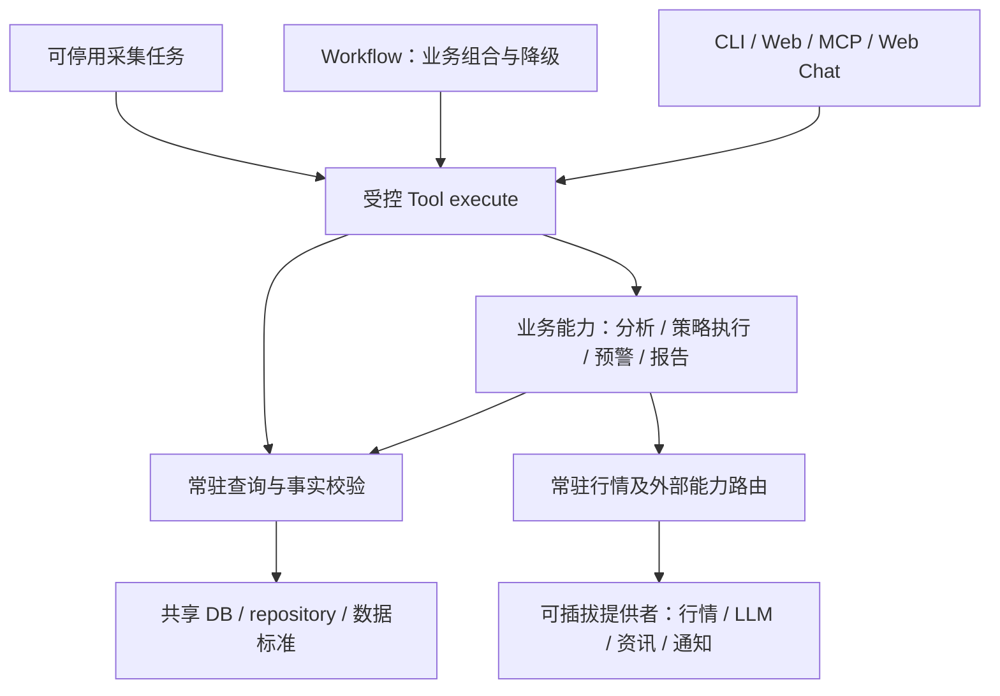

# 共享数据底座与能力插件详细设计及分阶段实施计划

> **2026-11-20 简化：** 插件启停收敛为 `plugins.json` 一个只读启用位——permit/许可令牌、撤销队列、drain 记账、`epoch`/revision 校验、Web 插件管理页与 `luoome plugins` 命令均已删除；本文涉及这些机制的小节仅作历史设计记录，当前语义见 [ARCHITECTURE.md](../ARCHITECTURE.md) §7.1.1。
>
> 状态（历史设计记录）：P0–P2 已实施；P3 策略执行与任务资源切片已实施，验收与限制见第 17 节；P4 内置管理面已于 2026-11-20 撤销（Web 插件页、`luoome plugins` 命令、permit/撤销队列/drain 记账/CAS 写入协议），现状为手写只读 `plugins.json` + 重启宿主生效，第 18 节及第 19–25 节的管理面描述仅作历史记录；其余业务切片见第 19–25 节。
> 日期：2026-11-15；代码基线：`1c0c516e`。
> 评估：Codex、GPT-6 Astra（High）、本地 Kimi CLI（`kimi-code/k3.1-pro`）共同讨论；评审取舍见第 14 节。
> 范围：本地单用户、单机多账户，CLI / Web / MCP / Workflow / Web 对话运行时共用业务能力。
> 依据：[领域语言](../../CONTEXT.md)、[当前架构](../ARCHITECTURE.md)、[安全约束](../SECURITY.md)、[Web 对话助手设计](./web-chat-design.md)、[数据源设计](./source-pluggability-and-observation-design.md)。

## 1. 目标与明确不做的事

目标是让数据提供者、采集任务和业务功能可以独立维护、替换和受控启停，同时保留共享事实与查询能力。关闭行情源不应让数据库、历史行情、策略历史和已有报告一起不可用；关闭 AI 不应阻断确定性计算。

首期采用同仓库、同版本的内建插件。插件是具有明确接口、贡献和生命周期的模块，不要求每个插件独立 npm 包，也不要求每个功能开关都是插件。

不做任意代码安装、插件商城、独立能力版本协商、通用可视化编排器、原生代码安全热卸载、自动证券交易或新的多租户体系。不重建已移除的 DailyBar revision、checkpoint 或调度 fencing 平台。代码、依赖和 DB schema 升级继续受控重启。

## 2. 当前事实与改造动机

| 当前事实 | 代码依据 | 设计影响 |
|---|---|---|
| Tool 库存与公共性统一，Zod 派生 I/O | [catalog](../../packages/tools/src/catalog.ts)、[registry](../../packages/tools/src/registry.ts) | 沿用唯一目录，不再维护插件 Tool 清单副本 |
| Workflow 类型与绑定来自完整 catalog | [define-workflow](../../packages/workflows/src/define-workflow.ts) | 保留类型推导，在实际执行增加策略检查 |
| `defineTypedTool` 有 authorize 回调，`defineTool` 未接入；回调目前接收 raw input | [define-tool](../../packages/toolkit/src/define-tool.ts) | 复用 execute 作为执行 seam，基于 schema 解析后的输入授权 |
| Tool 可以直接调其他 Tool、repo、adapter | [analyze-stock](../../packages/plugins/analysis/src/tools/analyze-stock.ts)、[草案确认](../../packages/tools/src/tools/settle-chat-draft.ts) | 过滤 registry 不能保证停用；跨模块端口和内部调用均需覆盖 |
| 多域复用泛型 SourceRegistry，进程内共享部分供应商实例 | [source-registry](../../packages/adapters/src/source-registry.ts)、[market factory](../../packages/adapters/src/market/factory.ts) | 提供者插件复用现有路由，不重写另一套源管理器 |
| manager 缓存可先于选源命中，Quote/DailyBar 缓存键不区分源 | [manager](../../packages/adapters/src/market/manager.ts)、[cache](../../packages/adapters/src/market/cache.ts) | 停源后必须复核 provenance 和用途，不能把 A 的缓存标成 B |
| 已有可注入的跨实例请求合并、缓存、租约和限流机制 | [request-coordinator](../../packages/adapters/src/market/request-coordinator.ts) | 复用已有机制并验证实际接线；当前普通 CLI/Web/MCP 构建路径不能据此声称已全部共享 |
| 源顺序最少一个；空字符串回默认源 | [market factory](../../packages/adapters/src/market/factory.ts) | 全关必须显式表达，不能用清空环境变量实现 |
| 一些现有 Tool 混合读、网络和写库 | [compute-indicators](../../packages/toolkit/src/tools/compute-indicators.ts)、[sync-daily-bars](../../packages/plugins/market-tasks/src/tools/sync-daily-bars.ts)、[get-stock-market-view](../../packages/toolkit/src/tools/get-stock-market-view.ts) | 按实际行为归属和授权，不能按 `get/read` 名称当纯本地查询 |
| 策略洞察已有窗口事实与 facts-only；日循环和周报均消费 | [strategy-insight](../../packages/toolkit/src/tools/strategy-insight.ts)、[日循环](../../packages/workflows/src/strategy-daily-cycle.ts)、[周报](../../packages/workflows/src/weekly-report.ts) | 首个纵向切片可验证组合与可选 AI，无须先搬整个策略模块 |
| 策略 tick 与收盘报告 cutoff 共用 stop | [strategy-scheduler](../../packages/plugins/strategy/src/resources.ts) | 拆清资源 owner 后才能声称独立停用 |
| 入站 MCP 按启动配置冻结发现；出站 MCP 已逐调用复核授权 | [MCP server](../../packages/mcp/src/server.ts)、[外部 MCP](../../packages/adapters/src/mcp/client.ts) | 入站动态发现是后续工作；沿用出站的撤销经验，不混淆两个方向 |

### 2.1 历史数据口径的限制

本地日线按 `dataAsOf` 截断记录，scheduled/replay 的 quote/bars 不使用今天的实时价格替代历史价格；scheduled 的其它数据并不全部是本地读取，例如引用连板天梯的规则仍调用当天 manager 并保存快照。当前 [DailyBar repository](../../packages/db/src/repository/drizzle/daily-bar.ts) 使用当前可见数据与因子做前复权投影，没有完整历史修订版本。因此“本地按日期回放”不等于“恢复当时可见的所有历史数据版本”。具备历史快照的数据集继续按各自契约使用；本文不扩大严格 PIT 的承诺。

## 3. 三层结构与术语



| 术语 | 本文定义 |
|---|---|
| 共享底座 | 常驻的数据、规则契约、查询及运行机制；没有普通业务停用开关 |
| Provider | 在稳定端口上提供外部能力的 adapter；可以复用多个 domain binding |
| Task | 拥有调度、批次和重试生命周期的生产任务；与提供者和业务开关独立 |
| Business plugin | 贡献可停用的业务操作或解释能力；不拥有共享 DB 生命周期 |
| Capability | 可声明依赖及受控使用的能力，例如本地日线读取、实时 quote、策略解释 |
| Workflow | 编排业务操作，明确必需/可选依赖、失败及降级，不承担插件加载 |
| Bundle | 预设一组功能开关与配置引用；不授予权限、不隐式开启依赖 |
| Activation epoch | 某项能力每次有效启停/重配置的持久单调世代；关后重开也改变 |
| Config revision | 全局配置条件提交与审计版本；不意味着每次修改都撤销所有插件 |
| Config incarnation | 每次初始化或灾难恢复生成的新配置实例 ID；防止重建后数值 epoch 碰巧相同而复活旧许可 |

## 4. 归属：哪些常驻，哪些可插拔

### 4.1 保留在共享底座

| 内容 | 保留方式 | 限制 |
|---|---|---|
| 股票身份、交易日历、Money/DailyBar/Advice/Strategy 等类型与不变量 | 继续在 core；零 IO | 常驻不代表所有业务功能启用 |
| 数据库、Drizzle schema、幂等迁移、事务、repository | 继续在 db；应用级生命周期 | 插件停用/卸载不删表、不改账本、不回滚历史事实 |
| 本地行情、账户事实、策略历史、Advice/Report 等授权查询端口 | 继续经 tools 提供；按领域组织查询模块 | 不向 Agent 暴露任意 repository/SQL；账户、正文、入口权限保持 |
| 规范化、复权投影、日期截断、覆盖度/新鲜度校验 | 保留当前领域契约及实现位置 | 不伪造缺失因子、价格或时间；不新增严格 PIT 承诺 |
| 行情路由、请求合并、缓存、供应商配额、健康观测 | 复用 adapters 现有 manager/registry/coordinator | 是机制底座，里面的 provider binding 可关闭；按域保留不同编排语义 |
| Tool schema、catalog、registry 推导、ToolResult、执行策略端口 | 保留 tools/core 现有分工 | 库存不授权；新增执行门控不复制 I/O schema |
| 身份与账户范围、确认、审计、权限上限、配置读取机制 | 按既有模块职责保留 | 权限不能由插件、模型或 Bundle 自行构造 |
| 确定性指标/规则求值的纯函数 | 留在现有 core 或内部纯函数模块 | 复用函数无须全部变成插件服务；对外操作另受业务开关控制 |

“本地查询常驻”是接口和生命周期决定，不要求把所有查询代码搬进 core。例如策略窗口事实仍是策略查询模块的派生视图，不能因为只读就把 StrategyInsight 编排塞入通用底座。

### 4.2 可插拔提供者与可停用任务

| 模块族 | 候选实例/功能 | 停用范围 |
|---|---|---|
| 行情 provider | Eastmoney、Tencent、Sina、Tushare、fuyao | 指定 provider 已声明的 binding；替代源仅从已配置且授权的候选中选择 |
| 非行情 provider | 资讯、板块、龙虎榜、情绪、股票目录等现有 adapter | 保持各 domain manager；共享供应商实例不重复创建 |
| LLM provider | 现有 generation/agent 配置引用 | 不把“关闭策略解释”变成“关闭整个聊天模型” |
| 通知、Vault、外部只读 MCP | 现有受控适配与管理配置 | 保留各自 opt-in、正文/场景白名单；MCP 不进入静态业务 catalog |
| 行情生产任务 | 日线同步、股票目录同步、快照采集、dump、分钟数据归档 | 停新 tick/批次/重试；不删除已经保存的数据 |
| 业务自动任务 | 策略调度、预警检查、报告生成/投递 | 独立 owner；不得共用一个粗粒度 stop 误停其它任务 |

提供者与任务分别配置。关闭日线同步不等于关闭本地日线查询，也不自动关闭行情 provider；关闭某个策略，不自动停止其他业务使用的共享日线同步。

### 4.3 业务模块与常驻读取的拆分

| 业务域 | 保留的读取 | 可停用的操作/插件 | 依赖重点 |
|---|---|---|---|
| 个股行情 | 本地日 K、已存 quote、身份与历史标记的授权查询 | 远端刷新/补齐操作 | 本地与远端分明，账户标记不能串账户 |
| 个股分析 | 既有 Advice、研究事实与报告读取 | 新个股分析、市场展望、策略候选分析 | 按 scope 解析依赖，正式 Advice 仍需确认及完整证据 |
| 策略 | 定义、版本、运行、信号、观察与窗口事实 | 新运行/回测、候选生成、AI 解释 | scan 与 scheduled/replay 的数据路径分别声明 |
| 盯盘 | Watchlist、AlertPlan、WatchTrigger 历史 | 规则检查、触发产生、投递 | 新鲜 quote、计划状态、额度及通知授权 |
| 报告/复盘 | 已存 Report、DecisionReview 等事实读取 | 新报告、AI 章节、通知 | 必需事实与可选章节分开；报告 cutoff 独立 |
| 账户 | 账户、现金、持仓、绩效与成交记录读取 | 现有人工写入操作与绩效快照任务 | 账本事务和专用确认保持；不引入自动交易 |

现有 `get_stock_market_view` 有网络、写库和账户事实组合，不能直接改名为“共享纯读”。首期只提取内部本地读取路径供组合复用，原 Tool 名称、输出与原授权保留；不靠新增 local-only 参数让 external Tool 绕过原授权。若后续要公开新的本地日线 Tool，另行做明确的 schema、公共性和 Skill 变更；本计划的无源验收使用已有本地查询及新提取的内部查询端口，不假设已有 external 入口自动变成 read。

`get_strategy_insight_facts` 是常驻策略查询贡献；`generate_strategy_insight` 是策略域组合入口，可调用可选 AI 解释 port。二者均不归 `strategy.ai-insight` 所有，否则关闭 AI 会一并关闭事实降级入口。

## 5. 包结构与接口：沿用当前架构

既有依赖方向不变：`surfaces / workflows → tools → {core, db, adapters}`，`db/adapters → core`。插件按业务职责组织已有文件，首期不新增通用 plugins package，不把 Agent SDK 依赖引入业务包。

| 位置 | 计划职责 |
|---|---|
| `core` | SDK 无关的纯策略/端口类型；没有文件读取、加载器或插件实例 |
| `adapters` | provider 定义与工厂、guarded transport/端口、配置持久化实现、manager 接线 |
| `tools/catalog.ts` | 每个 Tool 的唯一 owner/feature、公共性、操作依赖声明；保留 Zod 原始类型 |
| `tools/define-tool.ts` | 统一 execute 检查、schema、授权、错误与审计；不再新增字符串 invoke registry |
| `tools` 的各领域查询/操作模块 | 常驻查询与可停用操作；逐片缩小依赖注入范围 |
| `workflows` | 有类型的操作组合与显式降级，仅调用 `ctx.tools` |
| CLI/Web/MCP 组装根 | 可信身份/权限、运行快照、资源 owner 接线与宿主状态投影 |
| Web 对话运行时 | 只消费本轮授权的 callable 与用途白名单，不持有业务配置修改权 |

### 5.1 最小声明与单一事实来源

以下是计划契约示意，不是新增的已实现类型：

```ts
type ToolOwner = 'shared-query' | BusinessPluginId | TaskPluginId;

type OperationRequirement = {
  readonly capability: CapabilityId;
  readonly importance: 'required' | 'optional';
  readonly purpose: DataPurpose;
};

interface PluginDefinition<Config> {
  readonly id: PluginId;
  readonly kind: 'provider' | 'task' | 'business';
  readonly configSchema: ConfigSchema<Config>;
  readonly provides: readonly CapabilityId[];
  readonly requires: readonly CapabilityId[];
  prepare(config: Config, ports: DeclaredPorts): Promise<PreparedActivation>;
}
```

PluginDefinition 不再列一份 Tool 对象数组；Tool 贡献从 catalog 的 owner/feature 反向派生。provider 的能力事实复用现有 manifest/binding；task 的工具引用以 catalog 名字做编译期检查。未声明的依赖、重复 owner、重名贡献和依赖环在装配期拒绝。

例如 `sync_daily_bars` 的唯一 owner 是 `task.daily-bars-sync`，手动 Tool 调用与 timer tick 使用同一任务 gate；可另有“自动调度暂停”配置，只停止 timer，不等于关闭整个采集能力。不存在给同一个 Tool 再挂一项同义的 business enable。策略历史查询归 shared-query，策略新运行归业务操作 owner，调度资源再依赖该操作。

内部端口使用同版本 TypeScript 接口，Tool 对外 I/O 仍由 Zod 定义；不把每个内部函数都注册成 Tool，不复制 JSON Schema，不引入运行时版本协商。

### 5.2 执行检查与内部权限

1. 可信组装根生成执行 scope，绑定 caller、账户、入口、本次操作许可、config incarnation 及相关 epoch；插件和模型不能构造更高权限 scope。
2. `defineTool.execute` 检查当前 owner/feature 与 scope 世代，解析 input，再用解析后输入确定 scope/mode 依赖和授权。
3. 读取 readiness；必需依赖缺失返回既有 ToolResult，或由已有批处理契约逐项报告；可选依赖交给明确的组合逻辑处理。
4. handler 通过受控 port 获取跨插件能力；port 在实际请求、下一批/重试和结果发布前复核许可及 epoch。
5. 输出 schema 和审计保持现有统一路径；拒绝不得执行 handler、创建草案副作用或冒记调用成功。

入口白名单约束模型能主动调用什么；内部声明依赖约束已获准操作能委托什么。它们不能用同一工具名名单简单递归相交，也不能让内部调用免除账户、副作用或插件停用约束。`analyze_stock(scope=...)` 必须按解析后 scope 绑定特定子能力，不授予整个 catalog。

root 操作、受控内部 Tool 和 port 都复核相关能力。生产组装根必须注入策略；只给测试使用的显式 permissive fixture 不能成为生产 fallback。迁移中未纳管模块保留既有入口授权，不宣称全仓已经受控。

根操作的许可与可选 port 的许可分开：仅可选 AI 世代变化不自动撤销仍获准的事实组合入口，而是在调用 AI 的 seam 返回撤销，由该组合明确降级；根 owner 或必需许可撤销时则不能借可选降级继续执行。

## 6. 依赖与数据质量规则

依赖同时回答“有没有这个能力”和“本次数据是否合格”。`enabled/configurationReady/health` 不替代逐次数据校验。

| 操作/场景 | 必需数据路径 | 可以降级 | 不允许 |
|---|---|---|---|
| 纯本地查询/历史图表 | 本地 repository，显式日期范围 | 空/缺失/过期按契约展示 | 依赖缺失后偷偷发网络请求 |
| 行情展示/已有市场视图 | 配置的 quote 路由；已有本地 fallback | 来源、时间和 stale 标记完整的本地快照 | 用抓取时间代替可信行情事件时间 |
| 盘中预警/决策资格检查 | 符合现有交易日、上游时间及新鲜度要求的数据 | 现有规则明确允许的合格本地快照 | 用任意旧价、收盘价、延迟指数冒充实时证据 |
| 日线同步 | 启用 task、获准 daily-bars provider、有效复权/身份 | 逐股成功保留、失败逐项记录 | 空结果伪造完整覆盖、停用后开启隐藏源 |
| 策略 scan | 按策略引用实际需要的 live quote/daily-bars/其它事实 | 现有逐股失败和 coverage/acceptance | 为凑齐数据改变股票目录或发布资格 |
| 策略 scheduled | quote/bars 来自本地日线并按 dataAsOf 截断；所引用规则如需当天连板天梯，继续走现有 manager/快照路径 | 按每个实际数据依赖保留 coverage/acceptance/partial/withheld | 把所有 scheduled 都判成本地零外发，或用实时价替换历史日线 |
| 策略 replay | 本地日线及规则所需的既有历史归档，按既有时点契约读取 | 保留现有历史缺失/coverage/acceptance 规则 | 缺历史时向今天的 live 源取数补成历史 |
| 指标纯计算 | 调用方提供的合格规范日线 | 缺数据时保留未定义指标 | 自动换复权口径、用空指标冒充完整计算 |
| 策略窗口洞察 | 既有 window facts；AI 为可选解释 | 同一份 facts-only 并说明原因 | 降级重新读取另一窗口/账户，编造 AI 结论 |
| 新个股 Advice | 当前契约要求的行情、指标、模型与授权 | 只报告失败/缺失；可另提供事实视图 | 缺模型时伪造正式 Advice |
| 报告 | 章节各自事实与完整性要求 | 现有章节级 partial；可选 AI 缺失 | 因插件开关提前发布不符合既有 cutoff 的报告 |

具体新鲜度阈值、观察周期、行情资格与 Strategy acceptance 继续以现有领域契约为准，不在插件清单复制数值。新增用途必须有明确校验函数和测试，不能靠任意调用方传 `allowStale=true` 放宽规则。

`compute_indicators` 当前标 read 但会拉远端日线；`sync_daily_bars` 标 external 但会写库。这些属于 P0 必须列出的兼容与授权债。P2 将纯计算/本地读与网络采集分清：保持公开契约有明确迁移说明，任何真实网络/写入都需对应既有权限或经评审补齐的要求，不靠启用插件获得许可。不得顺手把旧 read 工具升为模型可写能力。

能力就绪按操作模式判断，不能因为 live quote 不可用就把同名 Tool 的 scheduled/replay 模式一起判死。静态 discovery 表达“至少一个已授权模式可用”，描述中提示限制；具体调用再对解析后模式校验。尚未完成模式化依赖迁移前保留原发现行为并明确该阶段覆盖范围。

## 7. 配置权威、并发与生效范围

> 2026-11-20 状态：本节的 writer lock、CAS、incarnation/revision/epoch、init/migrate 与 drain 协议均已撤销。`plugins.json` 现在只是手写、只读的启用清单（`version` + `entries[id].enabled`），宿主启动时读取，缺省即关闭，未知/已下线 key 被忽略；修改后重启生效。

### 7.1 各配置各司其职

| 权威配置 | 持续负责 | 不负责 |
|---|---|---|
| 拟新增 `$LUOOME_HOME/plugins.json` | provider 总开关、task/business feature 开关、incarnation、revision、受影响能力 epoch | 密钥、模型参数、源优先级、MCP command/args、用户业务实体状态 |
| 既有行情与各 domain 配置 | 路由候选与顺序、凭证引用及现有设置 | 不绕过 provider 总开关 |
| `ai-models.json` 与既有凭证存储 | generation/agent 模型配置 | 不把模型已配置当作策略 AI 已启用 |
| `mcp-servers.json` | 远端服务启用、工具/场景白名单和部署启动信息 | 不写回静态业务 catalog，不受 Bundle 自动授权 |
| Strategy/AlertPlan 等业务实体 | 用户的暂停、启用、cron、规则、范围 | 不能被插件开关批量改写 |

provider 总开关表达其所有已声明 binding 的上限；domain 路由表达某个用途的候选及优先级：

```text
有效提供者 = provider 总开关 ∩ domain 候选 ∩ 能力/覆盖支持 ∩ 配置就绪 ∩ 本次权限
```

这是两种不同控制，不复制同一字段。UI 应区分“供应商总停用”和“未选作本域来源”。已有源顺序即使保留默认值，所有 provider 的显式关闭也必须使 effective 为空，重启不能恢复网络访问。

组装先应用总开关，再实例化实际启用的 provider 并校验其凭证；已关闭、缺凭证的可选 provider 不能阻止本地底座启动。所有 provider 关闭时仍组装稳定 Gateway，其远端方法明确返回不可用，本地查询独立工作；不临时创建默认源或伪造行情。

示意文件（ID、schema 细节在 P0 冻结；仅包含控制信息）：

```json
{
  "version": 1,
  "incarnation": "23851822-182e-41df-a9b9-c40248aca79f",
  "revision": 12,
  "entries": {
    "source.eastmoney": { "enabled": false, "epoch": 4 },
    "task.daily-bars-sync": { "enabled": false, "epoch": 2 },
    "strategy.ai-insight": { "enabled": false, "epoch": 6 }
  }
}
```

init/migrate 按完整已知定义生成文件，示例不是完整默认清单。首次通过显式操作在同一写入协议下，从统一版本基线和该配置根的部署选择生成初始 desired；不能由率先启动的某个 surface 的局部 readiness 推断默认开关，例如没有模型的 MCP 不能替 Web 决定关闭业务。既有能力按 P0 记录的原行为初始化，只有新增可选能力默认关闭；有效调用仍受当前入口权限、候选、凭证与 readiness 限制，不把旧许可永久落盘。

升级读到缺少某个已知 entry 时，该能力视为 disabled，普通读取不补写；显式 migrate 在锁内为新增项补 disabled 和初始 epoch，并保留既有项及其 epoch。已存在 entry 缺 enabled/epoch、未知 ID/版本或顶层必需字段缺失均为无效配置，不能回默认。支持的正常写入保留 incarnation，不删除既有 entry，不回退 revision/epoch；正常回滚发布更高世代。共享查询没有 enabled 项。

初始化、文件丢失后的重建及备份灾难恢复都生成全新的随机 config incarnation，禁止直接覆盖旧备份沿用旧实例 ID。许可比较 `(config incarnation, capability epoch)`，宿主应用状态也带 config incarnation；即使恢复后数值 epoch 相同，旧 callable/waiter 仍失效。恢复操作在 writer lock 内发布，并重建相关 activation；不能从丢失文件猜测旧 epoch 上界。

### 7.2 原子提交与应用

作用域是同一个配置根（通常同一 `LUOOME_HOME`），与账户选择分开。当前账户隔离仍按请求生效。读取设置和历史数据不要求启动外部 provider。

管理写入、首次迁移和初始化共用排他 writer lock：锁内重读文件、校验 `(expectedIncarnation, expectedRevision)`、校验变更、增加 revision 与受影响项 epoch、唯一临时文件写入后原子 rename；首次创建校验 expected-absent。条件提交同时带配置实例，避免灾难恢复后 revision 数字相同接受旧修改。目录 `0700`、文件 `0600`；文件大小设上限，例如 64 KiB。锁只覆盖本地提交，不持锁做网络探测或等待 drain。锁超时拒绝写入；崩溃遗留锁不自动删除，核验 owner 后恢复；锁故障不妨碍读取已有合法配置。可复用系统自动释放锁时优先复用，不建立锁服务。

atomic rename 只防止半写；writer lock + 锁内 revision 校验才防止两个进程覆盖。普通启动和准入遇到 ENOENT、损坏、未知版本或权限/读取错误，一律拒绝已纳管的可选执行；已有纯本地查询继续可用，管理页提示显式初始化或恢复。只有 init/migrate 可以创建初始文件，它需显示配置根和将应用的基线；普通启动不能静默 bootstrap。这样无须凭文件不存在猜测是首次安装还是重启后丢失。P1 发布与部署步骤包含一次受控迁移，不把尚未初始化伪装成所有插件默认可用。

配置存 desired；`appliedRevision/failed/draining` 是各宿主带配置和进程 incarnation 的本地状态，不写成一个全局 applied。Web 成功不代表另一个 MCP 进程也成功。

准备资源时不启动 timer 或新业务请求；持久配置提交后发布受影响能力的执行屏障，再切换准备好的运行快照并启动新资源。若提交后应用失败，保留 desired 并对受影响能力 fail closed，显示 enabled 但 not-ready，不偷偷恢复旧 activation。无关能力保持运行。回滚也是新的 revision/epoch，不回退世代，不重放业务副作用。

异步 prepare 完成后、发布前必须重读配置实例和相关 desired epoch；只有实例相同且 `preparedEpoch == currentDesiredEpoch` 的候选可以发布和启动资源。较早的慢 enable 晚于新 disable/enable 返回时只 dispose 候选，不启动 timer、不覆盖新快照。宿主 applied 在同一配置实例内不倒退；全局 revision 变化但无关项未变化时可合并未受影响能力的准备结果，不误撤销其它执行。

一个操作只更新一个权威文件，Bundle 首期只改变 plugins.json 内的开关并引用既有配置，不承诺跨文件原子修改。更改源顺序/模型/凭证沿用自己的验证与应用流程，不能和插件启用拼成一个虚假的“全部原子保存”。

### 7.3 各入口生效点

| 入口 | 插件停用/许可收紧 | 发现与其它配置 |
|---|---|---|
| Web | 下一次 Tool/port/task 安全 admission 重读权威策略；旧闭包复核相关 epoch | 下一轮 Agent manifest 使用实际可用工具；设置返回本进程 applied 状态 |
| 一次性 CLI | 新进程启动读配置；长执行在每批/重试等安全点复核 | tools list 区分静态库存、当前可用与阻断原因 |
| 常驻入站 MCP | P1 起调用执行复核 live policy；旧工具表不构成调用许可 | 动态发现完成前需重启更新工具表；P4 已实现同连接 tools/list 与 list_changed |
| Web 对话运行时 | Tool/port 每次调用复核；运行时不缓存旧授权 | 下一轮重新装配工具集；仍无业务配置修改权 |
| 后台 task | tick、下一批、重试、通知前分别复核 owner 与实际依赖 epoch | 不使用启动时永久闭包替代当前策略 |

跨进程进程可能错过完整一次关→开，所以同一 config incarnation 内 epoch 必须持久单调，不能仅比较最终 enabled/config hash。已开始的调用保留配置实例与它实际依赖的 epoch；无关插件修改不能使所有会话失效，配置灾难恢复则使旧可选执行许可全部失效。每次安全点读取到的配置实例和 revision 是本次裁决的线性化点，已经通过旧裁决的在途操作不能追溯撤销。

P1 先保证已迁移能力在同一配置根的下一安全点撤销；不承诺远程主机或绕过受控入口的进程。源优先级、模型与凭证的热应用按各设置原有作用域报告，不能因 plugins.json 支持逐调用读取就声称所有配置全进程热更新；P2 为相关路由替换增加本进程世代与旧闭包撤销，跨进程其它配置先以明确 reload/重启为准。

## 8. 启停、资源与在途操作

> 2026-11-20 状态：drain 记账与撤销队列已撤销；停用能力不再有运行中的排空状态，而是改配置后重启宿主生效。

| 操作 | 新调用/生产任务 | 在途行为 | 历史事实 |
|---|---|---|---|
| 关闭 provider | 禁止其新请求；其它已配置源按同等资格 fallback | 阻断下一批/重试；过期 activation 的晚结果不发布到当前图 | 保留；本地读取按用途/来源/质量校验 |
| 关闭采集 task | 停新 tick/手动该任务入口 | 当前已开始事务安全结束，后续批次停止 | 保留，后续可能变 stale |
| 关闭业务 feature | 拒绝该操作与其拥有的新调度 | 不继续派生新 AI/通知/批次；已发生事实如实记录 | 查询模块继续可用 |
| 缺少必需依赖 | 阻断该操作，或按既有逐项契约报告失败 | 不自动启用依赖或改数据模式 | 不受影响 |
| 缺少可选依赖 | 仅执行事先声明的降级 | 不借降级扩大权限 | 返回真实已取事实与缺失说明 |
| 重新启用 | 新 epoch、资源就绪后接新调用 | 旧 activation 不复活 | 不重跑旧成功任务/发送旧通知 |

desired 状态与 runtime 生命周期分开：disabled、preparing、ready、blocked、draining、failed 都应能解释；健康状态和数据质量单独显示。外部暂时故障不自动把用户开关改为关闭，也不无限触发重载。

资源由实际 owner 登记 teardown，包括 timer、连接和订阅。共享 SourceSet 实例按实际 binding 引用管理；停一个业务不释放仍被使用的 provider。停止 timer 不代表旧 tick 已排空，宿主必须保留在途计数/取消信号与有界 drain 状态；超过 drain 时限报告未排空，不能声称已安全卸载或强制关闭共用 DB。

插件停用不是撤销已提交事务。长任务在下一安全点停止；短事务进入后按原子提交/失败收尾，不在事务中途注入取消。外部请求已发送就可能已发生，失败或状态不明不自动重放。取消草案、查看既有处理结果仍可用；停用后的新确认必须重查目标操作，不能复活旧权限。成功回执返回已发生事实不等于重新执行。

### 8.1 provider 名称与实际网络依赖

现有一个 binding 可能间接使用另一个供应商，例如 Tencent 全市场路径中的 Sina 目录。第一期 provider 总开关的严格承诺是“禁用该 provider 已声明 binding”，不能无证据标成“完全不再连接该供应商”。P2 清点真实 transport 依赖并在实际外发前检查相关 provider policy；只有该测试通过的实现才可展示“禁止该供应商外发”。未完成的 binding 标注实际网络依赖，不能隐藏旁路。

“禁止某来源数据继续被消费”与“停止向该源取数”不同。前者需要数据隔离/撤销查询能力，首期不提供这个开关，也不因普通停源删除历史数据。若未来增加，需明确隔离范围、已存 provenance 可追溯性及单独迁移，不复用普通 enabled 位。

## 9. 缓存、在途结果与事实发布

### 9.1 读缓存

缓存命中也经过来源、用途、时间、资格及当前策略判断；不能只看 TTL。manager 级缓存仍共享，但返回值保持真实来源。关闭 A 后的新 live 路由不把旧 A 缓存当 B 或当前上游成功；如业务允许本地 fallback，则走明确的 fallback 路径并标真实来源/时间，合格性以对应领域规则为准。

scheduled/replay 的 quote/bars 使用本地 repository 的既有口径，不因内存或 coordinator 缓存命中切成 live；其它规则数据按第 6 节分别判断。源故障/关闭时不会将 lastSuccessAt、retrieval 时间当成 dataAsOf。健康观测与缓存供数状态分别展示，不伪造一次网络成功。

### 9.2 晚结果与切换

P2 必须验证以下顺序：A 请求已发出并暂停 → 关闭 A/替换有效路由 → B 完成并发布 → A 晚返回。

受控 provider port 携带本次 activation 与相关路由 epoch 的内部凭据；结果返回、填充 manager/coordinator 缓存、更新当前健康、交给持久化路径前复核。过期结果不进入当前快照，不覆盖 B 的同日数据，也不启动后续重试。已经发送的请求只记录必要诊断，不把它伪装成当前成功。

repo 本身不依赖插件实现；采集与组合调用方先取得真实 SQLite 写资格（例如既有单写者串行入口或正确的 immediate 写事务），再做最后一次相关配置实例/epoch/来源/任务检查，并保持写资格至短事务提交。不能在拿到写资格前检查一次，然后等待锁后无条件 upsert；也不能在检查与提交间跨多个 await。事务适配仅接收 SDK 无关的同步校验回调/写入 scope，校验只读取本地策略、不外发、不 await，不反向依赖 tools 或插件实现。若实际实现不能提供等价顺序，则该持久化路径尚不能声称满足晚结果隔离。

验收还必须用真实临时 SQLite 覆盖 A 已取回数据但等待写资格 → B 提交 → A 恢复的顺序，断言 A 的过期结果不覆盖 B；不以 mock 的先后调用代替锁竞争。已取得写资格且通过最终检查的短事务按第 8 节安全收尾；文件配置与数据库不是同一原子事务，安全保证仍以该最终准入点为界，不承诺跨进程任意时点的通用提交撤销，不新增历史 revision/fencing 表。

供应商配额、cooldown、请求去重属于稳定机制，启停或重排不能重新获得配额。coordinator 作为已有可选基础设施，接入时同时验证普通构建根、设置重建路径和预构造共享 SourceSet 的 transport，不能只给新建 adapter 加 guard。先确定现有部署是否启用该机制，再测试对应路径，避免制造第二套请求租约。

请求合并只允许相关有效 activation/路由世代相同的消费者共享；停用后的新调用不得加入旧在途请求，关→开后的新调用不能借旧结果成为成功。每个 waiter 在实际消费前独立复核自己的 scope/epoch，首个调用者的许可不能代表其它消费者。隔离在途与结果缓存时，供应商级配额和 cooldown 仍以稳定 provider 身份保留，不能因把 epoch 加到合并键而绕过。验收覆盖同一请求两个 waiter、一方撤销，以及新 activation 到来时旧 lease 仍存活的情形。

## 10. 首个纵向切片：策略事实与可选 AI

1. `get_strategy_insight_facts` 保持常驻策略查询，继续 read。
2. `generate_strategy_insight` 保留组合入口、既有 external 准入和窗口语义；一次只装载一份 facts。
3. `strategy.ai-insight` 只贡献解释 port，不影响聊天模型和其它业务模型。
4. window、当前运行锚点、事实时间、fact IDs/limitations 在 AI 与 facts-only 两条路径一致；`runId` 继续用于既有当前选择一致性检查，不新增任意历史单 run 解释。
5. AI 关闭/配置未就绪时不尝试模型；首次尝试后被停用，不再 repair 重试。包括本来会成功的晚响应也在返回前复核，失效响应不作为当前 AI 解释发布，返回同一 facts 的 facts-only 与 `activation_revoked`；已经发出的模型请求与费用不能撤回。
6. 输出保留原结构，计划增量增加可选 `degradation`，原因如 `plugin_disabled / dependency_not_ready / provider_failed / activation_revoked`；所有调用方仍能消费 `provider='facts-only'`。
7. 权限不足不是正常业务降级：组合入口未获 external 仍拒绝，纯读走既有事实工具。Advice 生成不套用这个 facts-only 成功语义。
8. 日循环维持既有 partial、publication 及审计规则；周报保留事实行和限制；不更改报告截止、通知策略或生产运行资格。

事实查询依赖仍经现有工具/纯内部聚合模块，跨业务的 Workflow 不得绕过 `ctx.tools`。纯函数与 repo 访问并非都改成远端风格服务调用。

## 11. 安全、错误与可观测性

> 2026-11-20 状态：本节的控制面 CLI（`init/migrate/status/set`）已撤销；`plugins.json` 不提供写入协议，Web 管理页也不再存在。

有效入口工具集合为公共性、场景名单、账户/主体授权、sideEffect/requiredCapabilities、插件开关、依赖就绪、本轮范围的交集。未就绪时隐藏或标阻断的投影不能代替执行检查。管理页读取不连接上游；外部探测是单独显式操作，沿用 opt-in 和 Origin。

控制面自身常驻：P1 即提供最小 CLI 的 init/migrate、status 和条件 set，以便每个阶段可操作、可恢复，不等待 P4 的 Web UI。它独立于被控制的业务插件，缺配置时仍可执行可信本地管理；写配置要求现有 write 权限，不因 enabled=true 授予 external。Web 管理保存仍要求同源及写入权限，已有 MCP 设置的 write+external 要求不放宽。

- 保留 MCP trade 启动硬卡、`add_trade` 禁止暴露、write/external opt-in、研究正文授权和草案确认；Bundle/启用插件不扩大任何一项。
- 已授权的只读历史保留访问；策略执行、观察生成和 AI 建议的状态语义不由插件管理器重定义。
- 根操作 owner/feature 被停用或其 scope 过期，使用现有 `permission_denied`；必需 provider/运行能力不可用收口为 `adapter_error`，原有业务错误按原 kind 返回。已经获得授权且 facts 可用的组合，仅可选 AI port 被撤销时，可以按第 10 节明确契约返回同份 facts-only；这是组合入口处理可选依赖，不是把根操作授权失败吞成成功。不新增绕过 ToolResult 的异常协议。
- `degradation` 是成功组合结果内的结构化缺失说明，不将所有 Tool 全部包装成新的 envelope，不把授权失败吞成成功。
- 记录 plugin/feature、相关 epoch、revision、宿主 incarnation、操作名、原因码与耗时；不记录密钥、私人正文或投资数据。已有审计保持，不因门控产生重复成功记录。
- 日志区分 desired/applied、ready/health、data freshness、实际来源、fallback 和 drain。配置损坏时共享纯读继续服务，受影响的可选执行拒绝并提示恢复。

## 12. 管理体验与可替换性

> 2026-11-20 状态：本节描述的 Web「设置 → 插件」管理页、依赖/影响预览与 CLI 有效状态投影均已撤销；插件启用只由手写只读清单决定。

Web 设置页计划分“数据提供者 / 自动任务 / 业务能力”三组，常驻共享底座只显示状态，不提供误导性的普通关闭按钮。每项展示实际贡献、依赖、阻断原因、影响范围、相关 epoch 与本宿主应用状态。停用前预览会受影响的操作与组合降级；保存后说明已生效及仍在排空的部分。

源顺序与模型/MCP 配置继续使用既有页面和权威存储；提供者总开关与域选源共享同一读模型。浏览器不能输入任意可执行文件、import 路径或安装代码。

更换 provider 须满足同一端口、能力/覆盖、来源、时间、单位和复权契约，并通过现有 adapter contract/fixtures；不能只满足 TypeScript 方法名。更换业务实现保留公开 Tool 名/schema 或明确发布契约变更。内建版本作为一次仓库发布共同验证，无热装多版本。

CLI 保留静态库存用途并提供有效状态投影，避免把“工具已安装”误报为“本次可调用”。入站 MCP 后续通过同连接重新派生 inventory、发送 list_changed 并逐调用复核；未知/未暴露仍按 MCP 协议，执行失败仍映射现有 ToolResult。出站 MCP 继续独立白名单，业务插件不自动扩充它。

## 13. 分阶段实施计划

每阶段独立可交付、可回退。P0/P1 已按第 15 节完成，P2 实现见第 16 节，P3 策略执行与任务资源实现见第 17 节；其余业务切片见第 19–25 节；P4 内置管理面已于 2026-11-20 撤销，现状为手写只读 `plugins.json` + 重启生效，见第 18 节。不承诺固定工期；以阶段验收通过作为进入下一阶段的条件。

> 2026-11-20 状态：本分阶段计划保留为历史设计。P4 管理产品化整段（Web 插件页、CLI 管理命令、permit/撤销/drain/CAS 写入协议）已撤销；现状是手写只读 `plugins.json` + 重启生效。

### P0：契约、归属与兼容基线

| 任务 | 交付与涉及位置 | 退出条件 |
|---|---|---|
| P0.1 | catalog 的 owner/feature/模式依赖清点；标注共享查询与待迁移操作 | 每个 Tool 一个归属，无第二份手写 I/O/执行清单 |
| P0.2 | provider binding/真实 transport、repo 写入、timer/重试/通知 owner 清单 | 标清混合读写入口及共享 stop；不只按文件名归类 |
| P0.3 | 配置根、权威文件、持久 epoch、锁/CAS、显式首次迁移和错误恢复契约 | 全关、缺文件与损坏配置不会恢复默认启用；许可上限不落盘替代运行检查 |
| P0.4 | 现有发现、权限、schema、草案、数据质量和窗口事实基线测试 | 原接口和默认授权有可对比证据；副作用债有单独处理决定 |

不搬业务代码、不改 DB、不把新类型定义当作已经插件化。配置和安全语义在此确定，不能拖到管理 UI 阶段才决定。

### P1：最小执行策略与策略 AI 纵切

| 任务 | 交付与涉及位置 | 退出条件 |
|---|---|---|
| P1.1 | adapters 的配置读写与运行组装；core 纯策略端口；各宿主注入；最小 CLI init/migrate/status/set | 锁内 CAS、原子文件、持久 epoch；无配置也可管理恢复；可选执行 fail closed；只有显式测试策略可绕过 |
| P1.2 | defineTool.execute 接通启用/世代及 parsed input 授权；catalog 派生贡献 | Workflow/草案/Gateway 原有 execute 调用也受控，无新 invoke registry |
| P1.3 | strategy-insight 提取受控解释 port，保留常驻 facts/组合入口 | 关 AI 不影响窗口事实、聊天模型、日循环 publication 和周报事实行 |
| P1.4 | 旧闭包、重试、跨进程读取和兼容测试 | 旧进程完整错过关→开、配置丢失后以相同数值 epoch 恢复均不能复活旧调用；无关插件变更不打断它 |

关键验收：首次模型请求暂停后关闭插件，分别放行成功响应和可修复失败，前者不发布为 AI 结果，后者不得发送第二次 repair；关闭期间开始的新调用模型请求数为零；AI/facts-only 的事实指纹、时间、引用和限制一致；external 权限不足仍拒绝。慢 prepare 晚于关→开完成不能覆盖新 activation；MCP 首次启动不能凭局部 readiness 改写默认。只声称策略 AI 切片完成，其他入口明确标为未纳管。

P1 已提供的最小控制命令（2026-11-20 已撤销：以下 `luoome plugins ...` 命令不再存在）：`luoome plugins init --dry-run` 展示部署基线，显式 `init --apply` 在 expected-absent 条件下创建；`luoome plugins migrate` 预览并显式应用版本迁移；`luoome plugins status --json` 返回 desired 与当前 CLI 的应用状态；`luoome plugins set <id> --enabled false --expected-incarnation <uuid> --expected-revision <n>` 条件停用。启用和迁移应用同样必须给配置实例及 expected revision，所有写入复用第 7 节协议；不鼓励手改 epoch。P2/P3 复用这套控制，不等管理界面才获得启停能力。

### P2：提供者与采集任务，打通本地模式

| 任务 | 交付与涉及位置 | 退出条件 |
|---|---|---|
| P2.1 | provider master、实际 binding/transport guard、同源实例复用 | 全关后运行和重启均零新外发；domain 路由默认值不能绕过总开关 |
| P2.2 | manager/coordinator 缓存与晚结果校验、构建根及设置重建接线 | A 晚于 B 返回不得污染当前缓存/健康/持久数据；启停不重置配额 |
| P2.3 | 日线/目录/快照等采集 task 独立生命周期 | 停 task 不影响本地读和其它消费者；下一批/重试不再请求 |
| P2.4 | 纯本地读取/计算路径与混合 Tool 权限处理 | 无源、无模型时本地查询真实可用；缺数据返回缺失，不偷偷启源 |

关键验收：冷缓存与热缓存分别覆盖 display/盘中/scheduled/replay；全部源关闭、数据为空、因子不足、错误覆盖范围、未知上游时间均有断言。使用真实 adapter/manager 和受控 HTTP fixtures；至少一个真实 MCP 客户端验证无源仍能发现并调用本地查询。不能只 mock registry 返回值。

### P3：个股分析、策略执行与独立调度

| 任务 | 交付与涉及位置 | 退出条件 |
|---|---|---|
| P3.1 | 拆策略 tick 与报告 cutoff 等真实资源 owner | 关闭策略调度后 cutoff/补投照常；反复启停只有一个 timer |
| P3.2 | run_strategy 按 scan/scheduled/replay、规则引用收窄依赖 | 仅需本地资料的 scheduled 不受 live 关闭影响；需当天 ladder 的 scheduled 保留原 coverage/acceptance；replay 缺归档不访问当天源 |
| P3.3 | analyze_stock 各 scope 与子操作、其它业务操作迁移 | 停分析只拒新 Advice；已有 Advice 可读；跨插件无 raw adapter 绕行 |
| P3.4 | 盯盘/报告/通知按实际可独立职责分批迁移 | 关闭一个 feature 不误停其它任务，不改实体启停/cron，不越权投递 |

关键验收：假时钟+并发 worker 暂停点验证停止后的下一批/重试/通知；正式提交保持原子，已成功运行不重放；旧草案新确认拒绝，取消与成功回执读取可用；策略/预警/报告现有领域回归全部通过。

### P4：管理产品化与跨入口完整验收

> 2026-11-20 状态：本阶段未保留为现状。Web 插件管理页、`luoome plugins` 命令、permit/撤销/drain/CAS 写入协议均已删除；下表仅记录当时的设计与验收计划。

| 任务 | 交付与涉及位置 | 退出条件 |
|---|---|---|
| P4.1 | Web 安全投影、依赖影响预览、启停、desired/applied/drain 展示 | 原生 HTML/JS；已有权限与 Origin；读取零外发；桌面/手机实际浏览器验收 |
| P4.2 | 增强 CLI 依赖/影响投影、MCP 同连接动态 list/list_changed、Agent manifest | 保留 P1 的基本管理命令；tools/list 与 tools/call 一致，旧 manifest/同 callId 不绕过撤销 |
| P4.3 | 两宿主 CAS、丢失更新、休眠恢复、配置/应用失败测试 | 相同 revision 只有一个写成功；单宿主失败不谎报全局应用；未知配置 fail closed |
| P4.4 | README/架构/安全/用户手册/Skill 示例与验收记录同步 | 文档区分静态库存、当前可用和生效范围；全部实现阶段明确覆盖率 |

此时才可按实际已迁移范围声称统一插件管理。动态设置不能突破现有 MCP trade/研究权限、Agent 草案与外部服务白名单。

### 13.1 验证命令与证据要求

开发中先跑对应 Tool、Workflow、adapter、配置、scheduler 测试；依照 [package.json](../../package.json) 在每个代码阶段交付前运行适配范围的 `bun run typecheck`、`bun run lint`、`bun run test:all` 和构建检查。入站 MCP 变动运行 `bun run mcp:smoke` 并用真实 SDK 客户端；对话运行时变动跑 `bun run test:web` 的 AI SDK 集成测试。

Web 改动必须实际启动受控实例，完成启用→发现→调用→停用→旧调用拒绝→新会话无工具的浏览器链路，并检查移动布局。测试使用临时配置/数据库与 fixtures，不碰个人凭证或私人投资数据。

每阶段记录基线/改后结果、覆盖范围、未迁移绕行路径、失败原因和回退方法，不维护硬编码测试总数。纯文档变更检查相对链接和 `git diff --check`；P0/P1 代码验收见第 15 节。

### 13.2 发布、回退与风险

先部署同版本内建代码和兼容 schema，再启用本阶段管理开关；默认行为以 P0 基线为准，新能力默认关。插件代码升级采用停止接新执行→安全排空→重启→契约/实际库存探针，不在单次运行中替换实现。

回退优先用新的配置 revision 关闭本阶段可选能力，保留数据与审计；程序回滚前核对配置版本/epoch 是否被旧代码理解。P1 前的旧程序完全不识别控制文件，不能把“保留已关闭开关”当作安全回滚。部署核验必须停止并确认相关 Web/MCP/长运行 CLI 进程已退出或排空，再启动经过明确配置限制的旧版本并检查实际库存与网络行为；不能仅靠配置版本阻止旧二进制启动。DB 变动独立幂等迁移，不随开关回滚，不删除用户数据。

主要风险是共享依赖牵连、旧闭包复活、晚结果污染、数据质量漂移、双配置权威和多进程误报生效。对应措施分别是唯一 owner/窄端口、持久 epoch、发布前复核、既有质量契约、权威字段划分、宿主独立应用状态和真实调用验收。

## 14. 联合评审记录与取舍

本轮已分别让 Astra（High）和本地 Kimi 阅读现有事实并评估分层，再对详细稿进行复核；以下记录纳入设计的取舍。评审是设计验证，不代替实施后的测试与浏览器验收。

| 议题 | 评审意见与决定 |
|---|---|
| 共享底座过大 | 两者均要求区分机制/本地查询与业务派生编排；本文不把 get_stock_market_view 当纯读、不把所有窗口事实实现搬入 core |
| 最小执行接口 | 沿用 execute 与 guarded port，不新增通用 invoke registry，不把域内纯函数服务化 |
| 数据源关闭 | Astra 强调缓存/晚结果/真实 transport，Kimi 区分停源/停 task/禁止数据消费；本文明确三者不同，数据隔离不在首期 |
| 历史数据 | Astra 指出当前复权与历史修订限制；保留现有日期截断口径，不扩大严格 PIT 承诺 |
| facts 身份 | Kimi 撤回把窗口综述视为单 run bug 的推断；本文只保持同次 facts 与运行锚点一致 |
| 状态发布 | 两者支持 desired/applied 分离；Astra 要求 epoch 持久、applied 按宿主、锁内 CAS；已采用 |
| 停用与副作用 | 拒新、阻后续请求、事务安全收尾；不撤回已发生副作用、不声称任意代码热卸载 |
| 写入与共享请求 | Astra 要求取得 SQLite 写资格后最终复核，Kimi 要求合并请求逐 waiter 裁决；已加入真实锁竞争与旧 lease 验收 |
| 初始化与阶段可操作性 | 显式 init/migrate 区分首次配置与丢失，新增项默认关；P1 提供最小 CLI，P4 才补 Web 管理与增强发现 |
| 灾难恢复后的旧许可 | Astra 最后复核指出 epoch 数值可能碰撞；新增 config incarnation，许可、异步发布与 CAS 同时校验配置实例，并补恢复反例验收 |
| 阶段顺序 | 先契约与策略 AI 纵切，再 provider/task，再业务调度，最后 UI；配置安全不能等到最后才设计 |

首期设计不再依赖额外产品决策：历史单 run 解释、来源数据隔离、任意第三方原生插件安装、远程多宿主控制平面以及跨配置文件事务均明确不在本计划内。遇到这些需求时另立契约，不通过扩大已有开关含义解决。


## 15. P0/P1 实施记录与实际覆盖范围

> 2026-11-20 状态：第 15–25 节的实施记录均为历史快照；其中 Web 插件管理页、CLI `plugins` 命令、permit/撤销/drain/CAS/epoch 描述已不再代表现状。

### 15.1 P0 已完成

- 全部 Tool 的唯一 owner 写入原 catalog：共享查询、平台 Chat/审计、业务操作和采集任务；`sync_daily_bars` 对应 `task.daily-bars-sync`。这些 owner 是库存归属，未纳管的开关不会被 CLI 假装接受。
- `run_strategy` 与 `analyze_stock` 记录模式依赖清点；公共依赖仍由原目录派生，本阶段不改变 scan/scheduled/replay 或 scope 的实际数据路径。P3 再实现模式化就绪和按模式授权细化。
- P0 契约保护既有公开输入 schema、公共/内部库存、sideEffect、requiredCapabilities 与发现依赖；原有场景白名单、草案、MCP 和安全测试继续运行。

实际 IO/资源清点与后续归属如下（工具清单仍以 catalog 为准）：

| 当前模块 | IO/资源事实 | P0/P1 处置与后续阶段 |
|---|---|---|
| market manager/SourceRegistry/SourceSet | 多能力路由、按请求 key 缓存、部分供应商实例共享；coordinator 可注入但普通组装路径未全部接入 | 常驻机制保留；P2 增加总开关、guard、晚结果与配额接线 |
| Tencent snapshot / Sina universe、各供应商 client | 一个 binding 可能有间接 transport 依赖，不能仅凭声明的 source 名承诺禁止所有实际外发 | P2 清点并测试真实 transport；P1 不声称管理提供者 |
| search_stocks / compute_indicators | 当前 read 声明含远端读取，前者可本地查询、后者拉日线 | 归属标为市场业务组合，不误标纯共享读；P2 收口网络与本地计算，不在本次扩大权限 |
| get_stock_market_view / resolveQuotes | 远端刷新、本地 fallback、行情保存及账户事实组合 | 原 external 契约保留；P2 提取内部本地读，不自动新增公开 Tool |
| sync_daily_bars / dump / 目录与快照同步 | 网络采集、批次/重试和本地事实写入 | 唯一 task owner 清点；P2 才纳管任务许可与事务发布 |
| strategy-insight | 窗口事实读取、至多两次模型解释；无 timer/连接 | P1 唯一受控解释 port；共享查询及组合不归 AI 插件 |
| strategy-scheduler | strategy tick 与 closingReportCutoff 共用 stop | 已识别，P3 拆 owner；P1 关闭 AI 不调用这个 stop |
| market-batch / post-market / intraday-plan / portfolio-performance scheduler | 各自 timer、异步 tick、内部批次/投递 | P0 记录 owner，P3 按职责迁移；当前启动 write+external 卡不变 |
| Agent / 草案 / 对话运行时 | 请求/会话 scope、待确认执行与回执、进程内执行业务 | 仍经 execute；本次不新增 Agent 工具或插件管理工具 |

### 15.2 P1 已完成

- 新增 `core/plugin-policy` 纯接口、`adapters/plugins/config` 持久策略和最小 CLI；生产 CLI/Web/MCP 组装根注入相同策略，Web 显式 options 与执行权限上限一致。
- 当前配置版本只接受 `strategy.ai-insight`。init 仅在文件缺失时显式执行；migrate 保留既有 epoch、为缺项补 disabled；正常读取不写文件。配置异常保持纯事实查询可用，策略解释不调用模型。
- writer 排他锁、锁内配置实例/revision CAS、原子文件和大小限制；成功写入输出 `committed`，不谎报其它宿主 applied。重复设置同一 enabled 不增加 epoch。
- `defineTool.execute` 在统一错误收口内绑定 scope，并基于解析后的输入授权；Workflow 绑定保存原 activation。production buildContext 未提供策略时对 P1 入口拒绝；test-only 明确提供宽松策略。
- 解释 port 在每次模型请求前及返回后检查 incarnation/epoch；关→开、旧闭包、旧修复重试及恢复后 epoch 数字碰撞均无法复活。无配置模型的 placeholder 显式标 configurationReady=false，不实际调用 generate。
- `generate_strategy_insight` 增加可选 degradation，保留原 external 准入；get_strategy_insight_facts 保留 read。日循环降级仍保留 published 运行及审计事实，周报策略复盘仍有事实行与摘要。
- 该解释 port 是无状态受控调用，无异步 prepare、timer 或连接；不为它制造空生命周期框架。慢 prepare/资源注册测试待 P2/P3 出现真实资源后实施，不能据此声称已有通用插件加载器。

### 15.3 验收与交付边界

验收包括真实文件策略的两个宿主、真实两个进程竞争同一版本、损坏/超大/缺项配置、配置丢失恢复、旧 scope/port/Workflow、暂停成功模型响应及修复失败两种撤销、同窗口事实一致、external 拒绝不降级、日循环发布和周报事实保留。真实 Bun CLI 验证 dry-run/写权限/init/条件停用/过期写入拒绝，且不创建数据库或连接 provider。

交付检查执行 `bun run test:all`、`bun run typecheck`、`bun run lint`、`bun run build` 与 `bun run mcp:smoke`，保留既有 AI SDK 对话运行时和 MCP 客户端回归。P1 没有 Web UI 改动，不宣称已交付插件设置页或动态 MCP discovery。

上述为 P0/P1 阶段快照；P2/P3 的增量实现与边界见后两节。该历史阶段尚无 Web 插件管理；P4 增量见第 18 节。


## 16. P2 实现与验收

- core 中纳管 source/task ID；复用原 `plugins.json` 锁/CAS/持久 epoch，init 与 migrate 的新增 source/task 全部关闭，旧 P1 部署需显式启用。
- CLI/Web/MCP 根统一注入 ProviderRuntime；来源顺序与 master 取交集，真实 transport 识别实际供应商，覆盖 Tencent→Sina 间接依赖。无源无模型时仍可启动及读取本地数据。
- 日线、目录、快照、报价、dump、板块、连板历史和分钟采集独立任务许可；采集工具沿 catalog 派生 owner 和权限，下一请求/批次及最终写入重查。分钟查询的可选远端采集停用时保留本地历史。
- manager 按相关 source epoch/任务许可缓存实例，coordinator 合并键再隔离本进程路由实例；不跨路由实例共享结果/lease。实际外发的稳定提供者配额和 cooldown 存入公共 SQLite CAS 表，共享同库的进程不会因启停重新获额。
- 数据 scope 收集实际依赖许可；日线/报价/目录/快照等 repo 取得 immediate 写锁后执行同步最终校验，持锁到提交。复权投影涉及的因子读取也在该短事务内。
- Web 行情设置先构建候选、保存后发布，旧路由闭包失效；未保存的候选不撤销当前路由。其它宿主的域内优先级/凭证仍按原 reload/重启规则应用。
- `compute_indicators` 改为严格本地日线计算；MCP 每次发现/调用复核依赖就绪，源停用后去掉没有可用来源的远端工具，保留本地能力。Skill 与真实 stdio smoke 同步。
- 验收覆盖提供者/任务分别暂停 A、关→开、B 先发布、A 晚返回；旧绑定拒绝、逐 waiter 复核、间接 transport、持久配额、真实 Bun SQLite 写锁等待及重启后的本地 MCP 调用。
- P2 阶段只门控任务执行/外发/发布；P3 已为策略与快照 timer 增加真实资源管理，见下一节。2026-11-24 状态：后续报告、盯盘与账户绩效 timer 已在第 20–23 节迁入各自插件包；P4 管理面已于 2026-11-20 撤销，现状为手写只读 `plugins.json` + 重启生效，见第 18 节。


## 17. P3 策略执行与任务资源切片

### 17.1 已交付范围

- 新增 business.strategy-execution 与 task.strategy-schedules，初始化及 P2 配置迁移时默认关闭，保留既有 incarnation 与其它项的 enabled/epoch。
- catalog 标注策略新运行、试跑、版本对比及严格回测创建/执行的 p3 owner；历史读取和策略定义维护不随停用关闭，组合回测 get/list 保留。
- run_strategy 的 scan/scheduled/replay 保留现有资料、coverage 与 acceptance 契约，发现不再硬依赖 live quote/bars。仅本地资料的 scheduled 在全源关闭时仍可运行；当天 ladder 和 replay 归档缺失不伪造为可用。
- Workflow 捕获自身与父级执行许可，嵌套 Tool、下一批、求值与发布都复核；旧绑定完整错过一次关→开也不能复活。
- StrategyRun/StrictBacktest 的成功写入在 immediate 写资格内复核。允许撤销后收尾的失败路径只终结既有 running，保留身份/状态迁移校验，不产生结果/信号/metrics，不新建或覆盖终态。
- Web PluginTasks 持有策略与盘中快照 timer 的唯一资源登记；一个常驻控制 timer 每 250ms 观察权威配置。退役清除业务 timer、撤销 guard、abort 在途工作；排空前不激活下一代，重复配置/轮询不重复注册。
- 退出等待排空最多 5 秒，超时与 teardown 失败如实保留状态，不强制关闭共用数据库。真实资源当前是同步 timer，不声称完成任意连接或异步代码热卸载。
- closing-report scheduler 独立持有 cutoff/补投 timer；策略自动循环 deferReports，关闭策略执行/策略调度不会误停报告 cutoff 或补投。
- 每轮 Agent 草案工具绑定许可并过滤停用的 run_strategy，旧 callback 再次校验；旧草案的新确认不能执行，已有成功/失败回执与取消仍可用。MCP 同连接发现与调用保持一致。

### 17.2 验收证据与剩余范围

验收覆盖实际文件策略默认关闭与迁移、旧 scope 关→开、暂停 scan 下一批/回退停止、本地 scheduled 的旧 A 晚返回与 B 发布隔离、失败记录收尾、写锁内校验、不持久化试跑原权限、历史与草案回执/取消、真实 timer 注册/卸载计数、排空超时/销毁失败及独立报告补投。
真实 MCP SDK stdio 客户端使用临时 SQLite 验证全源关闭的本地 scheduled、停用后的同连接发现移除/旧工具名拒绝和定义历史读取。
浏览器在临时实例完成启用→Agent 发现→实际 Tool/SQLite 运行→停用→403/新会话移除→历史可读→再次启用只注册一次；单关自动任务仍可手动运行。
定时执行验收使用计数 fixture，手动策略使用真实运行逻辑；不访问模型/行情或个人数据库。桌面与 390px 手机宽度检查均完成，未新增插件设置 UI。

该切片完成 P3.1/P3.2 以及策略相关的执行、草案和资源验证；P3.3 的个股分析开关已在第 19 节落地，P3.4 的盯盘监控与报告已在第 20、21 节落地，通知、账户绩效、独立插件包与资源装配已在第 22–25 节落地。P4 插件管理界面已于 2026-11-20 撤销，现状为手写只读 `plugins.json` + 重启生效，见第 18 节。


## 18. P4 实施与验收：内置能力管理面

> 2026-11-20 状态：本节所述管理面已整体撤销。当前没有 Web「设置 → 插件」页面，也没有 `luoome plugins` 命令；`plugins.json` 为手写只读清单，修改后重启宿主生效。以下保留为历史实施记录。

本阶段交付 P4.1–P4.4 对现有受控内置能力的管理，不扩大第 17 节所列业务迁移范围。

- Web「设置 → 插件」使用现有原生 HTML/JS。GET 只读取安全投影，preview 不落盘、不外发；
  初始化、补齐新增项及启停均先预览再明确确认，保存保持同源/write 检查。模型不获得管理工具。
- 配置继续使用独立 plugins.json、writer lock、incarnation/revision CAS；两个宿主同版本只有一个变更写入成功，
  配置丢失/重建不接受旧预览，未知或损坏配置 fail closed，不自动重装/初始化。补齐新增项默认关闭。
- 元数据的 requires 同时参与任务资源组装和依赖预览；直接工具贡献及可选解释影响从 catalog 派生。
  来源路由按运行宿主的候选及间接来源展示可能影响，保留其它授权候选降级；不把预览当作精确可用表。
  缺 Tushare/Fuyao 凭证时启用只产生阻断状态，不破坏其余来源或本地启动。
- 返回 committedVersion 与本宿主 view，分开呈现用户开关、门禁复核、阻断、真实自动任务、相关在途及撤销后排空。
  保存后的资源应用失败保留已提交版本并提示刷新，不声称全局应用或静默回滚。
  排空超时/卸载失败保持可见，重启不能在旧资源排空前重复注册。
- 活动观测共享于绑定后的 Tool policy；可选策略模型单独跟踪；来源 scope 计数保留到实际嵌套端口结束，
  即使父工具已经超时或父任务被撤销也能显示旧工作。开关不回滚已完成的历史事务，也不撤回已发送请求费用。
- MCP 实时 list/call 加同连接 notifications/tools/list_changed，观察器断连释放；
  CLI status 提供依赖/贡献但明确 runtime not-started，来源路由影响由运行中的 Web 展示。
  Agent 每轮过滤受控工具，旧 callable、旧 manifest 或停用前草案仍需通过执行处世代校验。
- 前台仅在插件分区可见时轮询；恢复前台重新读取配置和状态，配置版本变化会废弃待提交预览，
  CAS 再保障页面休眠/旧响应不能覆盖较新配置。

验证包括安全投影/严格命令、两宿主 CAS、重建 incarnation、显式依赖、保存与应用失败分离、
真实 PluginTasks 排空及重复注册防护、父工作撤销后的模型/来源活动、Web 设置到 Agent callable/直接执行拒绝，
以及真实 MCP stdio 客户端的同连接变更通知、发现和调用。完整 Node/SQLite/Web 测试、typecheck、lint、build 和 mcp:smoke 为交付检查。

桌面 1366×900、手机 390×844 使用临时 SQLite、真实生产设置页和受控上游完成浏览器验收：
初始化预览/取消/确认、依赖阻断、启用策略及调度、停用后排空/超时展示、排空期间重开不重复注册、
旧工作完成后仅一份新资源。配合同一 Web 实例的实际 Agent manifest、旧 callable 和 Tool HTTP 调用，
确认停用后移除工具且拒绝旧调用，同时保留策略历史。本阶段不使用个人配置或真实模型/行情网络。

回退时可用 CLI 条件停用相关内置能力，再回退本阶段界面/投影；共享历史不删除。外部 MCP 服务设置、
模型目录、域内来源顺序与原有权限保持独立，不支持在页面安装任意程序或为未迁移业务创造虚假开关。


## 19. P3.3 增量：个股分析独立启停

`business.analysis` 复用既有 catalog owner，纳入可信内置 ID 与 Web 管理，新增项默认关闭。
覆盖 analyze_stock 的全部 scope、analyze_position、内部/旧 market_outlook 和 analyze_strategy_candidate，
由 catalog 派生 CLI/Web 的四个直接贡献及 Agent/MCP 执行门禁。开关不依赖策略执行开关，候选仍消费已发布入选事实。

分析入场及完成输入采集后、模型外发前、模型返回/失败后均校验绑定许可；候选异常修复不会吞掉插件撤销，
关后重开仍拒绝旧世代。Advice save 接入共享 RepositoryWriteScope，在 SQLite immediate 写锁内同步复核再写，
防止模型返回后等待写资格的窗口绕过停用。无行情 DataScope 的受控 Tool 同样安装写入校验。
已有 Advice、复盘、策略事实与报告保留；独立策略执行、策略 AI 洞察和聊天不随分析开关一起停用。

Web 使用现有 preview/CAS/set 协议，补齐新增项不启用，保存后显示真实 gate、依赖阻断和相关在途排空。
Agent 新一轮移除分析草案工具，旧 callback 及持久化草案的最终确认仍走受控 Tool；MCP 同连接重新发现并拒绝旧工具名。

验收覆盖全部 scope/内部入口的关闭、权限隔离、模型晚响应及关后重开、修复重试撤销、采集后与落库前竞态；
SQLite 双连接证明 Advice 校验发生在写锁内且不覆盖历史。Web 设置到 Agent/已存草案/HTTP 的调用链验证，
并完成生产插件页面的桌面与手机浏览器启停、历史查询和排空验收；模型及行情使用临时 SQLite 和受控 fixtures。
上述分析增量尚未管理盯盘；盯盘、报告与账户绩效的定时资源已分别在第 20–23 节接入，通知已在第 22 节迁移；盘后组合调度与当日判断仍由 Web 宿主启动，未迁入插件资源，也不支持任意第三方插件加载。


## 20. P3.4 增量：盯盘监控独立启停

新增默认关闭的 business.watch-monitoring，旧配置需显式补齐并启用。它控制 AlertPlan/TradingPlan 的统一 intraday-watch 求值、
触发和盯盘通知，并拥有 Web 的真实 intraday scheduler。列表/预警计划编辑、历史/反馈、其它报告与通用通知不归此开关。
不新增第二套计划启用字段，也不修改既有计划规则、额度、退避或场景权限。

catalog 派生五个受控写入口；Workflow requiredPlugins 与内部每步复核、Tool 许可、ProviderRuntime 数据 scope、
SQLite immediate 写事务形成连续执行边界。缺执行许可/旧世代失败使用现有 permission_denied，关后重开不恢复旧调用。
真实 scheduler 绑定 activation，通过 PluginTasks dispatch 跟踪账户任务；停用先撤销再清 timer，
旧工作排空前不注册新一代，同状态重复应用不创建第二个 timer。手动工作另计入本宿主插件活动，CLI 逐轮复核。

通知 manager 在异步 lookup/准备后与实际渠道调用前复核可信 guard；其它通知无盯盘 owner 的不会被误停。
begin_watch_delivery 预留通知 ID，send_notification 带该 ID 与 watchDelivery 事实。
已发出请求可能在停用后返回：先保存真实通知回执，再由 repository.completeDelivery 在事务内验证回执存在、
trigger 全部存在且属于该通知预留，只结束既有 pending，不创建触发或覆盖新尝试。
该受限收尾防止恢复后将已送达历史作为 pending 重发，但不承诺网络未知/进程崩溃时 exactly-once。

Web 复用既有预览/CAS/启停、安全投影与状态展示。验收覆盖默认关、旧上下文/工具、写锁内撤销、
异步发送准备撤销、已发送通知的晚回执、历史与反馈保留、其它通知隔离，以及实际定时器排空/重新启用不重复注册。
使用临时 SQLite 和受控行情/通知 transport 完成桌面、手机浏览器的生产插件页面与实际 HTTP 调用验收；
全量测试、类型检查、lint/build、真实 MCP 与 Skill 示例作为交付检查。报告、通知与账户绩效切片已分别在第 21–23 节独立落地；独立插件包与资源装配收敛见第 24、25 节。


## 21. 报告生成与投递切片

`business.report` 纳入显式配置，init/migrate 默认关闭；旧配置补齐不改其它开关。
开盘/收盘/周报、daily-review、risk-report、统一 report 与 cutoff 入口绑定报告许可；
生成、保存和通知领取复用 catalog 派生门禁，普通历史查询、渲染、删除沿用原授权。
报告不要求策略执行或盯盘开关开启；策略日循环在报告停用时跳过衍生报告，保留事实、发布状态和调度推进。

共享 runner 跟踪手动在途调用与 provider scope；区块返回后复核许可，ReportRepository 在 immediate 写锁内校验后发布或认领。
报告通知携带报告与投递尝试标识，manager 在实际发送前重新验证许可与领取。已发出的通知只凭持久化回执结束匹配的 pending，不能建立新报告或覆盖后来的领取。
成功报告不重投，失败/降级保留既有重试节流与渠道语义；不保证外部 exactly-once。

Web 的真实截止/补投定时器由 PluginTasks 独立管理，停用卸载，旧工作结束前不注册新一代；cutoff 等待全部并发 worker 收尾再释放任务资源。
不停止策略、盯盘、盘后采集或通用通知。管理页复用依赖/影响预览及运行/排空展示，不引入第二份工具目录。

验收覆盖默认关闭、旧 scope 关→开、晚区块/晚写入拒绝、发送前撤销、已发出回执收尾、真实 timer 反复启停与单次注册、策略事实与盯盘独立。
使用临时 SQLite 与受控通知 transport 完成桌面与 390px 手机生产设置页验收：补齐→启用→生成通知→在途停用/排空→旧调用拒绝→历史导出→重新启用无重复资源/通知。
全量测试、类型检查、lint/build、真实 MCP smoke 与 Skill 示例校验作为交付检查。


## 22. 通知投递切片

`business.notification` 默认关闭，复用 catalog 的 send_notification owner；报告保存/盯盘领取为可选贡献，不新增第二套目录或必需插件依赖。
统一发送工具与生产 manager 共享绑定的 incarnation/epoch 及 external 授权，飞书连接测试改经 Tool；sendLog/info 与实际发送前的异步 lookup 同样复核。
关闭既不调用外部渠道，也不降级 log 或创建虚假回执；报告生成、策略日循环与两类盯盘触发/边沿照常保留，新的事实不领取投递。
真实 ProviderRuntime 组合测试发现子通知许可会滞留父行情作用域；纯投递通过 dataScope=none 保留自身门禁但不追加行情依赖，停用通知不阻断盯盘后续步骤。
旧请求不能在关→开后复活；已发送的实际回执仍落库并收尾原领取，成功通知不重放。

通知通道没有独立 timer、订阅或后台补发队列，启停复用宿主实例，不重注册报告/盯盘资源；原业务的失败/中断重试保留原资格、时效、额度与幂等语义。
Web 管理展示唯一直接发送贡献、可选领取及其它业务保留项，并沿用在途/排空状态，不把配置提交声称为全局停止。
验收涵盖默认关、log/飞书/连接测试门禁、旧 Tool 与慢 lookup 撤销、已发出回执、成功记录幂等、两类盯盘事实及真实策略日循环独立，配合全量回归与桌面/手机浏览器验收。


## 23. 账户绩效估值任务切片

新增 task.snapshot-account-performance，初始化/迁移默认关闭；Web 复用现有预览、显式启停、许可与排空展示。
真实盘后估值 timer 移入 PluginTasks，dispatch 跟踪完整 Workflow；绑定任务世代，停用后不再执行，关→开前的 tick/上下文不能复活，旧工作排空后才注册新资源。
批量 Workflow 声明 requiredPlugins，并使用 catalog 中唯一任务工具 snapshot_account_performance（write + external）调用共享绩效计算，不复制计算逻辑。
每账户与每个行情请求前复核；并发 worker 全部收尾，撤销错误不降级为缓存 fallback；快照 repository 在 SQLite immediate 写锁内检查共享 guard，旧 A 晚到不能覆盖新 B。

历史列表/审计保持只读；get_account_performance 属于共享按需计算，账户、报告及 Agent 仍保持原授权与快照缓存语义，不因后台任务关闭而受阻。
重新启用不重复注册 timer；同一事实指纹复用快照，新事实按既有修订规则处理。其它插件和任务资源不重启，不自动启源或扩权。
验收覆盖默认关、旧 Workflow/工具、下一账户停止、真实 writer lock、A/B 发布隔离、timer 排空/单次注册、历史和共享查询保留，以及策略日循环、报告与盯盘独立。


## 24. 独立插件包落地

内置执行实现迁入 `packages/plugins/<name>/src`，每个子目录有独立 workspace manifest、导出和类型检查。
共享工具机制及历史/本地查询迁入 toolkit，tools 保留唯一 catalog、授权、场景与 surface 聚合。
代码归属、依赖图及逐包职责以 [Architecture](../ARCHITECTURE.md#独立插件包与共享底座) 为当前契约。

迁移复用原工具对象和原始 Zod schema，不改变名称、副作用、依赖、owner、公共性或场景白名单；
原始发现/授权基线保持一致。混合模块分离新执行与历史读取，避免共享查询反向依赖插件。
跨插件 Workflow 与宿主定时器维持原位置，防止插件经完整工具目录形成环。
独立包没有模块加载副作用，原配置 ID、撤销世代、晚结果/写锁隔离、可选通知作用域和资源排空机制继续生效。

新增契约测试检查生产 workspace 无环、源码 import 已声明、底座/插件依赖方向和聚合工具实例一致。
根 typecheck/build 从 workspace 配置发现嵌套插件；完整工具、Workflow、SQLite、Web、MCP 与 Skill 回归验证迁移。


## 25. 定义、工具贡献与资源装配收敛

各插件通过 `src/plugin.ts` 导出唯一描述，收拢能力定义、工具贡献与资源工厂；元数据包含默认值、requires、
模型/凭证就绪与影响说明。行情提供者定义在独立 market-providers 包，provider IO/路由/缓存继续由 adapters 提供。
共享能力贡献由 toolkit 声明，跨功能应用贡献由 tools 声明；宿主统一合并、查重并按名字排序，
保留每个工具原有 schema、owner、副作用、公共性、依赖和模式。迁移前规范化发现与元数据基线验证这些字段未变。

五类受控资源的 timer 和注册迁入对应包，宿主只注入实际 Workflow 执行端口，资源 requires 从能力定义派生。
插件发现、设置预览与资源清单生成不启动 IO/timer；write + external 双闸口、旧 permit/epoch、停用卸载、
排空等待和重新启用单次注册继续沿用。跨任务盘后组合调度保留在宿主，采集步骤分别受原 task 开关控制。
配置存储移除业务标签和默认值清单，初始化显式接收装配默认值；迁移新增项仍默认关闭，不改变配置格式与 epoch。

新增定义完整性/依赖环、重复工具/名字、资源归属与惰性、生产包无环、原发现/定义基线和真实资源装配回归。
装配后的实际绩效 timer 在途停用→排空→重开时拒绝旧工具与旧 tick，不重启其它资源；策略依赖撤销不影响报告。
Web 启动的 write/external 闸口通过真实 HTTP 插件投影验证，代替旧路径模块 mock。
