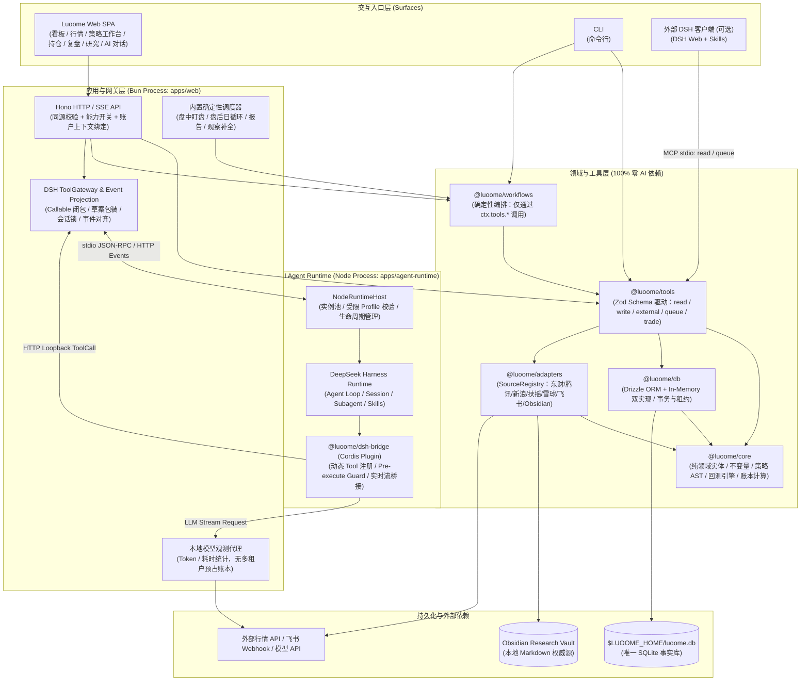
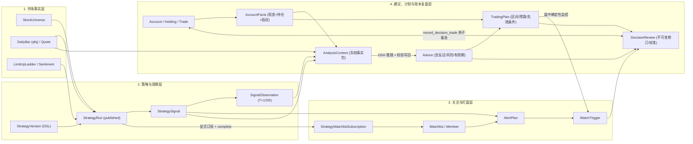
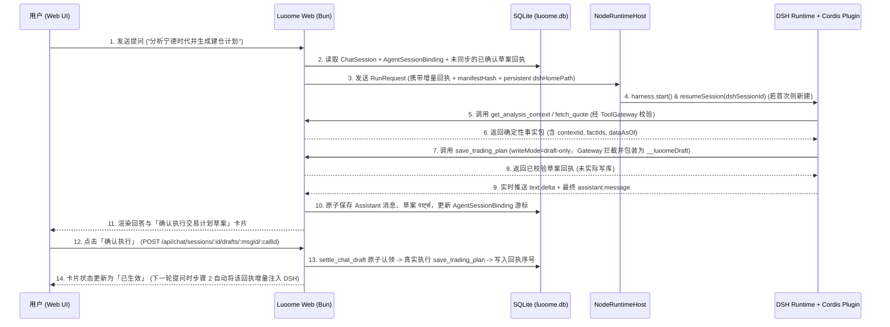
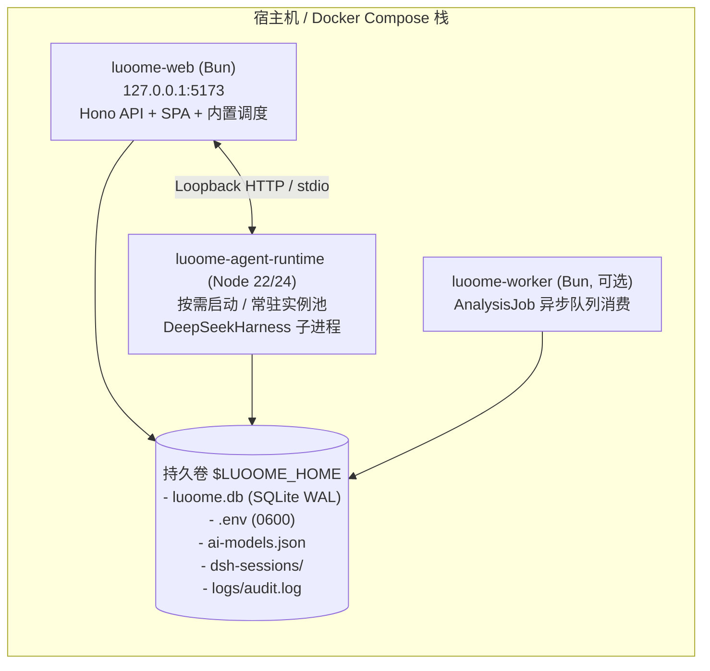

# LUOOME / AI Investment OS 整体技术架构与详细设计（去多租户 + 领域零 AI + DSH 深度集成）

> **基线分支**：`main`（`58ae5b9`）
> **核心架构决策**：
> 1. **彻底移除多租户（Hosted / Tenant / Subscription / Billing）体系**，回归纯粹的**单机/自托管（Self-Hosted）、单所有者、多投资账户（Multi-Account）**架构，唯一事实数据库为 `$LUOOME_HOME/luoome.db`。
> 2. **保留 `main` 分支完整业务底座与技术栈**（Bun Workspace + Hono Web + Drizzle/SQLite + 186 Zod Tools + 确定性 Workflows），不重写为 Next.js / NestJS / PostgreSQL / Redis。
> 3. **领域层 100% 零 AI 依赖**：移除领域内直接 LLM 调用与静默规则兜底，统一为 **`AnalysisContext`（冻结事实包）→ DSH / 消费端推理 → `record_*` / `complete_*`（强校验写回）**。
> 4. **DeepSeek Harness (DSH) 作为核心 Agent Runtime**：复用并演进 `main` 已验证的 `packages/dsh-bridge` + `apps/agent-runtime` + `apps/web/src/dsh`，补齐去租户化改造、持久 Session 恢复、`AgentDefinition` 领域模型与多 Agent 权限交集守卫。

---

## 一、整体技术架构与定位

### 1.1 系统定位

`LUOOME = 投资业务操作系统（确定性事实与账本内核） + DeepSeek Harness（智能推理与多 Agent 运行时）`

- **业务内核（TypeScript / Bun）**：负责行情与财务数据同步、前复权（`qfq`）与 Point-in-Time（PIT）门禁、版本化策略 DSL 求值、严格回测、多来源 Watchlist、AlertPlan 盘中/事件盯盘、账户现金与持仓账本（`Account` / `AccountFacts` / `Holding` / `Trade`）、逐股交易计划（`TradingPlan`）、结构化投资建议（`Advice`）、决策复盘与校准（`DecisionReview`）、以及本地 Obsidian 研究库（`ResearchVault`）。
- **Agent 运行时（Node / DeepSeek Harness）**：负责 Agent Loop、上下文管理与压缩、模型路由、Skill 装载、Subagent 协同、以及通过受控插件/MCP 调用 LUOOME 业务 Tool。

### 1.2 逻辑与物理架构总图



### 1.3 技术栈定案表

| 层次 | 选定技术 | 架构依据 |
|---|---|---|
| **主力运行时与包管理** | **Bun (`>=1.3.0`) + Bun Workspace** | 极速启动、原生支持 TypeScript 与 `bun:sqlite`，现有 4,000+ 测试基线零迁移成本 |
| **Agent 宿主运行时** | **Node.js (`>=22.19` / `24`)** | DSH SDK 依赖 `process.execPath` 与 Node 原生模块，由独立 `apps/agent-runtime` 承载 |
| **Web 服务与前端** | **Hono + 原生 HTML/CSS/JS + Lightweight Charts** | 零构建膨胀、同源部署、已完整实现策略工作台/看板/持仓/复盘/聊天确认卡 |
| **Agent 引擎与插件** | **DeepSeek Harness (`0.2.1-rc.2`) + Cordis (`4.0.5`)** | 复用成熟 Agent Loop、Session JSONL 持久化、Skill 加载与 Subagent 机制 |
| **ORM 与数据库** | **Drizzle ORM + SQLite (`$LUOOME_HOME/luoome.db`)** | 单文件零运维，支持 `IMMEDIATE` 原子账本事务、Fencing Token 租约与 FTS5 全文检索 |
| **契约与参数校验** | **Zod (`4.x`)** | 单一事实来源：自动派生 TypeScript 类型、MCP Schema、OpenAI Schema 与 DSH Tool 参数 |
| **任务队列与并发控制** | **SQLite 持久表 (`analysis_jobs` / `strategy_run_leases`)** | 利用 SQLite 串行写事务 + 部分唯一索引 + Fencing Token 实现去重、租约与死信，无需 Redis/BullMQ |

---

## 二、去多租户化（Multi-Tenant Removal）详细设计

### 2.1 为什么要移除多租户及其架构收益

在 `main` 分支中，为支持“个人订阅托管版（Hosted）”引入了双数据库拓扑（`control.sqlite` + 每租户 `tenant-id/luoome.db`）、邮箱 OTP 登录、套餐版本（`PlanVersion`）、订阅周期（`SubscriptionPeriod`）、支付回调、跨库 Outbox/Inbox 对账、预占计费账本（`hosted-meter`）以及单默认账户限制。

移除多租户后，系统回归**自托管单所有者（Single-Owner）+ 本地多投资账户（Multi-Account）**模型：
1. **存储合一**：废除 `control.sqlite` 与租户目录树，全局唯一数据库为 `$LUOOME_HOME/luoome.db`。
2. **多账户能力完全释放**：Web 端与 CLI/MCP 一致，支持创建和切换多个投资账户（如“A 股主账户”、“高股息子账户”、“模拟实验账户”），通过请求头 `x-luoome-account-id` 或参数指定 `accountId`。
3. **移除跨库补偿复杂度**：不再有平台 `HostedJob` 与业务 `WorkflowRun` 的跨库双写对账，所有异步任务（`WorkflowRun`、`AnalysisJob`）与业务事实处于同一 SQLite 事务边界内。
4. **DSH 调用链大幅精简**：`GatewayExecutionScope` 不再需要校验 `tenantId`、`tenantGeneration`、订阅有效性与微元（micro-CNY）预占冻结，只需校验 `runId`、`conversationId`、`accountId`、`manifestHash` 与能力边界。

### 2.2 逐包清理与重构清单

| 包 / 目录 | 直接删除的文件 / 模块 | 保留并重构的文件 / 模块 |
|---|---|---|
| **`packages/core`** | 删除 `src/hosted/` 整个目录（`auth.ts`、`llm.ts`、`notification.ts`、`payment-port.ts`、`payments.ts`、`platform.ts`、`privacy.ts`、`report-automation.ts`、`repository.ts`、`tenant.ts` 及测试）；删除 `src/public-market-store.ts` | 修改 [`src/index.ts`](file:///Users/lijun/project/luoome/packages/core/src/index.ts) 移除 `hosted/*` 导出；修改 [`src/context.ts`](file:///Users/lijun/project/luoome/packages/core/src/context.ts) 移除 `identity`、`hostedAuthorization`、`llmOperationScope`、`llmExecution` |
| **`packages/db`** | 删除 `src/hosted/` 整个目录（35 个文件，含 `platform-*`、`tenant-*`、`public-market-*`、`report-automation-*`、`watch-delivery-*`） | 保留 `src/schema/index.ts`、`src/client.ts`、`src/repository/`（标准单机 Drizzle + In-Memory 双实现） |
| **`packages/adapters`** | 删除 `src/hosted/` 整个目录（`email-otp.ts`、`payment.ts`、`smtp.ts`、`notification.ts`）；删除 `src/llm/hosted-meter.ts` 与 `src/llm/hosted-model-transport.ts` 及其测试 | 将 `src/llm/` 中的模型目录（`model-catalog.ts`）与 AI SDK 适配器迁移至独立包 `packages/ai-runtime` |
| **`packages/tools`** | 删除 `src/hosted/`（12 个文件）、`src/platform/`（22 个文件）、`src/tools/hosted-tenant.ts` 及测试；删除 `src/tools/update-account.ts` 中的 hosted 单账户限制 | 保留 `src/registry.ts` 与全部业务 Tool；恢复 `create_account` 在 Web 端的可用性 |
| **`packages/workflows`** | 删除 `src/hosted-reports.ts`、`src/hosted-strategy.ts` 及 5 个 `hosted-*.test.ts` | 保留全部标准业务 Workflow（`strategy-daily-cycle`、`trading-plan-daily-cycle`、`intraday-watch` 等） |
| **`apps/web`** | 删除 `src/hosted-*.ts` 及 `src/hosted-*.test.ts`（共 25 个文件）；删除 `src/dsh/hosted-stream.ts`；删除 `public/hosted/` 目录及 `public/js/hosted-*.js`（5 个文件） | 重构 [`src/server.ts`](file:///Users/lijun/project/luoome/apps/web/src/server.ts)：移除 `options.hosted` 分支，恢复 `startWeb` 直接使用 `buildWebContext(resolveDbPath())` 启动 `Bun.serve` 并挂载进程内可选调度器；精简 `src/dsh/` |
| **`apps/worker`** | 删除基于 `openHostedService` 的租户轮询逻辑（`src/index.ts`、`src/operations.ts`、`src/reports.ts`、`src/strategy.ts`、`src/watch.ts`、`src/fixture-load.ts`） | 重构为**单机后台 Worker（可选独立进程）**：直接连接 `$LUOOME_HOME/luoome.db`，执行定时 Workflow 与 `AnalysisJob` 队列消费 |

### 2.3 `ToolContext` 与 `startWeb` 恢复后的契约

移除多租户与内置 AI 端口后，[`packages/core/src/context.ts`](file:///Users/lijun/project/luoome/packages/core/src/context.ts) 中的 `ToolContext` 收敛为纯净的确定性上下文：

```ts
// packages/core/src/context.ts
export interface ToolContext {
  readonly repos: RepositoryRegistry;
  readonly adapters: {
    readonly market: MarketDataAdapterLike;
    readonly stockUniverse?: StockUniverseManagerLike;
  };
  readonly notification?: NotificationManagerLike;
  readonly eventProviders?: readonly StockEventProviderLike[];
  readonly limitUpLadder?: LimitUpLadderManagerLike;
  readonly dragonTiger?: DragonTigerManagerLike;
  readonly northboundFlow?: NorthboundFlowManagerLike;
  readonly news?: NewsManagerLike;
  readonly sectorQuote?: SectorQuoteManagerLike;
  readonly ashareSentiment?: AShareSentimentManagerLike;
  readonly researchVault?: ResearchVaultAdapterLike;
  readonly researchRemote?: ResearchRemoteImportAdapterLike;
  readonly researchEmbedding?: ResearchEmbeddingAdapterLike;
  readonly researchVaultGitSync?: ResearchVaultGitSyncAdapterLike;
  readonly fundamentalData?: FundamentalDataAdapterLike;
  readonly portfolioBenchmark?: {
    readonly stockId: string;
    readonly name: string;
  };
  readonly user: {
    readonly id: string;
    readonly defaultAccountId: string;
  };
  readonly clock: () => Date;
  readonly logger: Logger;
  readonly auditLog?: AuditLoggerLike;
  readonly auditCaller?: string;
  readonly reportExecutionOwner?: string;
  readonly abortSignal?: AbortSignal;
}
```

[`apps/web/src/server.ts`](file:///Users/lijun/project/luoome/apps/web/src/server.ts) 的 `startWeb` 恢复为直接加载本地单库 `$LUOOME_HOME/luoome.db`：

```ts
// apps/web/src/server.ts
export interface StartWebOptions {
  readonly port: number;
  readonly host?: string;      // 默认 '127.0.0.1'
  readonly dbPath?: string;    // 默认 resolveDbPath() -> ~/.luoome/luoome.db
  readonly enableScheduler?: boolean; // 默认 true（交易时段盯盘 + 盘后策略/计划/报告 tick）
}

export const startWeb = async (options: StartWebOptions): Promise<WebServerHandle> => {
  const dbPath = options.dbPath ?? resolveDbPath();
  const ctx = await buildWebContext(dbPath, process.env);
  const app = createWebApp(ctx, {
    exposeWrite: process.env.LUOOME_EXPOSE_WRITE === 'true',
    exposeExternal: process.env.LUOOME_EXPOSE_EXTERNAL === 'true',
    // 注入本地设置 Store（行情源、飞书、Research Vault、AI Runtime 配置）
  });
  const server = Bun.serve({
    hostname: options.host ?? process.env.LUOOME_HOST ?? '127.0.0.1',
    port: options.port,
    idleTimeout: WEB_SERVER_IDLE_TIMEOUT_SECONDS,
    fetch: app.fetch,
  });
  // 按配置启动进程内确定性调度器（使用 SQLite Lease 防多进程重入）
  ...
};
```

---

## 三、业务内核与量化数据底座详细设计

### 3.1 业务域模块与核心实体全集

在 `packages/core`、`packages/db`、`packages/tools`、`packages/workflows` 纵向分层下，系统包含 8 个正交业务域（保持 `main` 已验证的领域模型不变）：

| 业务域 | 核心领域实体 (`packages/core/src/entity/`) | 核心职责与不变量 |
|---|---|---|
| **1. 行情与市场事实 (Market & Events)** | [`Stock`](file:///Users/lijun/project/luoome/packages/core/src/entity/stock.ts), [`StockUniverseSnapshot`](file:///Users/lijun/project/luoome/packages/core/src/entity/stock-universe.ts), [`Quote`](file:///Users/lijun/project/luoome/packages/core/src/entity/quote.ts), [`DailyBar`](file:///Users/lijun/project/luoome/packages/core/src/entity/quote.ts), [`MinuteBar`](file:///Users/lijun/project/luoome/packages/core/src/entity/minute-bar.ts), [`LimitUpLadder`](file:///Users/lijun/project/luoome/packages/core/src/entity/limit-up-ladder.ts), [`AShareSentimentSnapshot`](file:///Users/lijun/project/luoome/packages/core/src/entity/ashare-sentiment.ts), [`DragonTigerList`](file:///Users/lijun/project/luoome/packages/core/src/entity/dragon-tiger.ts), [`NorthboundFlowSeries`](file:///Users/lijun/project/luoome/packages/core/src/entity/northbound-flow.ts), [`StockEvent`](file:///Users/lijun/project/luoome/packages/core/src/entity/stock-event.ts) | 统一使用前复权（`qfq`）日线计算指标与策略；严格区分 `observedAt`（市场事件时间）与 `fetchedAt`（抓取时间）；股票目录完整校验后原子更新，缺失只标 `missing` 不物理删除。 |
| **2. 策略与量化因子 (Strategy & Factor)** | [`Strategy`](file:///Users/lijun/project/luoome/packages/core/src/entity/strategy.ts), `StrategyVersion`, `StrategyRun`, `StrategyResult`, `StrategySignal`, [`SignalObservation`](file:///Users/lijun/project/luoome/packages/core/src/entity/signal-observation.ts), [`StrategySchedule`](file:///Users/lijun/project/luoome/packages/core/src/entity/strategy-schedule.ts), [`StrategyDataCheckpoint`](file:///Users/lijun/project/luoome/packages/core/src/entity/strategy-checkpoint.ts), [`FinancialFact`](file:///Users/lijun/project/luoome/packages/core/src/entity/fundamental.ts), `FundamentalScore` | 版本不可变（先校验后发布）；执行状态（`running/complete/failed`）、数据健康度（`complete/partial/unavailable`）与发布资格（`published/withheld/non-publishing`）三者正交分离；信号记录 T+1/T+3/T+5 真实表现。 |
| **3. 回测与评估 (Replay & Backtest)** | [`StrategyEvaluationSession`](file:///Users/lijun/project/luoome/packages/core/src/entity/strategy.ts), [`StrictBacktestRun`](file:///Users/lijun/project/luoome/packages/core/src/entity/strategy-backtest.ts), `StrictBacktestSpec`, `StrictBacktestGateAudit` | 区分“历史选股重放（Replay）”与“严格组合回测（StrictBacktest：D+1 开盘、100 股整手、佣金/印花税/滑点、涨跌停/停牌门禁、Evaluator 代码 SHA-256 指纹）”。 |
| **4. 股票池与盯盘预警 (Watchlist & Alert)** | [`Watchlist`](file:///Users/lijun/project/luoome/packages/core/src/entity/watchlist.ts), `WatchlistMember`, [`StrategyWatchlistSubscription`](file:///Users/lijun/project/luoome/packages/core/src/entity/strategy-watchlist-subscription.ts), [`AlertPlan`](file:///Users/lijun/project/luoome/packages/core/src/entity/alert-plan.ts), [`WatchTrigger`](file:///Users/lijun/project/luoome/packages/core/src/entity/watch-trigger.ts), [`WatchRun`](file:///Users/lijun/project/luoome/packages/core/src/entity/watch-run.ts) | 成员维护 `discovered → watching → researching → confirmed → archived` 阶段及 `manual/strategy/ai/portfolio/import` 多来源；Strategy 仅在显式订阅且 `published` 运行时同步至 Watchlist。 |
| **5. 账户账本与绩效 (Account & Portfolio)** | [`Account`](file:///Users/lijun/project/luoome/packages/core/src/entity/account.ts), [`AccountFacts`](file:///Users/lijun/project/luoome/packages/core/src/entity/account-facts.ts), [`Holding`](file:///Users/lijun/project/luoome/packages/core/src/entity/holding.ts), [`Trade`](file:///Users/lijun/project/luoome/packages/core/src/entity/trade.ts), `HoldingCashAdjustment`, [`PortfolioPerformanceSnapshot`](file:///Users/lijun/project/luoome/packages/core/src/entity/portfolio-performance.ts) | 现金余额 `Account.cashBalance` 与持仓/交易/资金流水在同一 `IMMEDIATE` 事务内增减，余额禁止为负；`AccountFacts` 提供带 `digest` 指纹的实时估值与对账门禁；支持 TWR 时间加权净值与基准归因。 |
| **6. 建议与逐股计划 (Advice & TradingPlan)** | [`Advice`](file:///Users/lijun/project/luoome/packages/core/src/entity/advice.ts), [`TradingPlan`](file:///Users/lijun/project/luoome/packages/core/src/entity/trading-plan.ts), [`InvestmentConsensus`](file:///Users/lijun/project/luoome/packages/core/src/entity/investment-workspace.ts) | `Advice` 必含核心论点、支持证据、**反证**、风险、有效期与标准免责声明；`TradingPlan` 绑定 `accountFactsDigest`，校验 100% 总仓位 / 30% 单票预算，盘中确定性监控入场与止损/退出边沿。 |
| **7. 决策复盘与报告 (Review & Report)** | [`DecisionReview`](file:///Users/lijun/project/luoome/packages/core/src/entity/decision-review.ts), `DecisionReviewRevision`, [`Report`](file:///Users/lijun/project/luoome/packages/core/src/entity/report.ts) | 冻结当时依据快照，追加不可变修订，支持原子登记外部已发生交易（`record_decision_trade`，唯一 `trade` 级人工入口）；生成开盘、收盘、周报结构化事实简报。 |
| **8. 研究库 (Research Vault)** | [`ResearchTopicIndex`](file:///Users/lijun/project/luoome/packages/core/src/entity/research-vault.ts), `ResearchDocument`, [`StockResearchProfile`](file:///Users/lijun/project/luoome/packages/core/src/entity/stock-research-profile.ts), [`ResearchEmbeddingIndexState`](file:///Users/lijun/project/luoome/packages/core/src/entity/research-embedding.ts) | 本地 Obsidian Markdown 为权威正文源，SQLite 维护 FTS5 全文索引、显式主体链接（`SubjectLink`）与可选向量分块投影。 |

### 3.2 核心对象关系与数据流向图



---

## 四、领域层去 AI 与异步分析管线详细设计（Domain Zero-AI）

### 4.1 设计目标与核心原则

1. **领域层零 AI**：`packages/core`、`packages/db`、`packages/tools`、`packages/workflows`、`packages/mcp`、`packages/adapters` 彻底移除 `LLMAdapterLike` 与 `AgentRuntimeLike`，不导入任何生成式 AI SDK。
2. **消除静默规则兜底**：废除原 `LLMManager` 在模型失败时静默返回 `MA5/MA20` 规则模板并当作正常 `Advice` 落库的路径（该路径此前污染了 `confidence` 校准统计）。**没有推理消费者在线时，任务保持 `pending`，绝不伪造建议。**
3. **统一写回契约**：无论是用户在 Web/DSH 中发起的**交互式分析**，还是盘后定时工作流触发的**批量分析**，全部遵循同一条可验证链路：
   - **Step 1（装配确定性事实包）**：领域层生成 `AnalysisContext`，持久化 `facts`、`factIds`、`dataAsOf`、`contextHash`、`writeUntil` 与 `expiresAt`。
   - **Step 2（消费端模型推理）**：DSH Agent 或后台 `ai-runtime` Worker 读取事实包，执行推理。
   - **Step 3（领域层强校验写回）**：调用 `record_advice` / `record_analysis_result` / `complete_analysis_job`，领域层强制核对 `contextId` 时效、证据 `factIds` 子集、价格不变量、自动注入标准免责声明与 `AnalysisProvenance` 后原子落库。

### 4.2 领域实体设计（`packages/core/src/entity/`）

#### 4.2.1 `AnalysisContext`（分析事实包）

```ts
// packages/core/src/entity/analysis-context.ts
export type AnalysisKind =
  | 'advice_stock'
  | 'advice_position'
  | 'advice_market'
  | 'advice_strategy_candidate'
  | 'research_directions'
  | 'strategy_version_proposal'
  | 'strategy_insight_narrative';

export interface AnalysisFactItem {
  readonly id: string;                 // 稳定事实 ID，如 "quote:600519.SH", "signal:sig-123"
  readonly category: 'quote' | 'indicators' | 'holding' | 'account' | 'strategy' | 'observation' | 'sentiment' | 'research' | 'preflight';
  readonly label: string;
  readonly asOf: Date;
  readonly value: Record<string, unknown>;
}

export interface AnalysisContext {
  readonly id: string;                 // UUID
  readonly jobId: string | null;       // 批量任务关联 ID；交互式分析为 null
  readonly kind: AnalysisKind;
  readonly accountId: string;
  readonly subjectKind: 'stock' | 'position' | 'market' | 'strategy' | 'workspace';
  readonly subjectId: string;
  readonly dataAsOf: Date;             // 最旧关键事实的时点（非装配时刻）
  readonly facts: readonly AnalysisFactItem[];
  readonly factIds: readonly string[]; // 供写回时做 O(1) 子集校验
  readonly limitations: readonly string[]; // 必填：显式列出数据缺失或 retrieval 限制
  readonly contextHash: string;        // sha256(canonicalJson(facts) + dataAsOf.toISOString())
  /**
   * 写回接受截止时间（Q17）：
   * - 交互式：min(createdAt + 30min, 当交易日 15:00 — 若在盘中装配)
   * - 批量：随关联 AnalysisJob 进入终态即截止
   */
  readonly writeUntil: Date;
  /**
   * 审计保留与物理清理截止时间（Q12/Q17）：
   * - 交互式：createdAt + 180 天（支撑半年复盘与校准回溯）
   * - 批量：finishedAt + 30 天
   */
  readonly expiresAt: Date;
  readonly createdAt: Date;
}
```

#### 4.2.2 `AnalysisJob`（待分析异步任务）

```ts
// packages/core/src/entity/analysis-job.ts
export type AnalysisJobStatus =
  | 'pending'
  | 'claimed'
  | 'completed'
  | 'failed'
  | 'dead_letter'
  | 'cancelled';

export interface AnalysisJob {
  readonly id: string;
  readonly kind: AnalysisKind;
  readonly source: 'workflow' | 'tool' | 'schedule' | 'chat';
  readonly accountId: string;
  readonly subjectKind: AnalysisContext['subjectKind'];
  readonly subjectId: string;
  readonly priority: number;           // 0..100，默认按 kind 赋权
  readonly dedupeKey: string;          // sha256(kind|accountId|subjectKind|subjectId|tradingDate|canonicalOptions)
  readonly payload: Record<string, unknown>;
  readonly dataAsOf: Date;
  readonly status: AnalysisJobStatus;
  readonly attempts: number;
  readonly maxAttempts: number;        // 默认 3
  readonly notBefore: Date | null;     // 失败退避重试时间
  readonly claimToken: string | null;  // Fencing Token (UUID)
  readonly claimedBy: string | null;   // 如 "dsh:session-xxx" 或 "worker:local-1"
  readonly leaseUntil: Date | null;
  readonly contextId: string | null;   // 首次 claim 时生成并绑定
  readonly resultRef: string | null;   // 成功后落库的实体 ID（如 advice.id）
  readonly lastError: {
    readonly code: string;
    readonly message: string;
    readonly retryable: boolean;
    readonly occurredAt: string;
  } | null;
  readonly createdAt: Date;
  readonly updatedAt: Date;
  readonly finishedAt: Date | null;
}
```

#### 4.2.3 `AnalysisProvenance`（生成来源元数据）

```ts
// packages/core/src/entity/analysis-provenance.ts
export type AnalysisGeneratorKind =
  | 'dsh-chat'
  | 'dsh-worker'
  | 'embedded-dsh'
  | 'local-worker'
  | 'manual'
  | 'legacy-ai';

export interface AnalysisProvenance {
  readonly generatorKind: AnalysisGeneratorKind;
  readonly model?: string;             // 如 "deepseek:deepseek-v4-pro"
  readonly skillVersion?: string;      // Skill 文件的 git blob hash 或版本号
  readonly sessionRef?: string;        // DSH sessionId 或 runId
  readonly contextId?: string;         // 关联 AnalysisContext.id
  readonly jobId?: string;             // 关联 AnalysisJob.id（批量路径）
  readonly evidenceFactIds: readonly string[]; // 实际引用的 factIds（必须 ⊆ context.factIds）
  readonly generatedAt: Date;
}
```

### 4.3 数据库 Schema（SQLite DDL）

在 [`packages/db/src/schema/index.ts`](file:///Users/lijun/project/luoome/packages/db/src/schema/index.ts) 与 [`packages/db/src/client.ts`](file:///Users/lijun/project/luoome/packages/db/src/client.ts) 的 `ensureSchema` 中同步新增：

```sql
CREATE TABLE IF NOT EXISTS analysis_contexts (
  id TEXT PRIMARY KEY,
  job_id TEXT,
  kind TEXT NOT NULL,
  account_id TEXT NOT NULL,
  subject_kind TEXT NOT NULL,
  subject_id TEXT NOT NULL,
  data_as_of INTEGER NOT NULL,
  facts_json TEXT NOT NULL,
  fact_ids_json TEXT NOT NULL,
  limitations_json TEXT NOT NULL,
  context_hash TEXT NOT NULL,
  write_until INTEGER NOT NULL,
  expires_at INTEGER NOT NULL,
  created_at INTEGER NOT NULL
);

CREATE INDEX IF NOT EXISTS analysis_contexts_subject_idx
  ON analysis_contexts (account_id, kind, subject_kind, subject_id, created_at DESC);
CREATE INDEX IF NOT EXISTS analysis_contexts_expiry_idx
  ON analysis_contexts (expires_at);

CREATE TABLE IF NOT EXISTS analysis_jobs (
  id TEXT PRIMARY KEY,
  kind TEXT NOT NULL,
  source TEXT NOT NULL,
  account_id TEXT NOT NULL,
  subject_kind TEXT NOT NULL,
  subject_id TEXT NOT NULL,
  priority INTEGER NOT NULL DEFAULT 50,
  dedupe_key TEXT NOT NULL,
  payload_json TEXT NOT NULL,
  data_as_of INTEGER NOT NULL,
  status TEXT NOT NULL,
  attempts INTEGER NOT NULL DEFAULT 0,
  max_attempts INTEGER NOT NULL DEFAULT 3,
  not_before INTEGER,
  claim_token TEXT,
  claimed_by TEXT,
  lease_until INTEGER,
  context_id TEXT,
  result_ref TEXT,
  error_json TEXT,
  created_at INTEGER NOT NULL,
  updated_at INTEGER NOT NULL,
  finished_at INTEGER
);

-- 活动态去重：同一 dedupe_key 在 pending/claimed 状态下全局唯一；终态后释放，允许次日或重排入队
CREATE UNIQUE INDEX IF NOT EXISTS analysis_jobs_active_dedupe_uq
  ON analysis_jobs (dedupe_key)
  WHERE status IN ('pending', 'claimed');

CREATE INDEX IF NOT EXISTS analysis_jobs_claimable_idx
  ON analysis_jobs (status, priority DESC, created_at ASC);
CREATE INDEX IF NOT EXISTS analysis_jobs_lease_idx
  ON analysis_jobs (status, lease_until)
  WHERE status = 'claimed';

-- 存量 advices 表幂等补列
ALTER TABLE advices ADD COLUMN provenance_json TEXT;
ALTER TABLE advices ADD COLUMN generator_kind TEXT;
CREATE INDEX IF NOT EXISTS advices_generator_kind_idx ON advices (generator_kind);
```

### 4.4 分析队列与写回 Tool 契约（12 个新增 Tool）

`SideEffect` 枚举更新为 `read | write | external | queue | trade`（移除原 `advice` 等级）。

| Tool 名称 | `sideEffect` | 核心职责与幂等/校验规则 |
|---|---|---|
| `enqueue_analysis_job` | `write`（Internal） | 仅导出至 `WorkflowToolMap`，不进公共 `toolRegistry`。按活跃 `dedupeKey` 幂等入队，已存在活跃任务则返回 `{ jobId, deduped: true }`。 |
| `get_analysis_context` | `read` | 交互式分析入口：实时装配目标标的/持仓/策略的确定性事实包并持久化至 `analysis_contexts`，返回 `{ contextId, facts, factIds, dataAsOf, limitations, writeUntil, expiresAt }`。 |
| `claim_analysis_jobs` | `queue` | 原子回收 `lease_until <= now` 的过期任务（`attempts < max_attempts` 回 `pending`，否则进 `dead_letter`），再按 `priority DESC, created_at ASC` 认领最多 `limit` 条任务，生成 `claimToken` 并装配 `AnalysisContext`。 |
| `complete_analysis_job` | `queue` | 校验 `claimToken` 与 `lease_until > now`（失租返回 `lease_lost_before_commit`）；调用统一校验器落库结果，同一事务将任务标为 `completed` 并冻结对应 `context.write_until = now`。同 token + 同结果哈希幂等返回。 |
| `fail_analysis_job` | `queue` | 校验 `claimToken`；若 `retryable && attempts < maxAttempts` 则设置指数退避 `not_before` 并回退为 `pending`，否则转入 `dead_letter`。 |
| `record_advice` | `queue` | 交互式建议写回入口：校验 `contextId` 存在、`now <= writeUntil`、若关联 `jobId` 则 job 未终态、`evidenceFactIds ⊆ context.factIds`、价格满足 `assertAdviceInvariants`，注入 `STANDARD_DISCLAIMERS` 与 `provenance` 后写入 `advices`。 |
| `record_analysis_result` | `queue` | 交互式非 Advice 结果写回入口（覆盖 `research_directions`、`strategy_version_proposal`、`strategy_insight_narrative`），经各自领域校验器落库。 |
| `list_analysis_jobs` | `read` | 按 `status`、`kinds`、`accountId` 分页查询任务队列。 |
| `get_analysis_job` | `read` | 查询单条任务详情、关联 `contextId` 与 `resultRef`。 |
| `get_analysis_metrics` | `read` | 返回各状态计数、`oldestPendingAgeMs`、**`claimExpiredNotRecycled`**（消费者离线监控指标）与按 `kind` 统计的成功率。 |
| `requeue_analysis_job` | `write` | 运维/人工将 `dead_letter` 或 `failed` 任务重置为 `pending`（`attempts = 0`）。 |
| `cancel_analysis_job` | `write` | 人工取消 `pending` 或 `claimed` 任务。 |

---

## 五、Agent 领域模型与 DSH 运行时详细设计

### 5.1 模块边界：在既有包上演进，不建平行空包

基于 `main` 分支已有资产，Agent 相关能力严格按以下四层落位，不新建冗余的 `agent-core / agent-dsh` 空包：

1. **`packages/core/src/entity/agent-definition.ts` & `agent-session.ts`**：纯领域定义（`AgentDefinition`、`AgentSessionBinding`、`AgentSkillDescriptor`）与 `Repository` 接口。
2. **`packages/db/src/repository/agent.ts`**：`agent_definitions` 与 `agent_session_bindings` 的 Drizzle + In-Memory 双实现及 Contract Tests。
3. **`packages/dsh-bridge`**：跨进程 JSON-RPC 旁路协议（`protocol.ts`）、运行时配置（`runtime-config.ts`）与 Node Cordis 插件（`plugin.ts`，负责工具动态注册、父子 Agent 权限交集守卫、实时流桥接、模型代理转发）。
4. **`apps/agent-runtime` & `apps/web/src/dsh`**：
   - `apps/agent-runtime`：独立的受限 Node SDK Host（`NodeRuntimeHost`），管理 `DeepSeekHarness` 实例生命周期与持久 Session 恢复。
   - `apps/web/src/dsh`：Bun 侧的 `ToolGateway`（移除多租户字段）、`DshChatRuntime`、会话级持久绑定同步与事件流投影。

### 5.2 Agent 领域模型设计（`AgentDefinition` 与 `AgentSessionBinding`）

将“Agent 产品定义（可复用模板）”与“DSH Runtime Session（一次有状态的会话上下文）”解耦为 `1:N` 关系：

```ts
// packages/core/src/entity/agent-definition.ts
export type AgentRoleKind =
  | 'coordinator' // 任务理解、分派与汇总
  | 'research'    // 个股基本面、事件与研究库深挖
  | 'market'      // 行情、连板天梯、情绪与技术指标分析
  | 'strategy'    // 策略 DSL 草案、回测评估与候选筛选
  | 'risk'        // 仓位预算、止损边沿与反证核查
  | 'custom';     // 用户自定义 Agent

export interface AgentExecutionPolicy {
  readonly maxToolCallsPerRun: number;    // 默认 32
  readonly maxModelCallsPerRun: number;   // 默认 8
  readonly runTimeoutMs: number;          // 默认 120_000
  readonly toolTimeoutMs: number;         // 默认 15_000
  readonly writeMode: 'draft-only' | 'queue-only' | 'disabled'; // 聊天默认 draft-only，后台消费者 queue-only
  readonly allowSubagents: boolean;
  readonly allowedSubagentIds: readonly string[];
}

export interface AgentDefinition {
  readonly id: string;                    // 如 "system:research", "user:high-dividend-analyst"
  readonly name: string;
  readonly description: string;
  readonly type: 'system' | 'user';
  readonly role: AgentRoleKind;
  readonly status: 'draft' | 'active' | 'disabled';
  readonly modelConfig: {
    readonly provider?: string;           // 缺省使用全局默认模型
    readonly model?: string;
    readonly maxTokens: number;
  };
  readonly systemPrompt: string;          // 角色专属提示词（追加在平台安全铁律之后）
  readonly skillIds: readonly string[];   // 允许装载的 Skill 标识
  readonly allowedDomains: readonly ('market' | 'research' | 'strategy' | 'portfolio' | 'watch' | 'review' | 'analysis-queue' | 'web')[];
  readonly allowedTools: readonly string[]; // 显式工具白名单；与 allowedDomains 及全局暴露面取交集
  readonly executionPolicy: AgentExecutionPolicy;
  readonly createdAt: Date;
  readonly updatedAt: Date;
}
```

#### 系统内置 Agent 矩阵（首期默认启用 `system:research` 与 `system:analysis-worker`，其余随多 Agent 阶段激活）

| 内置 ID | 角色 | 允许工具域 (`allowedDomains`) | `writeMode` | 核心职责 |
|---|---|---|---|---|
| `system:research` | 个股与组合投研助手 | `market`, `research`, `portfolio`, `watch`, `review`, `web` | `draft-only` | 默认 Web 对话 Agent；读取全量事实，生成建议/计划/持仓修改时返回待确认草案卡 |
| `system:strategy` | 策略研发助手 | `strategy`, `market`, `research` | `draft-only` | 辅助编写 Strategy DSL、对比运行 Diff、解读 `StrategyInsight` 事实 |
| `system:risk` | 风控与反证核查员 | `portfolio`, `market`, `watch`, `review` | `disabled` | 纯只读；专门挑刺既有论点、核查单票 30% / 总仓 100% 预算与止损失效条件 |
| `system:coordinator` | 多 Agent 协调器 | 全只读域 + 子 Agent 派发 | `draft-only` | 拆解复杂投研问题，并行/串行调度 `research` / `strategy` / `risk` 子 Agent 并汇总 |
| `system:analysis-worker` | 异步分析队列消费者 | `market`, `research`, `strategy`, `portfolio`, `analysis-queue` | `queue-only` | 后台认领 `AnalysisJob`（`claim` → 推理 → `complete` / `fail`），不暴露给普通聊天 |

### 5.3 持久 Session 恢复与回执增量同步设计（补齐 D08）

在 `main` 分支的 D01–D07 实现中，DSH 每次对话轮次都在临时目录重建 Session。为支持长周期研究上下文复用与崩溃恢复，新增 `AgentSessionBinding` 表：

```ts
// packages/core/src/entity/agent-session.ts
export interface AgentSessionBinding {
  readonly conversationId: string;        // PK：对应 ChatSession.id
  readonly accountId: string;
  readonly agentDefinitionId: string;
  readonly dshSessionId: string;          // DSH 持久化 JSONL 的 sessionId
  readonly dshHomePath: string;           // $LUOOME_HOME/dsh-sessions/<conversationId>
  readonly profileHash: string;
  readonly configHash: string;
  /**
   * 已同步至 DSH Session 的最后一条 Luoome ChatMessage 序号与已结算草案回执游标，
   * 避免每轮重复注入完整 20 条历史，同时确保用户在 Web 点击“确认草案”后的真实结果在下一轮准确进入 DSH 上下文。
   */
  readonly lastSyncedMessageId: string | null;
  readonly settledDraftReceiptsCursor: number;
  readonly status: 'active' | 'interrupted' | 'invalidated';
  readonly updatedAt: Date;
}
```

#### 会话续接与草案确认同步时序图



### 5.4 去租户化后的 `GatewayExecutionScope` 与 `ToolGateway`

移除 `tenantId`、`tenantGeneration` 与托管计费预占后，[`apps/web/src/dsh/execution-scope.ts`](file:///Users/lijun/project/luoome/apps/web/src/dsh/execution-scope.ts) 精简并强化对 `accountId` 与 `agentId` 的绑定：

```ts
// apps/web/src/dsh/execution-scope.ts
export interface GatewayIdentity {
  readonly accountId: string;
  readonly conversationId: string;
  readonly runId: string;
  readonly agentDefinitionId: string;
  readonly runtimeInstanceId: string;
  readonly sessionId: string;
}

export interface GatewayScopeSnapshot extends GatewayIdentity {
  readonly audience: string;
  readonly manifestHash: string;
  readonly expiresAt: number;
  readonly allowedCapabilities: readonly SideEffect[];
}
```

`ToolGateway` 强制执行三道防线：
1. **身份与账户强绑定**：若模型传入的 Tool 参数包含 `accountId` 且不等于 `scope.accountId`，直接拒绝（`permission_denied`）；缺省 `accountId` 的调用由服务端闭包强制注入 `scope.accountId`。
2. **草案隔离（Draft-and-Confirm）**：当 `writeMode === 'draft-only'` 时，`ToolGateway` 只暴露由 `buildChatTools` 包装后的 callable 闭包，禁止调用 `toolRegistry.get(name).execute`，从根本上杜绝模型在对话中直接修改持仓或账本。
3. **执行 Token 级去重**：沿用 `dsh-bridge` 按 `ToolExecution['token']` 分配的跨进程 `callId`，防止模型在不同推理步复用 `tool_call_id` 导致结果错位。

### 5.5 多 Agent 协同与子 Agent 权限交集守卫（补齐 D10）

根据对 DSH 上游 `subagent-spawn-in-process` 的源码审查（`dsh-plugin-platform-design.md` U14），**DSH 在进程内派生子 Agent 时，默认不会自动继承父 Agent 的 `agent.ctx.tools.restrict` 限制**。

为防止子 Agent 权限逃逸，[`packages/dsh-bridge/src/plugin.ts`](file:///Users/lijun/project/luoome/packages/dsh-bridge/src/plugin.ts) 在 `agent/created` 与 `tools/pre-execute` 钩子中实施硬性交集守卫：

```ts
// packages/dsh-bridge/src/plugin.ts 演进要点
ctx.on('agent/created', async ({ agent }) => {
  const isRoot = agent.session.id === sessionId;
  if (!isRoot && !run.allowSubagents) {
    throw new Error('Subagent creation is disabled for this run');
  }
  // 子 Agent 的允许工具集 = 子角色声明工具 ∩ 父级 Run Manifest 允许工具
  const subagentRoleTools = resolveSubagentAllowedTools(agent, run);
  const effectiveAllowlist = subagentRoleTools.filter((name) => manifest.has(name));
  agent.ctx.tools.restrict({ allow: effectiveAllowlist });
  boundAgentAllowlists.set(agent.session.id, new Set(effectiveAllowlist));
});
```

同时，父 Agent 与所有派生的子 Agent **共享同一个 Run 级计数器**：
- `toolCalls` 总数不超过 `host.limits.maxToolCalls`；
- `modelCalls` 总数不超过 `host.limits.maxModelCalls`；
- 只有当根 Agent 及其派生的全部活跃子 Agent 均进入终态后，`NodeRuntimeHost` 才判定整个 Run 完成。

---

## 六、项目代码目录结构与静态分层守卫

### 6.1 去多租户后的标准 Monorepo 目录结构

```txt
luoome/
├── packages/
│   ├── core/                  # 纯领域层（零 IO、零 AI）：实体、Branded Types、不变量、策略 AST/回测/账本纯计算、Repository 接口
│   ├── db/                    # 数据持久层：Drizzle SQLite Schema、ensureSchema 幂等迁移、Drizzle + In-Memory 双仓储与 Contract Tests
│   ├── adapters/              # 外部适配层：统一 SourceRegistry（东财/腾讯/新浪/扶摇/雪球/10jqka）、飞书通知、Obsidian 研究库、可选向量 Embedding
│   ├── tools/                 # 业务工具层：190+ Zod Schema 驱动的 Tool 定义、Registry、MCP/OpenAI Schema 派生、Agent 场景白名单
│   ├── workflows/             # 确定性编排层：盘后策略日循环、逐股计划日循环、盘中盯盘、开盘/收盘/周报、策略自治（仅调 ctx.tools.*）
│   ├── mcp/                   # MCP 暴露层：stdio Server，支持 read / queue / write / external 暴露面与 allowlist/denylist
│   ├── dsh-bridge/            # DSH 桥接协议与插件：跨进程 JSON Schema 协议 + Node Cordis 插件 (luoome-run-bridge)
│   ├── ai-runtime/            # 模型运行时包（从 adapters/llm 抽离）：模型目录加载与 AI SDK 适配器（仅允许 apps/* 导入）
│   └── cli/                   # 命令行入口（luoome start / web serve / mcp serve / workflow run / tools list）
├── apps/
│   ├── web/                   # Hono Web 服务 + 同源 SPA + DSH ToolGateway / 会话绑定 / 实时事件投影 + 进程内可选调度器
│   ├── worker/                # 单机后台 Worker（可选独立常驻进程）：消费 AnalysisJob 队列与执行定时 Workflow
│   └── agent-runtime/         # 独立受限 Node DSH SDK Host（管理 DeepSeekHarness 子进程与受限 Profile）
├── skills/
│   └── luoome/                # 供 DSH 加载的投研技能集（analysis-worker / morning-brief / post-close-review / stock-deep-dive / decision-journal）
├── infra/
│   └── dsh/                   # 固定 DSH/Cordis 产物哈希、受限 Profile 模板与构建/验收脚本
└── docs/                      # 架构、领域语言、PRD、DDD 与运维手册
```

### 6.2 依赖方向与静态守卫（`scripts/check-layers.ts`）

```txt
cli / mcp ──────────────► tools ──► core
                                  │
                                  ├──► db ──► core
                                  └──► adapters ──► core
workflows ────────────────────► tools ──► core
apps/web / apps/worker ───────► { tools, workflows, ai-runtime, dsh-bridge }
apps/agent-runtime ───────────► dsh-bridge
```

新增 `scripts/check-layers.ts` 并接入 `bun run lint` / `bun run check:layers`，强制执行以下 4 条静态门禁：
1. **领域包零 AI 包依赖**：`core`、`db`、`tools`、`workflows`、`mcp`、`adapters` 禁止导入 `@luoome/ai-runtime`、`ai`、`@ai-sdk/*`、`@deepseek-ai/*`。
2. **领域包零模型端点字面量**：除 `packages/adapters/src/research-embedding/`（仅限 `/embeddings` 向量检索基础设施白名单）外，领域包源码禁止出现 `/chat/completions`、`/completions`、`/embeddings` 字面量。
3. **零多租户残留**：全仓禁止再次引入 `control.sqlite`、`tenantId`、`tenantGeneration`、`HOSTED_*` 等多租户概念。
4. **Core 零 IO**：`packages/core` 禁止导入 `bun:sqlite`、`drizzle-orm`、`node:http`、`node:net` 或其它工作区包。

---

## 七、部署架构与安全边界

### 7.1 部署拓扑（单机直装 / Docker Compose）

系统移除多租户后，仅需单机或单台轻量云服务器（2–4 vCPU / 4–8GB RAM）即可完整运行：



### 7.2 安全与副作用铁律

| 安全维度 | 强制机制 |
|---|---|
| **交易硬卡 (`advice ≠ trade`)** | 任何 Advice、StrategySignal、TradingPlan 或盯盘触发均不自动下单；`record_decision_trade` 仅用于事后登记用户在券商已完成的成交，且永不向 MCP 或 DSH Agent 暴露（`LUOOME_EXPOSE_TRADE=true` 启动即抛错退出）。 |
| **五级副作用门控** | `read`（默认开放）、`queue`（仅 `LUOOME_EXPOSE_QUEUE=true` 的消费者实例开放）、`write`（需 `LUOOME_EXPOSE_WRITE=true`，且 Web 对话强制走草案确认）、`external`（需 `LUOOME_EXPOSE_EXTERNAL=true`）、`trade`（远端/Agent 永不开放）。 |
| **DSH 受限 Profile** | 剥离 `Shell`、`danger-full-access`、动态 `plugin_manager` 与 `session-log-deepseek`；每次启动前执行 `--dump-config` 校验插件清单哈希。 |
| **外部 URL 与 SSRF 防护** | 原生 `web_fetch` 及远程研究文档导入强制经过地址分类、禁止内网/回环/云 Metadata IP、DNS 解析绑定与响应体积限制。 |
| **建议合规披露** | 所有 Advice 写回由领域层强制校验 `counterEvidence`（反证）、`risks`（风险点）、`validUntil`（有效期）并自动注入 `STANDARD_DISCLAIMERS`；`confidence` 仅表达模型信心度，严禁表述为确定性胜率。 |

---

## 八、分阶段实施路线图与验收标准

不再从零重写基础模块，直接在 `main` 分支上按 **4 个可独立验收、可安全回滚的阶段（M1 → M4）** 推进：

| 阶段 | 核心任务范围 | 关键产出物 | 验收标准 (Acceptance Criteria) |
|---|---|---|---|
| **Phase 1 (M1)：去多租户化清理与单机多账户恢复** | 1. 删除 `core/db/adapters/tools/workflows/web` 中的 `hosted` 与 `platform` 模块及测试；<br/>2. 恢复 `apps/web/src/server.ts` 的 `startWeb` 直接挂载 `$LUOOME_HOME/luoome.db` 与进程内调度器；<br/>3. 恢复 Web 端多投资账户创建与切换；<br/>4. 精简 `apps/web/src/dsh/` 中的租户字段与计费预占传输。 | 干净的单机多账户代码树；更新后的 `README.md`、`CONTEXT.md`、`ARCHITECTURE.md` | 1. 全仓无 `hosted` / `tenant` / `control.sqlite` 残留；<br/>2. `bun run typecheck`、`bun run lint`、`bun run test:all` 全绿；<br/>3. `bun run web` 启动后可直接免登录进入完整看板并切换多账户。 |
| **Phase 2 (M2)：领域层去 AI 与分析队列三件套** | 1. 新增 `AnalysisContext`（含 `write_until` 与 `expires_at`）、`AnalysisJob`、`AnalysisProvenance` 实体、DDL 与双仓储（含并发 Contract Tests）；<br/>2. 实现 12 个分析队列与写回 Tool，新增 `queue` capability；<br/>3. 改造 `daily-advice`、`strategy-daily-cycle`、`trading-plan-daily-cycle`、`weekly-report`、`strategy-autonomy-weekly` 为确定性事实装配 + 入队；<br/>4. 将 `adapters/llm` 抽离为 `packages/ai-runtime`，删除领域内 9 个内置 AI Tool 与 `ToolContext.adapters.llm/agent`；<br/>5. 上线 `scripts/check-layers.ts` 零 AI 守卫。 | `analysis_jobs` / `analysis_contexts` 表；12 个新 Tool；`packages/ai-runtime`；`check-layers.ts` | 1. `bun run check:layers` 证明领域包零 AI 依赖与零模型端点字面量；<br/>2. 批量工作流执行期间模型调用次数为 `0`；<br/>3. 未知 `factId`、过期 `write_until`、违反价格不变量的写回 100% 被拒绝；<br/>4. 存量 Advice 自动回填 `legacy-ai` 且校准统计分桶正确。 |
| **Phase 3 (M3)：DSH 深度集成与持久 Session 恢复** | 1. 实现 `AgentSessionBinding` 仓储，打通 `NodeRuntimeHost` 的 `resumeSession` 与已确认草案回执增量注入；<br/>2. 重构 `apps/worker` 为单机队列消费者（支持用 `ai-runtime` 或内嵌 DSH 消费 `AnalysisJob`）；<br/>3. 落地 `skills/luoome/` 下的 5 个标准投研 Skill（含 `context_expired` 自动重取重试约定）；<br/>4. 将 Web Chat 默认运行时切换至受控内嵌 DSH Runtime（保留 `ai-sdk` 配置回退开关）。 | `agent_session_bindings` 表；单机 `apps/worker`；5 个 DSH Skills；端到端浏览器验证 | 1. Web 对话通过 DSH 调用真实行情与事实包工具，流式输出、工具卡与草案确认卡正常；<br/>2. 确认草案后下一轮提问 DSH 准确感知已执行回执，重启 Web 后会话上下文不断裂；<br/>3. 盘后策略入队的 `AnalysisJob` 被消费者成功认领并写回可追溯 Advice。 |
| **Phase 4 (M4)：`AgentDefinition` 与多 Agent 协同** | 1. 落地 `AgentDefinition` 实体、双仓储与 CRUD Tool；<br/>2. 内置 `coordinator / research / market / strategy / risk` 五类系统 Agent 模板；<br/>3. 在 `packages/dsh-bridge/src/plugin.ts` 中激活子 Agent 派生与 `agent/created` 工具权限交集守卫；<br/>4. 在 Web 端提供 Agent 配置与运行轨迹查看界面。 | `agent_definitions` 表；多 Agent 协同插件守卫；Web Agent 管理面板 | 1. Coordinator 可拆解任务并调度 Research / Risk 子 Agent 协同产出综合报告；<br/>2. 子 Agent 越权调用父级未授权工具时 100% 被 `dsh-bridge` 拦截；<br/>3. 父子 Agent 共享单次 Run 的工具与模型调用上限，全部子任务收尾后 Run 才标记 `completed`。 |
