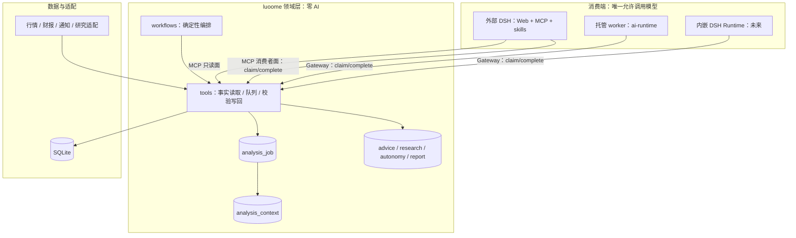

# luoome 的 DSH 改造详细设计

> 状态：草案（待外部评审，未实施）。
> 日期：2026-10-22。
> 决策来源：用户确认「DSH 是投资入口」并选择「方案 C：移除内置 AI，改为事实包 + 待分析队列，由消费端执行推理」；Q1、Q4、Q5 按建议确认（见 §1.4）。
> 上位设计：[Luoome × DSH 插件能力平台设计](./dsh-plugin-platform-design.md)（DSH 负责 Agent 执行，Luoome 拥有业务事实、身份、权限、确认、任务与成本账本）。
> 本文定位：把「单机接入 DSH」「领域层去 AI」「托管消费」三件事整合成一份可评审、可排期的改造总设计。
> 取代关系：本文整合并取代此前的「DSH 集成设计」草稿与「内置 AI 外置与待分析队列详细设计」；实施完成后，[AI SDK 接入与 LLM 重构设计](./ai-sdk-llm-refactor-design.md) 中「领域内 LLM 调用点不变」的部分退役。
> 关联：[Agent Loop 技术选型分析](./agent-loop-tech-selection.md)、[Web 对话助手设计](./web-chat-design.md)、[托管个人订阅详细设计](./hosted-personal-subscription-detailed-design.md)、[Strategy 日运行与历史评估可靠性详细设计](./strategy-daily-cycle-and-replay-detailed-design.md)、[Strategy AI 生命周期管理详细设计](./strategy-ai-lifecycle-detailed-design.md)、[Strategy 实验、晋级与反馈闭环详细设计](./strategy-experiment-feedback-detailed-design.md)、[账户绩效与组合归因详细设计](./account-performance-detailed-design.md)。
> 影响范围：`core` / `db` / `tools` / `adapters` / `workflows` / `mcp` / `cli` / `tui` / `apps/web` / `apps/worker` / `apps/agent-runtime` / 测试与文档。

## 1. 背景与决策

### 1.1 为什么要改造

luoome 今天同时承担四种角色：领域数据服务、自带 UI 的应用、调度器、以及 AI 推理宿主。前三件与 DSH 大量重复，第四件让领域层直接依赖模型，带来三个具体问题。

**问题一：双推理、双配置、双成本**

- 领域内有 8 处 `ctx.adapters.llm.generate` 和 1 处 `ctx.agent.run`（§2.2）。
- 模型目录是独立的 `ai-models.json`（`LUOOME_AI_CONFIG`），与 DSH 的模型设置互不相识。
- 同一句用户提问可能触发「外层对话模型 + tool 内层模型」两次推理，内层看不到对话语境，也无法被用户中途 steer。
- 成本没有统一账本：托管侧有 `HOSTED_JOB_BUDGET_MICRO` 与 `hosted-model-transport`，单机侧只有 provider 的 `maxRetries`（仓库根 `ai-models.json` 里是 5）。

**问题二：surface 重复**

TUI、Web 看板、自定义 chat session、4 个 `setInterval` 调度器、通知通道，都是 DSH 已经提供或更适合提供的能力。继续维护它们，等于用业务团队的时间维护一个二流 agent 宿主。

**问题三：单机与托管分叉**

单机走 CLI/TUI/MCP + 内置 AI；托管走 `apps/web` + `apps/worker`，并已有一条受控的内嵌 DSH Runtime（`packages/dsh-bridge` + `apps/agent-runtime`，D01–D07 开发验收，生产未启用）。两条路径各有各的推理实现，同一份 Advice 的质量口径无法比较。

结论：**领域层只回答「事实是什么」和「结果记下来了吗」；推理交给消费者。单机的消费者是 DSH，托管的消费者是 worker 或内嵌 DSH Runtime。**

### 1.2 DSH 改造的三条线

```text
线 A  单机接入 DSH        luoome → MCP 数据面 + 面板 + 技能 + 日程，DSH 成为投资入口
线 B  领域层去 AI         fact context + analysis job + record/complete，领域包零 AI
线 C  托管与内嵌 DSH      worker 用 ai-runtime 消费队列；未来切换内嵌 DSH Runtime，保留 AI 售卖与计量
```

三条线共享同一份领域契约：**事实包（context）→ 消费端推理 → 校验写回（record）**。线 A 和线 C 只是两个不同的消费者。

### 1.3 边界：谁负责什么

| 层 | 负责 | 明确不负责 |
|---|---|---|
| **DSH（宿主）** | agent loop、模型路由、会话持久化、鉴权、插件树、schedule、subagent、goal/job、审批与沙箱、`present`、技能发现 | 行情、领域模型、回测、投资语义 |
| **luoome 领域层** | 领域类型与不变量、SQLite、行情/财报/通知/研究适配、策略引擎、Alert/Watch、Advice/Decision 持久化、待分析队列、事实装配、结果校验 | 调用模型、对话、UI、调度、下单 |
| **消费端**（DSH / worker / 内嵌 DSH） | 领取任务、调用模型、按 schema 产出、写回、通知外发 | 改领域规则、伪造事实、绕过校验 |
| **ai-runtime**（新包） | 模型目录、AI SDK adapter、provider quirks、hosted 计量传输 | 被领域包 import |

### 1.4 已确认决策

| 编号 | 决策 | 状态 |
|---|---|---|
| D1 | DSH 是投资入口，聊天是主要交互面 | 用户已确认 |
| D2 | 保留 luoome 业务与 Web（托管产品），不重写核心 | 用户已确认 |
| D3 | 领域层（core/db/tools/workflows/mcp/adapters）零 AI 依赖 | 用户已确认（本文方案 C） |
| Q1 | 托管消费者先用 `ai-runtime`，接口不变，后续再切内嵌 DSH Runtime | **已确认** |
| Q4 | 任务完成后的通知由消费者显式调用，领域不触达外部 | **已确认** |
| Q5 | `advice` sideEffect 在 P5 删除 | **已确认** |
| Q2 | 交互式建议是否也创建 `analysis_job` | 待定，本文默认不创建 |
| Q3 | `analysis_context` 保留期 | 待定，本文默认「批量到终态 / 交互 30 分钟」 |
| Q6 | 存量 Chat 会话是否迁出领域 | 待定，本期不动 |
| Q7 | skill 版本标识 | 待定，倾向 git blob hash |
| Q8 | provenance 是否记录完整生成参数 | 待定，倾向只记 model + skillVersion |

### 1.5 目标

1. 单机用户打开 DSH 就能完成「盘前 → 盘中 → 盘后 → 研究 → 复盘」的完整闭环，看板与聊天同源。
2. 领域层零 AI 依赖，可用静态检查证明；模型运行时只存在于消费层。
3. 所有需要模型产出的结论走同一条契约：事实包 → 推理 → 校验写回；批量任务异步化、可重试、可人工接管。
4. 每条建议保留可审计来源：`generatorKind`、模型、技能版本、事实包 hash、数据时点、证据 id。
5. 移除静默降级：不再有「模型失败 → 规则兜底 → 当作正常 Advice 落库」的路径。
6. 单机与托管共用同一套队列契约，消费者不同、领域事实同一份。

### 1.6 非目标

- 不改行情抓取、技术指标、Strategy 规则引擎、回测、Watch/Alert 的确定性逻辑。
- 不改 `Advice` 的业务语义（决策、信心度、反例、风险、免责声明、有效期）。
- 不引入第二套调度器；托管 worker 的持久任务系统继续是唯一后台调度。
- 不做自动交易；`trade` 永不进入 MCP，也不进入队列结果类型。
- 不在本期重写 Web 前端；托管 Chat 与看板保持现有交互。
- 不把 DSH 的插件 API 当作领域契约；领域只认 MCP/网关工具名。

## 2. 事实基线

### 2.1 运行时与执行路径

| 路径 | 入口 | 数据 | 现状 |
|---|---|---|---|
| 单机 | `luoome` CLI / TUI / `luoome mcp serve` | `$LUOOME_HOME/luoome.db`（默认 `~/.luoome`） | 自带 AI 与调度；MCP 为 stdio |
| 托管 | `apps/web`（登录/订阅/租户）+ `apps/worker`（持久任务） | 每租户 SQLite | AI 为付费能力；已有成本账本 |
| 内嵌 DSH | `apps/agent-runtime`（Node Host）+ `packages/dsh-bridge`（Cordis 插件） | 私有临时 `DSH_HOME` | D01–D07 开发验收；`LUOOME_CHAT_RUNTIME=dsh` 仅开发环境；生产拒绝启动 |
| 外部 DSH | DSH Web + MCP client | 通过 MCP 访问单机库 | 设计目标（线 A） |

### 2.2 领域内 LLM 调用点（当前工作树）

| 调用点 | 所属 tool | sideEffect | 触发方式 | 备注 |
|---|---|---|---|---|
| `analyze-stock.ts:80` | `analyze_stock` | advice | `daily-advice` 批量、chat 草案、CLI/MCP | 单次生成；含规则 fallback |
| `analyze-position.ts:122` | `analyze_position` | advice | `trading-plan-daily-cycle.ts:495`、chat 草案 | 内层最多 2 次生成 |
| `market-outlook.ts:147` | `market_outlook` | advice | `risk-report.ts:174`、chat 草案 | 单次生成 |
| `analyze-strategy-candidate.ts:275` | `analyze_strategy_candidate` | advice | `generate-strategy-recommendations.ts:470`、`:616` | preflight 之后才调用 |
| `strategy-insight.ts:704` | `generate_strategy_insight` | external | `strategy-daily-cycle.ts:759`、`weekly-report.ts:539`、`strategy-autonomy-weekly.ts:325`、`:493` | 2 次生成，失败降级 facts-only |
| `strategy-proposal.ts:137` | `generate_strategy_version_proposal` | external | `strategy-autonomy-weekly.ts` | workflow-only；2 次生成 |
| `investment-workspace.ts:206`、`:454` | `research_investment_directions` | advice | 用户对话/草案确认 | 研究共识生成（内部组合写库与外部数据读取，tool 声明仍为单一 sideEffect） |
| `agent-run.ts:154` | `agent_run` | external | 用户对话 | `ctx.agent.run`，自定义 agent loop |

### 2.3 批量管线

| 管线 | 触发者 | 最坏模型请求 | 持久化 | 门禁/并发 | 失败语义 |
|---|---|---|---|---|---|
| `daily-advice` | 仅 CLI workflow 注册表 | 每持仓 1 次生成 | 每条持仓一条 Advice | 无冷却、无预算、无 WorkflowRun 审计；`Promise.all` 无上限并发（`daily-advice.ts:66`） | 单票 warn + 跳过（`:74`） |
| `strategy-daily-cycle` | Web/worker 调度 + CLI | insight ≤4 + 推荐 ≤3 只 × 4 | StrategyRun、checkpoint、SignalObservation、Advice、WorkflowRun | schedule lease + heartbeat、同日去重、交易日、checkpoint、publication、preflight 冷却 | insight facts-only → `partial`；推荐失败 → `partial` |
| `strategy-autonomy-weekly` | 周日定时 + 手动端点 + CLI | 每策略 3 次生成（暂停/归档 insight + proposal） | AutonomyAction、StrategyVersion、evaluation session、WorkflowRun、周报 | 7 天提议冷却、inflight 跳过、new-strategy 周限 1、确定性 runId 幂等 | adapter_error 当周跳过；invalid-output 落 failed 动作 |
| `weekly-report` | `/api/reports/run/weekly`、CLI、autonomy | 每个有 published run 的策略 1 次 insight | Report（按 kind/scope/period upsert） | 无 LLM 预算；样本 <10、benchmark 缺失显式标注 | insight 失败记 missingDimension；报告 partial |
| `opening-report` / `closing-report` / `daily-review` | Web/CLI | 0 | Report / 复盘 | — | 无 AI 依赖 |

### 2.4 静默降级路径（必须一并处置）

`LLMManager` 默认 `fallback: 'rules'`（`packages/adapters/src/llm/manager.ts:33`、`:145`）：两次生成失败后返回 MA5/MA20 规则模板，`analyze_stock` 照常落库为 Advice，仅以中文文本常量标记——`RULE_FALLBACK_PREMISE_MARKER='LLM 推理不可用'` 与 `RULE_FALLBACK_EVIDENCE_MARKER='规则 fallback'`，由 `isRuleFallbackAdvice` 按 premise 或 evidence 任一命中判定（`packages/core/src/entity/advice.ts:364`）。托管模式用 `fallback: 'throw'`（`apps/web/src/hosted-providers.ts:171`）。

后果：调用方无法区分「模型建议」与「规则兜底」，confidence 校准与命中率统计被污染。改造要求：**没有消费者就不要产生结果**；结果失败必须显式失败，不允许把降级模板当 AI 结论。

### 2.5 配置与装配面

- 唯一模型目录入口：`loadAIModelCatalog`（`packages/adapters/src/llm/model-catalog.ts:282`），路径 `LUOOME_AI_CONFIG` 或 `$LUOOME_HOME/ai-models.json`。
- 装配点：`packages/cli/src/context.ts:99`、`packages/tui/src/index.ts:50`、`packages/mcp/src/context.ts:69`、`apps/web/src/server.ts:291`、`:1534`、`apps/web/src/hosted-providers.ts:168`、`:215`、`apps/web/src/hosted-ai-settings.ts:608`。
- `ToolContext.adapters.llm` 是必填（`packages/core/src/context.ts:284`、`packages/tools/src/context.ts:30`）；`llmOperationScope` / `llmExecution` 用于托管计量包裹（`packages/core/src/context.ts:264`）。
- 托管计量权威清单：`hostedLLMToolNames`（`packages/adapters/src/llm/hosted-meter.ts:33`），含 7 个领域 AI tool + `agent_run` + `hosted_chat_stream`。

### 2.6 数据与分类现状

- `Advice` 必填字段：`id`、`subjectKind`、`subjectId`、`decision`、`confidence`、`horizon`、`reasoning`、`risks`、`disclaimers`、`basedOn.dataAsOf`、`validFrom`、`validUntil`、`createdAt`（`packages/core/src/entity/advice.ts:111`、`AdviceSchema` 在 `:334`）。
- 不变量：`assertAdviceInvariants`（`packages/core/src/entity/invariants.ts:47`），含 confidence 范围、免责声明必含 `STANDARD_DISCLAIMERS`、有效期顺序、入场区间与止损/目标价关系。
- 有效期映射：`adviceExpiryDays`（`advice.ts:42`）。
- `SideEffect` 五值：`read | write | external | advice | trade`（`packages/core/src/types/side-effect.ts:7`）。
- MCP 暴露：`resolveAllowedSideEffects` 默认 `{read, advice}`，`LUOOME_EXPOSE_WRITE/EXTERNAL` 整组追加，`LUOOME_EXPOSE_TRADE=true` 启动抛错（`packages/mcp/src/exposure.ts:26`）；唯一的按名过滤是 `server.ts:69` 的 `research` 子串。

### 2.7 已有 DSH 资产（不要重复建设）

| 资产 | 位置 | 可复用点 |
|---|---|---|
| 原生 Cordis 插件 + Tool Manifest | `packages/dsh-bridge/src/plugin.ts` | `ctx.tools.register`、`ctx.llm.registerAdapter`、`ctx.systemPrompt.section`、事件桥 |
| Node SDK Host | `apps/agent-runtime/src/host.ts` | 受限 Profile、私有 `DSH_HOME`、进程隔离、run 生命周期、取消 |
| 模型计量代理 | `packages/adapters/src/llm/hosted-model-transport.ts`、`hosted-meter.ts` | 先准入再发送、流结束结算、unknown 费用恢复 |
| 工具 Gateway | `packages/dsh-bridge/src/http.ts`、`apps/web/src/dsh/` | 固定 loopback、认证、manifestHash 绑定、callId 身份 |
| 固定组合与构建 | `infra/dsh/`、`bun run build:dsh` / `test:dsh` | 依赖固定、完整性哈希、受控验证 |

## 3. 目标架构

### 3.1 总图



### 3.2 角色分工

| 角色 | 负责 | 不负责 |
|---|---|---|
| 领域生产者 | 判定「哪些标的需要分析」、装配确定性事实、入队 | 调用模型、生成叙事 |
| `analysis_job` | 持久化待办、去重、优先级、租约、重试、终态 | 存模型输出 |
| `analysis_context` | 保存事实包快照、hash、事实 id、过期 | 存模型文本 |
| 消费者 | 领取任务、调用模型、按 schema 产出、写回、外发通知 | 改领域规则、伪造事实 |
| `record_*` / `complete_*` | 校验结果、计算有效期/免责声明、落库、推进状态 | 生成内容 |
| DSH / 托管 worker | 提供会话、预算、技能、调度 | 持有领域事实 |

### 3.3 依赖规则（可静态检查）

```text
core ← db, adapters
core ← tools ← workflows, mcp
apps/* ← tools, ai-runtime, dsh-bridge
core / db / tools / workflows / mcp / adapters  ⟂  ai-runtime, ai, @ai-sdk/*, @deepseek-ai/*
```

计划在仓库根新增 `scripts/check-layers.ts`（扫描 import），并接入 `bun run lint` 或独立 `bun run check:layers`。这比依赖人工 review 可靠。

### 3.4 三条线的顺序

```text
P0 决策冻结
  → 线 A 最小闭环（MCP 只读 + 面板 + 技能）：先让单机用户用起来
  → 线 B 实体与队列工具：不改变现有行为
  → 线 B 生产者切换：双轨开关，可回滚
  → 线 B/C 消费者：DSH + worker
  → 线 B 摘除领域 AI
  → 线 C 迁移内嵌 DSH Runtime（后续版本）
```

先做线 A 的原因：它不依赖队列，1–2 天可验证「聊天就是入口」这个假设；假设不成立时，线 B 的投入可以延后。

## 4. 改造线 A：单机接入 DSH

### 4.1 目标体验：五个闭环

| 闭环 | 触发 | 输入 | 产物 | 责任方 |
|---|---|---|---|---|
| 盘前 | 交易日 08:45 | 隔夜新闻、持仓、关注列表、策略信号、数据健康 | 今日简报和计划 | DSH schedule → skill |
| 盘中 | 规则命中或定时检查 | AlertPlan、WatchTrigger、行情 | 分级告警和判断 | 确定性预筛（luoome）+ 事件唤醒 DSH |
| 盘后 | 交易日 15:30 | 当日盈亏、成交、建议后续表现 | 复盘和明日计划 | DSH schedule → skill |
| 研究 | 用户提问 | 新闻、财报、指标、研究库 | 深度报告，可落库 | DSH 会话 / subagent |
| 复盘/校准 | 周/月 | Advice 结果、DecisionReview | 命中率、错误归因、纪律检查 | DSH schedule、面板 |

只有「判断」需要模型，其余都能确定性完成；两类自动化不能混在一个循环里。

### 4.2 接入载体

| 载体 | DSH 机制 | 承接 | 风险 |
|---|---|---|---|
| agent 工具 | MCP（`@deepseek-ai/dsh-mcp-client`） | 读事实、队列消费、写回 | 写面必须显式 opt-in |
| 人看的面板 | Client 插件（`ctx.slots`） | 持仓、触发、建议、策略、复盘 | 私人数据必须走 harness 认证路径 |
| 行为约束 | `ctx.systemPrompt.section()` | advice≠trade、先反证后结论、confidence 语义 | 措辞不当会让 agent 越界表态 |
| 技能 | `.dsh/skills`（`dsh-skill-filesystem`） | 晨报、复盘、深挖、队列消费 | 技能本身不授予权限 |
| 定时 | DSH schedule / 宿主常驻 | 判断型定时任务 | 需宿主常驻、绑定原会话 |
| 事件 | host plugin 轮询 + 会话唤醒 | 盯盘触发 | 需去重、静默、分级 |

### 4.3 MCP 暴露面

当前 inventory（2026-10-22 工作树实测，`bun packages/cli/src/index.ts tools list --json`）：186 个 tool，`read 89 / write 64 / external 26 / advice 6 / trade 1`。默认暴露 `read + advice`（95 个，扣除 research 名后 83 个）。目标：

| 层 | 暴露内容 | 说明 |
|---|---|---|
| L0 只读 | read 面 | 聊天、看板、研究 |
| L1 消费者 | `claim_analysis_jobs`、`complete_analysis_job`、`fail_analysis_job`、`get_analysis_context`、`get_analysis_metrics` | 单独 MCP 实例；`LUOOME_EXPOSE_WRITE=true` + `LUOOME_EXPOSE_TOOLS` |
| L2 写面 | 64 个 write | 默认关；按需开，依赖 DSH approval |
| L3 external | 26 个 | 拆组：行情/同步可开；`send_notification`、外部导入不开 |
| L4 trade | 0 | luoome 服务端硬卡，DSH 无绕过 |

新增通用开关：

- `LUOOME_EXPOSE_TOOLS`：逗号分隔 allowlist；
- `LUOOME_EXPOSE_DENY`：deny 优先。

规则：

```text
allowed = (requiredCapabilities ?? [sideEffect]) ⊆ allowedSideEffects
        ∧ (allowlist 为空 ∨ name ∈ allowlist)
        ∧ (name ∉ denylist)
```

这替代现在 `server.ts:69` 的 `research` 子串特判。

### 4.4 系统提示词纪律

DSH 侧至少注入以下约束（保留原文，便于评审）：

1. 谈具体标的时先取事实再下结论，不要凭记忆报价格、涨跌幅或财报数字；取不到就直说取不到。
2. `advice` 不等于 `trade`；没有下单能力，永远不说「已买入/已卖出」；给出的是带条件的建议与观察计划。
3. 引用建议时保留反证、风险、免责声明和有效期；`confidence` 是模型信心度，不是概率，更不是确定性。
4. 区分 `StrategySignal`、`Advice` 和成交记录，不要把信号说成建议，也不要把建议说成已执行。
5. 讨论「要不要买」时，先给反面证据，再给结论，最后给可证伪的观察条件（价位、量能、失效条件）。
6. 侧栏面板与工具是同一份数据；聊天里读到的，面板会同步显示。

### 4.5 面板（只读投影）

| 面板 | 内容 | 数据来源 |
|---|---|---|
| 投资看板 | 账户与资产概览、持仓表（现价/涨跌/成本/市值/浮盈/今日盈亏）、盯盘触发、既有建议（决策/信心度/证据/反证/风险/免责声明/有效期）、关注列表 | `list_holdings`、`list_watch_triggers`、`get_advice`、`list_watchlists` |
| 策略 | 策略清单、状态、当前版本、更新时间、盯盘健康度 | `list_strategies`、`get_watch_status` |
| 复盘（后续） | 建议命中率、T+n 观察、待补齐观察 | `get_advice_stats`、`list_pending_strategy_observations` |

约束：

- 面板只做投影，不自己算数；数字必须与工具输出逐位一致。
- 数据通道走 harness 的 `/api` 路由（`ctx.connection.fetch.register`），继承浏览器认证与 Origin 栅栏，不自建裸端口。
- 不在插件里重建 163 条路由的完整 Web 后台；深度管理留给托管 Web 或命令行。

### 4.6 技能目录

| skill | 触发 | 行为 |
|---|---|---|
| `analysis-worker` | 手动或 host plugin 唤醒 | `claim` → 推理 → `record_advice`/`complete`；失败 `fail`；输出摘要 |
| `morning-brief` | 交易日 08:45 | 读事实 → 生成本日简报 → `save_report` / `present` |
| `post-close-review` | 交易日 15:30 | 复盘、建议兑现、`record_advice_outcome` |
| `stock-deep-dive` | 用户提问 | 事实 + 研究检索 + 可选 `record_advice` |
| `decision-journal` | 用户记录决策 | 落 DecisionReview，保留当时依据与失效条件 |

技能文件放工作区 `.dsh/skills/<name>/SKILL.md`，frontmatter 必填 `name`、`description`；技能正文用 git 管理，版本号用 blob hash 记录进 provenance。

写回约定：凡调用 `record_advice` / `record_analysis_result` / `complete_analysis_job` 的 skill，遇到 `context_expired` / `stale_context` 时必须先用 `get_analysis_context` 重取事实包并重试一次，不得直接放弃或沿用旧事实；重试仍失败才向用户报告。该流程固化在技能正文里，不留给模型自由发挥。

### 4.7 日程、事件与常驻

两类自动化必须分开：

| 类型 | 例子 | 载体 | 花 LLM |
|---|---|---|---|
| 确定性定时 | 行情预热、策略日循环、观察补全、成交清算 | host 插件 `ctx.interval` 调 MCP tool（或 launchd + CLI） | 否 |
| 判断型定时 | 早报、收盘复盘、周报 | DSH `schedule` → skill | 是 |
| 事件驱动 | 盯盘规则命中 | luoome 规则预筛 + host 插件轮询 + 会话唤醒 | 命中才花 |

已知限制（来自 DSH 0.2.1-rc.2）：

- schedule 绑定创建它的会话；日程要集中在一个「投资主会话」里。
- 宿主必须常驻；重复任务只补最近一次；headless 不能挂 schedule。
- 子会话创建 schedule 会被拒绝。
- 没有交易日历：cron 只按星期过滤，节假日由 skill 在开头查 `get_market_data_status` 后静默退出。

兜底：不能保证电脑常开时，用 launchd + `dsh --profile headless` 做日报/复盘（headless 只读 env/`.env`），再用 luoome 的通知 adapter 外发。

### 4.8 工作区与安全

- **工作区分离**：投资工作区（如 `~/invest`）与 luoome 代码仓库分开，避免把编码 AGENTS.md 注入投资会话、避免会话历史混在一起。
- **认证**：DSH Web 默认只监听 loopback + token + Host/Origin 栅栏；远程访问走 SSH 隧道或 Tailscale，不直接暴露。
- **私有数据**：持仓/成交会进入模型上下文，这是使用云端推理的固有边界；只传分析必需字段，不上传账户号，不把密钥放进提示词。
- **写面**：默认只读；写操作单独实例 + allowlist；`trade` 永不暴露。
- **建议边界**：所有建议保留反证、风险、免责声明、有效期；不把 confidence 说成概率。

### 4.9 线 A 验收

1. 新会话问「我的持仓和今日盈亏」，数字全部来自 tool 且带 `dataAsOf`；面板同源。
2. 连续 3 个交易日自动产出晨报/复盘；非交易日零输出。
3. 盘中触发 60 秒内出现在会话或面板；同一触发不重复。
4. 写工具在只读实例中不可见；消费者实例只看到 allowlist 中的工具。
5. 面板/技能失效不影响聊天读事实。

## 5. 改造线 B：领域层去 AI

### 5.1 边界与包职责

| 包 | 是否允许 AI | 说明 |
|---|---|---|
| `packages/core` | 否 | 只保留领域类型、不变量与事实包 schema；删除 `LLMAdapterLike` / `AgentRuntimeLike` |
| `packages/db` | 否 | 只做持久化 |
| `packages/tools` | 否 | 工具只读事实或写结果；不调用模型 |
| `packages/workflows` | 否 | 编排只产任务、消费结果；不调用模型 |
| `packages/mcp` | 否 | 只暴露 tool |
| `packages/adapters` | 否（仅行情/财报/通知/研究） | `llm/` 目录整体迁出 |
| **`packages/ai-runtime`（新）** | 是 | 从 `adapters/llm` 抽出的模型运行时；只允许 `apps/*` 导入 |
| `apps/web`（托管） | 是 | 对话与 AI 设置是产品能力，走 `ai-runtime` |
| `apps/worker`（托管） | 是 | 待分析队列的托管消费者 |
| `apps/agent-runtime` + `packages/dsh-bridge` | 是 | 已存在的内嵌 DSH 执行路径，可承接托管消费 |
| `packages/cli` / `packages/tui` | 否 | 单机推理交给外部 DSH；本地不再配置模型 |

### 5.2 三件套

| 组件 | 作用 |
|---|---|
| `analysis_job` | 待办：kind、去重键、优先级、租约、attempts、dead-letter |
| `analysis_context` | 事实包快照：`facts`、`factIds`、`dataAsOf`、`contextHash`、过期 |
| `record_*` / `complete_*` | 校验后落库：证据必须来自事实包；免责声明、有效期、id 由领域计算 |

### 5.3 领域模型

#### 5.3.1 `AnalysisJob`

| 字段 | 类型 | 说明 |
|---|---|---|
| `id` | text PK | uuid |
| `kind` | text enum | 见下 |
| `source` | text enum | `workflow` / `tool` / `schedule` / `chat` |
| `account_id` | text | 账户隔离键 |
| `subject_kind` / `subject_id` | text | 分析对象；market 类用 `market` + 范围标识 |
| `priority` | integer | 0–100，越大越先；默认按 kind |
| `dedupe_key` | text | `sha256(kind|account|subject|tradingDate|options 规范序)` |
| `payload_json` | text json | 确定性参数（policy、runId、window 等） |
| `data_as_of` | integer ms | 事实截止时间；过期任务不再可领 |
| `status` | text enum | `pending / claimed / completed / failed / dead_letter / cancelled` |
| `attempts` / `max_attempts` | integer | 默认 3 |
| `claim_token` | text nullable | fencing token，每次领取写入新 uuid |
| `claimed_by` | text nullable | `dsh:session-xxx`、`hosted:worker-1` |
| `lease_until` | integer ms nullable | 租约到期 |
| `context_id` | text nullable | 领取时生成的事实包 |
| `result_json` / `error_json` | text json nullable | 终态摘要 / 最近失败 |
| `created_at` / `updated_at` / `finished_at` | integer ms | 审计 |

`kind` 枚举：

```text
advice_stock / advice_position / advice_market / advice_strategy_candidate
research_directions / strategy_version_proposal / strategy_insight_narrative
```

不变量：

- `dedupe_key` 在 `status IN ('pending','claimed')` 内唯一；终态不占用，允许次日再入队。
- `status='claimed'` 时 `claim_token`、`claimed_by`、`lease_until` 必填；其他状态必须为空。
- `result_json` 只在 `completed` 存在。
- `kind` 与 `subject_kind` 必须匹配。
- `data_as_of` 不得由消费者修改。

#### 5.3.2 `AnalysisContext`

| 字段 | 类型 | 说明 |
|---|---|---|
| `id` | text PK | uuid |
| `job_id` | text nullable | 批量任务；交互式为空 |
| `kind` / `account_id` / `subject_kind` / `subject_id` | text | 与 job 一致 |
| `data_as_of` | integer ms | 事实截止 |
| `facts_json` / `fact_ids_json` | text json | 结构化事实 / 可引用事实 id |
| `context_hash` | text | `sha256(canonical(facts_json) + data_as_of)` |
| `expires_at` | integer ms | 批量：任务终态前有效；交互：默认 30 分钟 |
| `created_at` | integer ms | — |

事实包通用形状：

```json
{
  "kind": "advice_stock",
  "dataAsOf": "2026-10-22T07:10:00.000Z",
  "subject": { "kind": "stock", "id": "600519.SH", "name": "贵州茅台" },
  "facts": [
    { "id": "quote:600519.SH", "label": "最新行情", "value": { "...": "..." }, "evidenceIds": ["e1"] }
  ],
  "limitations": ["quote retrieval 时间不连续，不作为盘中行动依据"],
  "factIds": ["quote:600519.SH", "indicators:600519.SH", "position:...", "strategy:...", "preflight:..."]
}
```

要求：

- 事实只来自确定性数据（行情、指标、持仓、策略事实、preflight 结果、既有建议），不得包含模型生成文本。
- 每个事实有稳定 `id`，跨多次生成可比较。
- `dataAsOf` 反映最旧关键事实的时点，而不是装配时刻。
- `limitations` 必填，至少列出数据缺失/降级。

#### 5.3.3 `AnalysisProvenance`

```ts
interface AnalysisProvenance {
  readonly generatorKind: 'dsh-chat' | 'dsh-headless' | 'hosted-worker' | 'embedded-dsh' | 'manual' | 'legacy-ai';
  readonly model?: string;          // provider:model
  readonly skillVersion?: string;   // 技能文件 git blob hash / frontmatter version
  readonly promptHash?: string;     // 可选
  readonly sessionRef?: string;     // DSH session id 或托管 runId
  readonly contextId?: string;
  readonly jobId?: string;
  readonly evidenceFactIds: readonly string[];
  readonly generatedAt: Date;
}
```

挂在 `Advice`、`InvestmentResearch`、`StrategyAutonomyAction`、报告正文上。`generatorKind='legacy-ai'` 用于存量回填。`model`/`skillVersion` 用于校准分组；缺失时校准页必须显示「来源未知」。

#### 5.3.4 结果落点

| kind | 结果 schema | 落库 |
|---|---|---|
| `advice_*` | `AdviceDraft`（复用现有 `AdviceLLMSchema` 语义） | `AdviceRepository.save`；`basedOn` 由 context 回填；`resultRef=advice.id` |
| `research_directions` | `InvestmentResearch` 内容 | 既有 InvestmentWorkspace repository |
| `strategy_version_proposal` | `StrategyVersionProposal` | 既有 `propose_strategy_version_draft` 校验后落 AutonomyAction / draft |
| `strategy_insight_narrative` | `StrategyInsightNarrative` | 目标 Report / AutonomyAction 的 `aiNarrative` |

所有结果只能由 `record_*`/`complete_*` 落库；tool 内不允许再直接 `repos.advice.save`。

#### 5.3.5 状态机

```text
pending ──claim──► claimed ──complete──► completed
   ▲                  │  │
   │                  │  └──fail(retryable, attempts<max)──► pending
   │                  └──────fail(attempts>=max | !retryable)──► dead_letter
   │
   └── cancel（人工）──► cancelled

claimed ──lease 到期（claim 内回收）──► pending（attempts 已计）
```

- 领取即 `attempts += 1` 并写入新 `claim_token`。
- `complete` / `fail` 要求 `claim_token` 匹配且 `lease_until > now`；否则返回 `lease_lost_before_commit`。
- 租约到期由 `claim` 的条件更新回收（`WHERE status='claimed' AND lease_until <= now`），不额外起后台守护。
- `completed` 后再次 `complete`：同 token + 同结果 hash 幂等返回；不同结果返回 `invalid_input`（重复提交）。
- `dead_letter` 只能通过 `requeue_analysis_job` 人工重排。

### 5.4 Tool 契约

#### 5.4.1 新增（12 个）

| tool | sideEffect | 输入要点 | 输出 | 消费者 |
|---|---|---|---|---|
| `enqueue_analysis_job` | write | kind、subject、accountId、options、priority?、notBefore?、source | `{jobId, deduped}` | workflows（内部） |
| `list_analysis_jobs` | read | status?、kinds?、limit、since? | job 列表 | 消费端/看板 |
| `get_analysis_job` | read | jobId | job + 结果摘要 | 消费端/运维 |
| `get_analysis_metrics` | read | windowDays? | 队列深度、最老 pending、完成/失败率、按 kind 统计 | 看板/运维 |
| `claim_analysis_jobs` | write | owner、kinds?、limit(1–10)、leaseSeconds | `[{job, claimToken, context}]` | 消费端 |
| `complete_analysis_job` | write | jobId、claimToken、result | `{jobId, status, resultRef}` | 消费端 |
| `fail_analysis_job` | write | jobId、claimToken、error、retryAfterSeconds? | `{status}` | 消费端 |
| `requeue_analysis_job` | write | jobId | `{status}` | 运维 |
| `cancel_analysis_job` | write | jobId | `{status}` | 人类 |
| `get_analysis_context` | read | kind、subject、accountId?、options? | `{contextId, facts, factIds, dataAsOf, limitations, expiresAt}` | 交互式 |
| `record_advice` | write | contextId、decision、confidence、horizon、价位、reasoning、risks、provenance、requestId? | `Advice` | DSH/托管 |
| `record_analysis_result` | write | contextId、kind、result、provenance、requestId? | 结果引用 | DSH/托管 |

约定：

- `enqueue_analysis_job` 是内部 tool：只导出给 `WorkflowToolMap`，不进 `toolRegistry`，因此不出现在 MCP。
- `claim_analysis_jobs` 返回的 `context` 与 `get_analysis_context` 同形；消费者不需要二次取事实。
- `record_advice` 与 `complete_analysis_job(kind=advice_*)` 共用同一套校验与落库函数。
- 所有校验失败返回 `invalid_input`（带 `issues`），不落半成品。

#### 5.4.2 删除（P5 执行）

| tool | 替代 |
|---|---|
| `analyze_stock` | `get_analysis_context` + `record_advice` |
| `analyze_position` | 同上（kind=advice_position） |
| `market_outlook` | 同上（kind=advice_market） |
| `analyze_strategy_candidate` | 同上（kind=advice_strategy_candidate） |
| `research_investment_directions` | `get_analysis_context` + `record_analysis_result` |
| `generate_strategy_insight` | `get_strategy_insight_facts` + `get_analysis_context` + `record_analysis_result` |
| `generate_strategy_version_proposal` | `get_analysis_context` + `record_analysis_result` |
| `generate_strategy_recommendations` | 确定性 preflight + `enqueue_analysis_job` |
| `agent_run` | DSH 会话 / 托管 run（领域不再提供 agent loop） |

保留：`get_strategy_insight_facts`、`propose_strategy_version_draft`、`get_advice`、`get_advice_stats`、`get_confidence_calibration`、`record_advice_outcome`、`render_report`、`save_report`、`settle_chat_draft`、chat 会话 CRUD（托管 Chat 现状保留，Q6）。

#### 5.4.3 `advice` sideEffect 的处置（Q5 已确认删除）

| 旧 | 新 |
|---|---|
| `analyze_*` / `generate_*`：`advice` | 删除 |
| `get_advice` / `get_advice_stats`：`read`（现状） | 不变 |
| `record_advice` / `complete_analysis_job` | `write` |
| `advice` 枚举值 | P5 从 `SideEffect` 删除 |

影响：`resolveAllowedSideEffects` 默认集 `{read, advice}` → `{read}`；需要同步 `packages/core/src/types/side-effect.ts`、`packages/mcp/src/exposure.ts`、`docs/SECURITY.md`、`docs/ARCHITECTURE.md`、`AGENTS.md` 与测试。

#### 5.4.4 消费者身份与 MCP 实例

| 实例 | serverName | env | 用途 |
|---|---|---|---|
| 只读面 | `luoome` | `LUOOME_EXPOSE_WRITE=false` | 聊天、看板、研究 |
| 消费者面 | `luoome-worker` | `LUOOME_EXPOSE_WRITE=true` + `LUOOME_EXPOSE_TOOLS=claim_analysis_jobs,complete_analysis_job,fail_analysis_job,get_analysis_context,get_analysis_metrics` | 队列消费 |

#### 5.4.5 错误映射

| 场景 | 错误 |
|---|---|
| job 不存在 | `not_found{entity:'AnalysisJob'}` |
| job 已终态/不可领 | `invalid_input{message:'job_not_claimable'}` |
| claim token 或租约失效 | `lease_lost_before_commit` |
| context 过期/hash 不符 | `invalid_input{message:'context_expired' | 'context_mismatch'}` |
| 证据 id 不在 `context.factIds` | `invalid_input{message:'unknown_fact_reference', issues}` |
| advice 不变量不满足 | `invariant_violation` |
| 重复提交且结果不同 | `invalid_input{message:'duplicate_result'}` |
| 数据时点过旧 | `invalid_input{message:'stale_context'}` |

不新增 `ToolErrorKind`：现有 8 个 kind 足够，避免协议面扩散。

### 5.5 生产者改造

#### 5.5.1 `daily-advice`

- 保留「列出持仓」的确定性部分。
- 对每个持仓 `enqueue_analysis_job(kind='advice_stock')`。
- 输出改为 `{enqueued, deduped, jobIds}`；不再返回 Advice。
- 顺带修复：无上限并发 → 由队列与消费者 limit 控制；WorkflowRun 审计记录入队数。
- CLI 命令语义从「立即生成」变为「生成待办」。

#### 5.5.2 `generate_strategy_recommendations`

- 保留全部确定性部分：`list_strategy_result_views`、rank/score 过滤、`evaluateStrategyRecommendationPreflight`（账户/持仓/行业暴露/流动性/信号冲突/冷却/数据年龄）、`maxPerRun`。
- 对通过 preflight 的候选 `enqueue_analysis_job(kind='advice_strategy_candidate')`，context 带 preflight 事实、信号/观察、quote/indicators、可选 position。
- 立即返回 `{enqueued, skippedPreflight, skippedCooldown}`；通知改由消费者在完成后调用（Q4）。

#### 5.5.3 `strategy-daily-cycle`

- `insight`：调 `get_strategy_insight_facts` 产事实，`enqueue_analysis_job(kind='strategy_insight_narrative')`；周期状态 `partial`，不等待模型。
- `recommendations`：改为入队，不再同步生成。
- `insightProvider` 改为 `narrativeState: 'pending' | 'ready' | 'unavailable'`；兼容旧记录读取。
- 报告先渲染 facts-only 版本；narrative 到达后更新报告 revision。

#### 5.5.4 报告（opening / closing / weekly / daily-review）

- 报告生成本身是确定性渲染，保持不变。
- weekly-report 的策略洞察段落改为 facts-only + 入队（`target=reportId`）。
- 报告状态增加 `narrativePending`；缺失维度继续显式标注。

#### 5.5.5 `strategy-autonomy-weekly`

- 暂停/归档判定、提议冷却、每周确定性 runId、`validate → publish` 门禁保持确定性。
- 原本 3 次同步生成改为入队（暂停/归档 insight、proposal）。
- 自动发布仍只在「提议已落库 + 确定性验证通过 + 晋级门满足」后发生；消费者缺席时当周不发布，AutonomyAction 记录 `pending`，不允许空成功。

#### 5.5.6 `research_investment_directions`

- tool 从领域移除；交互式对话改用 `get_analysis_context(kind='research_directions')` + `record_analysis_result`。
- 托管 Chat 的草案确认（`settle_chat_draft`）从「执行 tool」改为「提交结果」，写路径仍经过同一校验。

#### 5.5.7 入队与去重规则

- `dedupeKey`：`sha256(kind|accountId|subjectKind|subjectId|tradingDate|optionsHash)`。
- 同一交易日内同标的同 kind 只保留一个活动任务；重复入队返回 `deduped=true`。
- `data_as_of` 取事实装配时刻的「最旧关键事实」；claim 时超过扫描窗口（默认 1 个交易日）直接 `stale_context` 失败。
- 优先级：`advice_strategy_candidate` 80、`advice_position` 70、`advice_stock` 60、`research_directions` 50、`strategy_version_proposal` 40、`strategy_insight_narrative` 30。

### 5.6 消费者契约

#### 5.6.1 个人 DSH（外部）

消费循环：

```text
1. get_analysis_metrics() → pending > 0?
2. claim_analysis_jobs(owner=sessionId, limit=3)
3. for each job: 基于 job.context 推理 → complete_analysis_job(jobId, token, result)
4. on error: fail_analysis_job(jobId, token, {kind, message, retryable})
5. 汇总：完成/失败/跳过，写回总结
```

约束：

- 不允许把 `context.facts` 之外的数据当作证据（schema 拒绝未知 `factIds`）。
- 不允许修改 `dataAsOf`、`disclaimers`、`validUntil`；这些由领域计算。
- 失败必须显式 `fail_analysis_job`；不调用则租约到期自动重排（最多 `max_attempts`）。

#### 5.6.2 托管 worker

- `apps/worker` 增加 `analysis` pass：逐租户 claim，调用 `packages/ai-runtime`（当前 AI SDK 路径）完成推理。
- 计量：模型调用继续走 `hosted-model-transport`，按 `HOSTED_JOB_BUDGET_MICRO` / provider job policy 预占与结算；`hostedLLMToolNames` 改为「消费者 run 级」计量，不再按 tool 名拦截。
- 权益：`HOSTED_ENTITLEMENT_REQUIRED` 语义不变；job 的 `budgetOperationId` 归属 `ExecutionScope`。
- 结果写回走内部 gateway，不直接打开 SQLite 写路径。

#### 5.6.3 内嵌 DSH Runtime（后续）

- 复用现有 Run / Tool Manifest / 模型代理 / 事件桥；manifest 新增 `claim/complete/fail`，`executionLocation='bun-gateway'`。
- 每个 run 固定工具清单、模型、预算；结果仍由 `complete_analysis_job` 校验，模型不能直接写库。

#### 5.6.4 并发、限流与背压

- 单次 `claim` 上限 10，推荐 3；托管 worker 按租户串行、跨租户并行。
- 队列积压不影响领域事实：面板显示 pending 数与最老任务年龄；超过阈值时报告标记 `narrativePending`。
- `claim` 使用单条 `UPDATE ... RETURNING`（SQLite）保证互斥；内存实现同语义。
- 不允许「先写结果再 claim」。

#### 5.6.5 可观测性

`get_analysis_metrics` 至少返回：`pending/claimed/deadLetter`、`oldestPendingAgeMs`、`completed24h/failed24h`、`byKind`、`avgClaimToCompleteMs`、`deduped24h`、`byGenerator`。

由于租约回收只发生在 `claim` 内（§5.3.5），消费者全部离线时「`claimed` 但租约已过期」的任务不会自动回到 `pending`，`oldestPendingAgeMs` 会低估真实积压。因此 metrics 必须另返回 `claimExpiredNotRecycled`（租约已过期但尚未回收的任务数与最老年龄），看板与告警以该指标覆盖「消费者不在线」场景（§10）。

### 5.7 数据模型与迁移

#### 5.7.1 DDL（`packages/db/src/client.ts` 的 `ensureSchema`，与 `packages/db/src/schema/index.ts` 手工对齐）

```sql
CREATE TABLE IF NOT EXISTS analysis_jobs (
  id TEXT PRIMARY KEY,
  kind TEXT NOT NULL,
  source TEXT NOT NULL,
  account_id TEXT NOT NULL,
  subject_kind TEXT NOT NULL,
  subject_id TEXT NOT NULL,
  priority INTEGER NOT NULL,
  dedupe_key TEXT NOT NULL,
  payload_json TEXT NOT NULL,
  data_as_of INTEGER NOT NULL,
  status TEXT NOT NULL,
  attempts INTEGER NOT NULL DEFAULT 0,
  max_attempts INTEGER NOT NULL DEFAULT 3,
  claim_token TEXT,
  claimed_by TEXT,
  lease_until INTEGER,
  context_id TEXT,
  result_json TEXT,
  error_json TEXT,
  created_at INTEGER NOT NULL,
  updated_at INTEGER NOT NULL,
  finished_at INTEGER
);
CREATE UNIQUE INDEX IF NOT EXISTS analysis_jobs_active_dedupe_unique
  ON analysis_jobs (dedupe_key) WHERE status IN ('pending', 'claimed');
CREATE INDEX IF NOT EXISTS analysis_jobs_claim_idx
  ON analysis_jobs (status, priority DESC, data_as_of);
CREATE INDEX IF NOT EXISTS analysis_jobs_lease_idx
  ON analysis_jobs (status, lease_until);
CREATE INDEX IF NOT EXISTS analysis_jobs_account_kind_idx
  ON analysis_jobs (account_id, kind, created_at);

CREATE TABLE IF NOT EXISTS analysis_contexts (
  id TEXT PRIMARY KEY,
  job_id TEXT,
  kind TEXT NOT NULL,
  account_id TEXT NOT NULL,
  subject_kind TEXT NOT NULL,
  subject_id TEXT NOT NULL,
  data_as_of INTEGER NOT NULL,
  facts_json TEXT NOT NULL,
  fact_ids_json TEXT NOT NULL,
  context_hash TEXT NOT NULL,
  expires_at INTEGER NOT NULL,
  created_at INTEGER NOT NULL
);
CREATE INDEX IF NOT EXISTS analysis_contexts_job_idx ON analysis_contexts (job_id);
CREATE INDEX IF NOT EXISTS analysis_contexts_expiry_idx ON analysis_contexts (expires_at);
```

`advices` 表新增（通过 `ensureColumn` 幂等补列）：

```sql
ALTER TABLE advices ADD COLUMN provenance_json TEXT;
ALTER TABLE advices ADD COLUMN generator_kind TEXT;  -- 冗余列，避免依赖 JSON1 表达式索引
CREATE INDEX IF NOT EXISTS advices_generator_kind_idx ON advices (generator_kind);
```

#### 5.7.2 迁移步骤（幂等）

1. `ensureSchema` 创建两张新表与新索引；`ensureColumn` 给 `advices` 补两列。
2. 回填存量建议：`generator_kind='legacy-ai'`，`provenance_json={"generatorKind":"legacy-ai","sourceTool":<旧值>}`；不猜测模型。
3. 不迁移 chat/报告/策略数据；不删除旧行。
4. 新代码读取时 provenance 缺失按 `legacy-ai` 处理。
5. 回滚：旧代码忽略新表与未知列，可直接回退版本。

#### 5.7.3 配置退役

| 配置 | 单机 | 托管 |
|---|---|---|
| `ai-models.json` / `ai-models.example.json` | 删除 | 保留（迁到 `ai-runtime` 目录约定） |
| `LUOOME_AI_CONFIG` | 删除 | 保留（`HOSTED_AI_ENABLED` 配套） |
| provider `apiKeyEnv` | 不需要 | 保留 |
| `LUOOME_AI_*` 设置页/热替换 | 删除 | 保留（只影响托管 Chat/消费者） |
| `HOSTED_LLM_CALL_BUDGET_MICRO` / `HOSTED_JOB_BUDGET_MICRO` | 不适用 | 保留，扩展到 `analysis` job |
| DSH 侧模型配置 | 由 DSH 管理 | 不适用 |

#### 5.7.4 装配点调整

- `packages/cli/src/context.ts`、`packages/tui/src/index.ts`、`packages/mcp/src/context.ts`：删除 `createAIStackFromEnv` 与 `unavailableLLM`。
- `apps/web/src/server.ts`：删除 `ctxRef.current.adapters.llm` 热替换；Chat 运行时从 `ai-runtime` 直接构造，不再经 `ToolContext`。
- `apps/web/src/hosted-*`：继续装配模型与计量；`hosted-meter` 只保留 Provider 级计量（`hosted-model-transport`），删除按 tool 名拦截。
- `packages/core/src/context.ts`：删除 `LLMAdapterLike`、`AgentRuntimeLike`、`ToolContext.adapters.llm`、`ToolContext.agent`、`llmOperationScope`、`llmExecution`。

### 5.8 校验、审计、校准与降级

#### 5.8.1 结果校验（领域侧强制）

1. `contextId` 存在、未过期、kind/subject/account 一致；
2. 证据 `factIds ⊆ context.fact_ids`；
3. `dataAsOf` 取 `context.data_as_of`，不采信调用方；
4. `disclaimers` 由领域注入 `STANDARD_DISCLAIMERS`，调用方多余免责声明保留但不可替换标准三条；
5. `id`、`createdAt`、`validFrom`、`validUntil` 由领域计算（`validUntil = validFrom + adviceExpiryDays[horizon]`，intraday 截断到当日 15:00）；
6. 价格不变量复用 `assertAdviceInvariants`；
7. 通过后写 provenance 与 `sourceTool/sourceWorkflow`（兼容旧读取），再落库。

#### 5.8.2 校准口径

- `get_confidence_calibration` 增加分组：`generatorKind`、`model`、`skillVersion`。
- 样本 <N 时只显示样本数，不给结论。
- 存量 `legacy-ai` 与新增来源分开统计；不混桶。
- 校准页显示「生成方式」与「数据时点」。

#### 5.8.3 降级语义

| 场景 | 行为 |
|---|---|
| 没有消费者 | 任务停留 `pending`，报告/面板显示 `narrativePending`；不产生假建议 |
| 消费者失败 | `fail_analysis_job` 记录；重试到上限进 `dead_letter` |
| facts 不足 | context 的 `limitations` 显式列出；skill 可只输出事实，不落 advice |
| 所有模型不可用 | 队列不变；`get_advice` 继续返回历史建议；面板标 `stale` |
| 旧数据无 provenance | `generator_kind='legacy-ai'`，不进新口径统计 |

### 5.9 安全

| 边界 | 落地 |
|---|---|
| trade 永不暴露 | 保持现状；队列 kind 不含 trade；`record_*` 不接受 trade |
| 写面最小化 | 两个 MCP 实例 + allowlist；消费者实例只开 6 个工具 |
| 提示词注入 | 事实包中的新闻/研报文本只作为 data，不作为指令 |
| 数据最小化 | context 只含分析必需字段；账户号、密钥、完整成交明细不进 context |
| 托管租户隔离 | `account_id` + tenant DB；claim 带租户上下文；worker 不跨租户合并结果 |
| 预算防护 | 托管走既有计量；单机由 DSH 额度与消费者 limit 控制 |
| 审计 | claim/complete/fail 记 `claimed_by`、`claim_token`、时间；结果带 provenance |

### 5.10 线 B 验收

1. 双实现 contract 通过；claim/lease/幂等/证据校验测试通过；MCP 默认仍只读。
2. `flag=queue` 时批量管线模型调用为 0（用 fake LLM 计数器断言）；`flag=inline` 保持旧行为。
3. 入队 → claim → record → `get_advice` 可见；超时进 dead_letter。
4. 领域包无 AI import；`bun run typecheck`、`bun run test:all` 通过。
5. 存量建议带 `legacy-ai`，校准页正确分组。

## 6. 改造线 C：托管与内嵌 DSH

### 6.1 现状

- `packages/dsh-bridge` + `apps/agent-runtime` + `infra/dsh` 已实现受限 Node Host、Cordis 插件、工具 Gateway、模型计量代理、事件桥、私有 `DSH_HOME`、run 生命周期与取消。
- 开发验收 D01–D07 通过；`LUOOME_CHAT_RUNTIME=dsh` 仅开发环境可用，生产拒绝启动。
- 托管 Chat 当前默认仍是 AI SDK 路径（`ai-sdk`），DSH 路径是可选实验。

### 6.2 托管消费者（Q1 已确认：先 ai-runtime）

- `apps/worker` 增加 `analysis` pass：从平台队列逐租户 claim，调用 `packages/ai-runtime` 完成推理。
- 每个 job 的模型调用走 `hosted-model-transport`，预占/结算与现有账本一致；job policy 增加 `analysis` 类别与预算。
- 结果写回仍走内部 gateway 的 `complete_analysis_job`，不直连数据库。
- 单机与托管共享工具契约；托管多一层租户与权益检查。

### 6.3 计量、预算与通知（Q4 已确认）

- 领域在 `complete_analysis_job` 成功后只返回结果，不发通知。
- 消费者在成功回调里调用 `send_notification`（托管 worker 或 DSH skill），通知内容引用 `advice.id` 与 `provenance`。
- 预算：`HOSTED_JOB_BUDGET_MICRO` 扩展到 `analysis` job；`HOSTED_LLM_CALL_BUDGET_MICRO` 继续限制单次调用。
- 失败/超预算：`fail_analysis_job` 标记 `retryable=false`，通知降级为「分析未完成」，不伪造结论。

### 6.4 后续切换内嵌 DSH Runtime

- 消费者从 `ai-runtime` 切到 `apps/agent-runtime`：每轮 run 的 manifest 增加 `claim/complete/fail` 三个工具，模型代理沿用 `luoome-metered`。
- 切换条件：D01–D10 全部验收、生产启用评审通过、run 恢复与多 Agent 边界明确。
- 领域契约不变，切换只影响消费者实现。

### 6.5 与平台设计的关系

- 本文不改变 `dsh-plugin-platform-design.md` 的 Run/Tool Manifest/计量/生命周期契约；只是把「AI 建议生成」从领域 tool 迁移到消费者 run。
- 不 fork 上游、不引入第二套 SDK client、不在领域层引入 DSH 类型。
- `infra/dsh` 的固定组合与构建保持不变。

## 7. 实施阶段

| 阶段 | 范围 | 产出 | 验收 | 回滚 |
|---|---|---|---|---|
| **P0 决策冻结（0.5 周）** | 确认 Q1/Q4/Q5（已完成）；Q2/Q3/Q6/Q7/Q8 沿用 §11 默认值进入实施；冻结新增 `ctx.adapters.llm` 调用；本文评审 | 决策记录、评审意见 | 评审通过 | — |
| **P1 线 A 最小闭环（1–2 天）** | MCP 只读接入、系统提示、看板面板、工作区分离 | 插件/配置、面板 | §4.9 第 1、4、5 条 | 移除插件行 |
| **P2 领域实体与工具（1.5–2 周）** | `analysis_job`/`analysis_context` 实体、repo、DDL、12 个 tool、provenance 列 | 新表、双实现、contract tests | §5.10 第 1 条 | 不切换生产者，旧路径不变 |
| **P3 生产者切换（1–1.5 周）** | daily-advice、recommendations、daily-cycle、weekly-report、autonomy；`LUOOME_ANALYSIS_MODE=inline|queue` | workflow 改造 + 测试 | §5.10 第 2、5 条 | flag 回 inline |
| **P4 消费者（1–1.5 周）** | 单机 DSH skill + host plugin 唤醒；托管 worker `analysis` pass；端到端 | skill、worker pass、e2e | §4.9 第 2、3 条；§5.10 第 3 条 | 停消费者，任务留 pending |
| **P5 摘除领域 AI（1 周）** | 删除 8+1 个 AI tool、`ToolContext` 端口、`adapters/llm` 迁出、CLI/TUI/MCP 配置 | 清理提交 | §5.10 第 4 条；`advice` 删除 | 回退版本（旧代码忽略新表） |
| **P6 收口（0.5 周）** | 文档同步、校准分组、CI 守卫、旧测试清理 | 文档 + 守卫 | 链接检查、`git diff --check`、全量测试 | — |
| **后续** | 线 C 切换内嵌 DSH Runtime | 消费者替换 | D01–D10 + 生产评审 | 保留 ai-runtime 消费者 |

总量约 7–9 周（单人，含线 A）。

## 8. 测试策略

| 类别 | 用例 |
|---|---|
| contract（db） | job claim 互斥、租约过期回收、attempts 递增、dedupe 唯一、complete 与 enqueue 对同 dedupe_key 的并发竞争、context 过期、provenance 往返 |
| tool 单元 | enqueue 去重、claim 返回 context、complete 幂等/重复结果冲突、fail 退避、超限 dead_letter、requeue、cancel |
| 校验 | 未知 factId 拒绝、context 过期拒绝、dataAsOf 不匹配拒绝、免责声明不可替换、validUntil 计算、价格不变量 |
| workflow | `flag=queue` 时模型调用为 0、入队数正确；cycle 产 job 且状态 pending；report `narrativePending` |
| 暴露面 | 默认无写；消费者 allowlist 精确；trade 仍硬卡；research 子串过滤被通用 allowlist 取代 |
| 消费者 | DSH 端到端（MCP stdio）；托管 worker 租户隔离 + 预算 |
| 回归 | `get_advice`/stats/calibration 兼容；`legacy-ai` 分组；报告读取兼容 |
| 删除守卫 | 领域包不得 import `@luoome/ai-runtime`、`ai`、`@ai-sdk/*`、`@deepseek-ai/*` |
| 线 A | MCP 只读面零写泄漏；面板认证通道；提示词生效；交易日静默 |
| 文档 | 相对链接检查、`git diff --check` |

命令：`bun run test`、`bun run test:db`、`bun run test:web`、`bun run test:dsh`、`bun run typecheck`、`bun run lint`。

## 9. 影响面清单

| 包 | 新增 | 修改 | 删除 |
|---|---|---|---|
| `packages/core` | `entity/analysis-job.ts`、`entity/analysis-context.ts`、`entity/analysis-provenance.ts`、repository 接口 | `entity/advice.ts`（provenance）、`entity/invariants.ts`、`repository/index.ts`、`context.ts`（删 LLM/Agent 端口）、`types/side-effect.ts`（P5） | `LLMAdapterLike`、`AgentRuntimeLike`、`ToolContext.adapters.llm/agent` |
| `packages/db` | drizzle + memory 实现、contract tests、schema 表、DDL | `schema/index.ts`、`client.ts`、`repository/index.ts` | — |
| `packages/tools` | 12 个 analysis tool、facts builders | `context.ts`、`registry.ts`、`index.ts` | `analyze-stock.ts`、`analyze-position.ts`、`market-outlook.ts`、`analyze-strategy-candidate.ts`、`strategy-insight.ts`（generate 部分）、`strategy-proposal.ts`（generate 部分）、`investment-workspace.ts`（research AI 部分）、`agent-run.ts` |
| `packages/adapters` | — | 桶导出 | `src/llm/` 整体迁出 |
| `packages/ai-runtime`（新） | 模型目录、AI SDK adapter、hosted meter/transport、profile 路由 | — | — |
| `packages/workflows` | — | `daily-advice.ts`、`strategy-daily-cycle.ts`、`strategy-autonomy-weekly.ts`、`weekly-report.ts`、`strategy-recommendations.ts`、`trading-plan-daily-cycle.ts` | — |
| `packages/mcp` | allowlist/denylist 解析 | `exposure.ts`、`server.ts` | research 子串特判 |
| `packages/cli` | — | `context.ts`、`env.ts`、`mcp serve` | AI 配置命令/环境变量 |
| `packages/tui` | — | `index.ts` | AI 装配 |
| `apps/web` | 托管 Chat 改用 `ai-runtime` | `server.ts`、`hosted-providers.ts`、`hosted-ai-settings.ts` | 单机 AI 设置页；按 tool 名拦截 |
| `apps/worker` | `analysis` pass | `index.ts` | — |
| 文档 | 本文 | `docs/README.md`、`ARCHITECTURE.md`、`SECURITY.md`、`CONTEXT.md`、`USER_GUIDE.md`、`README.md` | `ai-sdk-llm-refactor-design.md` 标记历史 |

## 10. 风险与缓解

| 风险 | 影响 | 缓解 |
|---|---|---|
| 托管产品依赖 AI 建议售卖，改造期断供 | 收入/体验 | P3 前保持 inline；P4 用 worker 承接；灰度按租户 |
| 建议质量口径漂移 | 校准失真 | provenance 强制；skill 版本纳入；新旧来源分开统计；小样本不展示结论 |
| 消费者不在线 | 批量任务堆积 | 面板显示 pending/最老年龄；死信可见；launchd/headless 兜底 |
| 重复完成/租约丢失 | 重复建议或丢结果 | fencing token + 结果 hash 幂等；明确错误 |
| 事实包过大或过旧 | 成本/错误建议 | 只含必需字段；`dataAsOf` 窗口校验；过期直接失败 |
| 迁移破坏旧库 | 启动失败 | 幂等 `ensureSchema` + `ensureColumn`；先备份 |
| DSH 插件 API 不稳定 | 消费者层返工 | 队列只依赖 MCP 工具名；DSH 改动收敛在 skill/plugin |
| 提示词注入 | 越权/错误结论 | 事实文本作为 data；skill 禁止执行数据指令；写路径校验 factId |
| 领域层残留 AI import | 边界回退 | 导入扫描 + CI 阻断 |
| 单机 Web 与 DSH 入口混淆 | 用户路径分裂 | 单机以 DSH 为入口；托管 Web 保留；文档明确 |

## 11. 待决问题

| 编号 | 问题 | 选项 | 建议 |
|---|---|---|---|
| Q2 | 交互式建议是否也创建 `analysis_job` | A. 不创建；B. 创建以便审计/重放 | A + provenance 已足够 |
| Q3 | `analysis_context` 保留期 | A. 批量到终态；B. 交互 30 分钟；C. 统一 7 天 | A/B；C 利于复盘但存储上升 |
| Q6 | 存量 Chat 会话是否迁出领域 | A. 本期不动；B. P6 迁移 | A，本期只处理 AI |
| Q7 | skill 版本标识 | git blob hash / frontmatter version / 文本 hash | git blob hash 最可复现 |
| Q8 | provenance 是否记录完整生成参数 | A. 只记 model；B. 记完整参数快照 | B 利于复盘，schema 会膨胀 |
| Q9 | 线 A 的插件包放哪 | A. 独立仓库；B. luoome 仓库 `plugins/`；C. 用户配置目录 | A，避免与领域仓库耦合 |
| Q10 | 托管 Chat 是否也切内嵌 DSH Runtime | A. 先保留 AI SDK；B. 同步切换 | A，先验证分析消费者 |
| Q11 | 消费者面（L1）的写面收窄机制 | A. 维持 `LUOOME_EXPOSE_WRITE=true` + allowlist；B. 消费者实例默认 deny + 显式 allow；C. 队列工具声明独立 capability，不占 write 组 | B 或 C；A 漏配即写面全开，默认方向不对（评审 §13.3-1） |
| Q12 | 交互式建议的审计等价物（Q2/Q3 对齐） | A. 不建 job，但交互 context 持久化、不随 30 分钟过期清理；B. 交互式也建轻量 job | A；否则 context 过期后 provenance 审计链断裂（评审 §13.3-3） |
| Q13 | 双消费者（DSH skill / 托管 worker）同账户竞争 claim 的分工 | A. 先到先得；B. 按 kind 或来源划分配额 | A，claim 互斥已保证不重复消费，但需在 §5.6 写明这是期望语义（评审 §13.3-7） |
| Q14 | 托管 Chat 直连 `ai-runtime` 的架构例外 | A. 作为显式例外写入 `docs/ARCHITECTURE.md` 与 `check-layers.ts` 白名单；B. Chat 也改经 `ToolContext` | A，Chat 是托管产品能力，例外合理但必须落笔（评审 §13.3-8） |
| Q15 | `enqueue_analysis_job`「只进 `WorkflowToolMap`、不进 `toolRegistry`」的注册机制 | A. P2 前置 spike 验证现有 tools 包能否支持；B. 直接进 registry，MCP 侧再过滤 | A，该机制不存在时 P2 的 1.5–2 周估算偏紧（评审 §13.3-5） |
| Q16 | 线 A 验收的前置条件 | A. 验收条款写明宿主常驻与 DSH 版本下限，节假日静默退出纳入判定口径；B. 维持现状 | A，否则「连续 3 交易日产出」与「非交易日零输出」无法同周同时满足（评审 §13.3-4） |

## 12. 附录

### 12.1 旧 → 新 tool 映射

| 旧 tool | 新路径 |
|---|---|
| `analyze_stock` | `get_analysis_context(kind=advice_stock)` → 模型 → `record_advice` |
| `analyze_position` | `get_analysis_context(kind=advice_position)` → 模型 → `record_advice` |
| `market_outlook` | `get_analysis_context(kind=advice_market)` → 模型 → `record_advice` |
| `analyze_strategy_candidate` | `enqueue_analysis_job(kind=advice_strategy_candidate)` → `claim` → `complete` |
| `research_investment_directions` | `get_analysis_context(kind=research_directions)` → 模型 → `record_analysis_result` |
| `generate_strategy_insight` | `get_strategy_insight_facts` + `get_analysis_context(kind=strategy_insight_narrative)` → `record_analysis_result` |
| `generate_strategy_version_proposal` | `get_analysis_context(kind=strategy_version_proposal)` → 模型 → `record_analysis_result`（内部走 `propose_strategy_version_draft`） |
| `generate_strategy_recommendations` | 确定性 preflight + `enqueue_analysis_job` |
| `agent_run` | DSH 会话 / 托管 run |

### 12.2 术语

| 术语 | 含义 |
|---|---|
| 事实包 / context | 由领域装配、带 `factIds` 与 `dataAsOf` 的确定性数据快照 |
| 生产者 | 领域内决定「要分析什么」的代码（workflow/tool） |
| 消费者 | 唯一允许调用模型、产出结论的进程或会话 |
| 写回 | 把消费者结果经校验后落库的路径 |
| provenance | 建议/结果的生成来源元数据 |
| 死信 | 超过重试上限、不再自动调度的任务 |
| 只读面 | 默认 MCP 实例（serverName `luoome`），只暴露 read 面，供聊天、看板、研究使用（§4.3、§5.4.4） |
| 消费者面 | 单独 MCP 实例（serverName `luoome-worker`），按 allowlist 暴露队列消费工具（§4.3、§5.4.4） |

### 12.3 关键证据索引

| 主题 | 位置 |
|---|---|
| 领域 LLM 端口 | `packages/core/src/context.ts:164`、`:172`、`:217`、`:284` |
| Advice 定义与不变量 | `packages/core/src/entity/advice.ts:111`、`:334`；`packages/core/src/entity/invariants.ts:47` |
| 规则 fallback | `packages/adapters/src/llm/manager.ts:33`、`:145`；`packages/core/src/entity/advice.ts:364` |
| MCP 暴露 | `packages/mcp/src/exposure.ts:6`、`:26`；`packages/mcp/src/server.ts:69` |
| Tool 契约 | `packages/tools/src/define-tool.ts:54`、`:183` |
| 租约范例 | `packages/db/src/schema/index.ts:872`（strategy_run_leases）；`packages/db/src/client.ts:902`；`packages/core/src/repository/index.ts:810` |
| 队列式 claim 范例 | `packages/core/src/repository/index.ts:1257`（WorkflowRunRepository） |
| 内嵌 DSH 路径 | `packages/dsh-bridge/`、`apps/agent-runtime/`、`infra/dsh/README.md` |
| 托管计量 | `packages/adapters/src/llm/hosted-meter.ts:33`、`hosted-model-transport.ts` |
| 订阅中 AI 的价值 | `docs/prd/subscription-pricing-v1.md` §3.1 |
| 平台基线 | `docs/ddd/dsh-plugin-platform-design.md` |

## 13. 评审意见（2026-10-22）

> 评审方式：通读全文，并对事实基线章节的关键断言做了代码抽查（`packages/core`、`packages/tools`、`packages/adapters`、`packages/mcp`、`apps/agent-runtime`、`packages/dsh-bridge`，以及 `bun packages/cli/src/index.ts tools list --json` 实测快照）。

### 13.1 总体结论

**通过，建议按 §7 排期进入 P1，但需先修正 §13.2 的事实基线偏差。**

设计的核心判断是对的：把「事实是什么」与「结论是什么」分开，用 `context → 推理 → record` 一条契约统一三条改造线，方向、边界和分期都成立。以下几点尤其值得肯定：

1. **静默降级的处置**（§2.4、§5.8.3）抓住了现有系统最伤的问题——规则兜底污染 confidence 校准，「没有消费者就不要产生结果」是正确的原则。
2. **队列机制设计扎实**：fencing token、完成幂等（同 token + 同结果 hash）、部分唯一索引做活动态去重、租约回收不起后台守护，都是与现有 `strategy_run_leases` 一致的成熟模式，没有重新发明轮子。
3. **错误映射克制**（§5.4.5）：不新增 `ToolErrorKind`，避免协议面扩散。
4. **阶段划分可回滚**：P1 先用 1–2 天验证「聊天就是入口」的假设再投入线 B，是这份文档最务实的一笔；每个阶段都带验收条款与回滚路径。
5. **抽查的行号引用基本准确**：`analyze-stock.ts:80`、`manager.ts:33`、`hosted-meter.ts:33`、`context.ts` 的 `ToolContext.adapters.llm` 必填定义、`exposure.ts` 的 `LUOOME_EXPOSE_TRADE` 硬卡、`server.ts` 的 research 子串特判均与代码一致；§12.3 引用的关联文档全部存在。

### 13.2 必须修正：事实基线数字与实测不符（§4.3）——**已于 2026-10-22 修正**

§4.3 原称「180 个 tool，`read 87 / write 61 / external 26 / advice 5 / trade 1`」，实测（2026-10-22 工作树）为 **186 个 tool，`read 89 / write 64 / external 26 / advice 6 / trade 1`**。两个具体偏差：

- `advice` 实为 6 个而非 5 个，漏计了 `generate_strategy_recommendations`（它本身在 §5.4.2 的删除清单里，基数却漏了它，自相矛盾）。
- 「默认暴露 `read + advice`（约 80 个，扣除 research 名）」实测为 95 个，扣除 research 名后 83 个。

这不是吹毛求疵：L2/L3 层的暴露面估算、P5 删除清单的完整性、验收条款 4 的断言基数都建立在这组数字上。**修正要求：数字改为实测值，并注明取数命令与日期快照**，避免文档与代码漂移后无人察觉。（已落实：§4.3 正文已更新为实测数字并标注取数命令与日期。）

另外一处小的事实出入：§2.4 原称规则兜底「在 `reasoning.evidence` 标记 `RULE_FALLBACK_*`」，实际代码是中文文本常量 `RULE_FALLBACK_PREMISE_MARKER='LLM 推理不可用'` 与 `RULE_FALLBACK_EVIDENCE_MARKER='规则 fallback'`，判定走 premise 或 evidence 任一命中（`advice.ts` 的 `isRuleFallbackAdvice`）。应引用常量名而非杜撰标记格式。（已落实：§2.4 正文已改为常量名与判定方式。）

### 13.3 设计层面的意见（按重要度排序）

1. **L1 消费者实例的写面收窄机制不够硬**（§4.3、§5.4.4）。当前方案是 `LUOOME_EXPOSE_WRITE=true` 打开整个 write 组（64 个），再靠 `LUOOME_EXPOSE_TOOLS` allowlist 收窄到 6 个。这意味着 allowlist 漏配或拼写错误时写面全开——默认是「开」而不是「关」。建议：消费者实例改为默认 deny + 显式 allow，或为队列工具声明独立的 capability（不占用 write 组），让「消费者身份」本身成为暴露依据，而不是依赖运维配置正确。

2. **租约惰性回收会让 metrics 失真**（§5.3.5、§5.6.5）。租约回收只发生在 `claim` 内，意味着消费者全部离线时，`claimed` 且租约已过期的任务既不自动回到 `pending`，也不会体现在 `oldestPendingAgeMs` 里——而这恰好是最需要告警的场景（§10「消费者不在线」）。建议在 `list_analysis_jobs` / `get_analysis_metrics` 的读路径也做惰性回收，或在 metrics 中单列 `claimExpiredNotRecycled` 指标。

3. **Q2 的默认答案与审计目标有张力**（§1.4、§5.3.3）。目标 4 要求每条建议可审计，但交互式建议不建 job 时 `provenance.jobId` 为空，审计链只剩 `contextId`，而交互式 context 默认 30 分钟过期（Q3）——过期清理后审计链断裂。建议：要么明确交互路径以 `contextId` + 持久化 context（而非 30 分钟过期）作为审计等价物，要么交互式也建轻量 job。现状是「待定 + 默认不创建」叠加「30 分钟过期」，两个默认值互相打架。

4. **线 A 验收依赖的上游能力是 rc 版本**（§4.7、§4.9）。schedule 绑定会话、无交易日历、headless 不能挂 schedule，这些限制都来自 DSH 0.2.1-rc.2；验收条款 2「连续 3 个交易日自动产出晨报」还要求用户机器常驻。建议在线 A 验收中显式写明前置条件（宿主常驻、DSH 版本下限），并把「节假日静默退出」的 skill 行为纳入验收条款 2 的判定口径，否则「非交易日零输出」与「连续 3 个交易日」在同一周可能无法同时满足。

5. **`enqueue_analysis_job` 的「只进 WorkflowToolMap、不进 toolRegistry」是新机制**（§5.4.1），现有 tools 包是否支持「注册但不进 registry」需要确认；若需要新增注册路径，P2 的 1.5–2 周估算可能偏紧。建议 P2 任务清单里单列这一项的技术验证。

6. **部分唯一索引的并发边界值得一个显式 contract test**（§5.7.1）。`complete`（status 离开活动集）与并发 `enqueue`（同 dedupe_key 进入活动集）之间的 TOCTOU 依赖 SQLite 串行写保证，理论上安全，但这是整个去重语义的根基，建议 §8 contract 测试表中显式补上「complete 与 enqueue 并发竞争」用例，而不只写「dedupe 唯一」。

7. **双消费者并存时缺少分工约定**（§5.6.1、§5.6.2）。P4 之后同一账户可能同时有 DSH skill 和托管 worker 两类消费者竞争 claim；`claimed_by` 前缀能区分来源，但没有配额或分工策略。低风险（claim 互斥保证不会重复消费），但文档应有一句说明：先到先得是否就是期望语义。

8. **`apps/web` 的 AI 例外要在架构文档中显式落笔**（§5.1、§5.7.4）。「Chat 运行时从 `ai-runtime` 直接构造，不再经 `ToolContext`」打破了 AGENTS.md「surface 统一经 tools 使用业务能力」的分层规则。这个例外本身合理（Chat 本来就是托管产品能力），但 §3.3 的 `check-layers.ts` 扫描规则必须把它写成白名单条款，否则守卫脚本会误报；同时 `docs/ARCHITECTURE.md` 需要同步记录这个例外，不能只活在这篇 DDD 里。

9. **交互式 30 分钟 context 过期的用户体感**（Q3 默认值）。用户在 DSH 会话中讨论超过 30 分钟后再决定落 advice，会吃到 `context_expired`，skill 需要重新取 context 再生成。语义正确（事实确实可能过时），但 §4.6 的 skill 行为表应注明「遇 `context_expired` 自动重取 context 重试一次」，把重试流程固化进技能而不是留给模型自由发挥。

### 13.4 微小问题（不阻塞，顺手改）

- §2.2 表中 `investment-workspace.ts` 的 sideEffect 标注为「advice（组合 write/external）」，与该 tool 实测的单一 sideEffect 声明方式不一致，建议注明这是组合语义的口头描述，避免读者去代码里找一个不存在的复合声明。（已落实：§2.2 该行已改为单一 `advice` 声明并在备注说明组合语义。）
- §7 P0 写「确认 Q1/Q4/Q5（已完成）」，但 §1.4 中 Q5 的表述是「P5 删除」，两处口径一致即可，建议 P0 行补一句「Q2/Q3/Q6/Q7/Q8 沿用默认值进入实施」。（已落实：§7 P0 行已补充。）
- §12.2 术语表建议补「消费者面 / 只读面」两个词，§4.3 与 §5.4.4 都在用但没有定义条目。（已落实：§12.2 已补充两条。）

另：§13.3 中三条可在文档层面直接落实的意见也已并入正文——§5.6.5 增加 `claimExpiredNotRecycled` 指标说明（对应 §13.3-2），§8 contract 测试表增加「complete 与 enqueue 并发竞争」用例（对应 §13.3-6），§4.6 增加 skill 的 `context_expired` 重试约定（对应 §13.3-9）。其余 6 条涉及设计取舍或排期的意见已整理为 §11 待决问题 Q11–Q16（消费者面默认 deny、Q2/Q3 默认值对齐、双消费者分工、ARCHITECTURE.md 例外条款、P2 注册机制验证、线 A 验收前置条件），待文档 owner 逐条拍板。

### 13.5 评审结论

| 项 | 结论 |
|---|---|
| 总体方向 | 通过 |
| 事实基线（§2、§4.3） | 通过（§13.2 所指偏差已于 2026-10-22 修正） |
| 数据模型与状态机（§5.3、§5.7） | 通过，补 §13.3-6 的并发测试用例 |
| Tool 契约（§5.4） | 通过，建议落实 §13.3-1 的消费者暴露机制 |
| 实施分期（§7） | 通过，P2 增加注册机制验证任务 |
| 待决问题默认值 | Q2/Q3 默认值需对齐后再进入 P2（已并入 Q12 待拍板） |

评审人：Kimi（代码 Agent），评审日期：2026-10-22，评审基线：`main` 分支工作树（`b8b2318`）。
